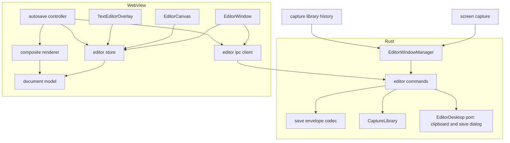
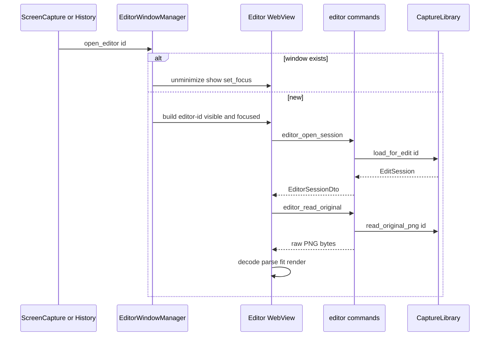
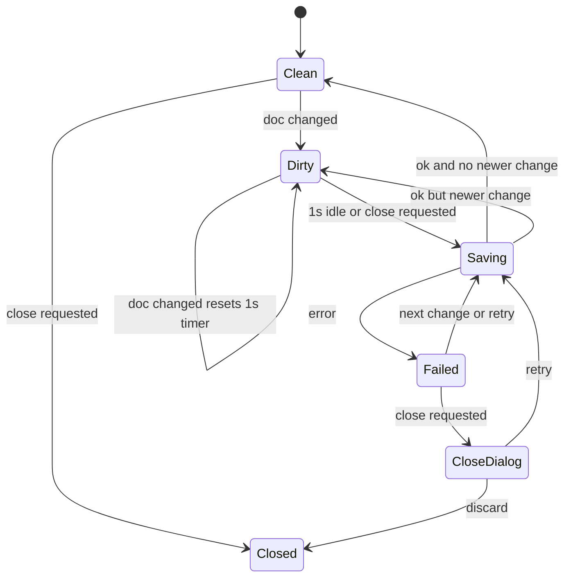

# Design Document: annotation-editor

## Overview
**Purpose**: キャプチャ画像の上に矢印・四角・テキスト・ぼかし(モザイク)・切り抜き・番号付きマーカーを非破壊のオブジェクトとして重ね、元解像度の合成画像をクリップボード / ファイルへ出力する編集画面を提供する。
**Users**: 手順書・バグ報告・チャット説明のために、撮影直後または履歴から開いたキャプチャへ注釈を付ける利用者。
**Impact**: 新規。`editor-<captureId>` ラベルの WebView ウィンドウ、Rust の `annotation_editor` モジュール、`shared::EditorLauncher` の実装、AnnotationDocument スキーマ(`schemaVersion: 1`)を追加する。

### Goals
- 1 キャプチャ = 1 編集ウィンドウ。既に開いていれば前面化する(1.4)
- 注釈は TypeScript で厳密に型付けした AnnotationDocument として保存し、何度でも再編集できる
- 書き出し / コピー / 自動保存の合成画像は、切り抜き範囲について元画像と同じピクセル解像度で、モザイク部の元画素を含まない

### Non-Goals
- フリーハンド、図形ライブラリ、回転、複数画像の結合、図形のコピー&ペースト
- 保存ファイルの配置・命名・履歴管理(capture-library)
- 撮影と撮影直後のクリップボードコピー(screen-capture)

## Boundary Commitments

### This Spec Owns
- 編集ウィンドウのライフサイクル(生成・前面化・閉じる際の保存要求・外部からの flush 付きクローズ)と `shared::EditorLauncher` の定義と実装
- 編集画面向け IPC command `editor_*`(7 本: 読み込み・元画像バイト・注釈保存・コピー・書き出し・flush 応答)と保存封筒の形式
- 終了時の未保存注釈 flush(app-shell の `BeforeExitHooks` に登録)と、削除・外部からの flush 付きクローズ(`EditorLauncher::close_editor`)
- AnnotationDocument スキーマ(TypeScript 型、`schemaVersion`、読み込み時の検証と移行)
- 6 種のツール、選択・移動・変形・削除、スタイル、Undo/Redo、ズーム表示、キーボードショートカット
- 合成レンダリング(表示 / 書き出し / コピー / 自動保存用 PNG)とモザイクの不可逆性
- 「名前を付けて保存」のダイアログとファイル書き込み
- 前回スタイルの保持(`localStorage`)

### Out of Boundary
- 注釈 JSON・合成済み PNG の保存先とファイル名、履歴への反映、`has_annotations` の判定(capture-library)
- クリップボード書き込みの Win32 実装(capture-library の `platform::windows::clipboard::copy_image`)
- 元画像バイトの取得元と保存失敗時の一時画像の保持(capture-library の `read_original_png` / `load_for_edit` が透過的に提供)
- コマンド登録・プラグイン登録・ラベルによるビュー振り分け(app-shell のコンポジションルート)
- 履歴一覧 UI、撮影フロー

### Allowed Dependencies
- Rust: `capture_library::CaptureLibrary`(`load_for_edit`, `read_original_png`, `save_annotations`)、`shared::CaptureId`、`platform::windows::clipboard::{copy_image, ClipboardImage}`、app-shell の `Arc<dyn Notifier>` / `BeforeExitHooks`、Tauri v2 コア、`tauri-plugin-dialog`(登録は app-shell)
- TS: `@/shared/ipc/annotation-editor`(本 spec が定義)、`@tauri-apps/api`、konva / react-konva、zustand
- 禁止: screen-capture への依存、capture-library の保存ファイルパスを TS へ渡すこと、Rust 側で注釈スキーマを解釈すること(`schemaVersion` の整数チェックのみ可)

### Revalidation Triggers
- AnnotationDocument の `schemaVersion` 変更(capture-library の読み込み互換、2.5 に影響)
- `EditorLauncher` のメソッド追加・シグネチャ変更(screen-capture, capture-library)
- `EditSession` / `read_original_png` / `save_annotations` / `copy_image` / `BeforeExitHooks` のシグネチャ変更
- ウィンドウラベル規約 `editor-<captureId>` や CaptureId の文字種の変更

## Architecture

### Architecture Pattern & Boundary Map



**Architecture Integration**:
- 採用パターン: 純粋モデル(TS)+ 単一ストア + 薄いビュー。Konva ノードは真実のソースにしない。
- 依存方向(TS): `model` → `store` → `services` → `canvas` / `ui` → `EditorWindow`。左は右を import しない。例外は型のみの import で、`store/editor-context.tsx` は `services/image-source` の `ImageSource` 型を import する(実行時の依存は生じない)。`shared/ipc` は `services` からのみ import。
- 依存方向(Rust): `shared` → `annotation_editor::{error, envelope}` → `session` → `window_manager` / `commands`。`capture_library` は外部依存として `commands` と `window_manager` からのみ参照。
- 表示と書き出しは `shape-attrs.ts`(図形 → Konva 設定の純粋関数)を共有し、見た目の一致を保証する。
- steering 準拠: 座標は画像の物理ピクセル、画像は生バイト IPC、注釈は元画像と分離。

### Technology Stack

| Layer | Choice / Version | Role in Feature | Notes |
|-------|------------------|-----------------|-------|
| Frontend | React 19.3 / TypeScript 5 strict | 編集 UI | react-konva 19.3 が React ≥19.3 を要求 |
| Canvas | konva 10.x / react-konva 19.3.x | 表示・選択・Transformer・オフスクリーン書き出し | `toCanvas({ pixelRatio: 1 })` |
| State | zustand 5.x(vanilla store) | ドキュメント・履歴・選択・表示状態 | React 外(オートセーブ)からも購読 |
| Backend | Rust stable / Tauri 2.12 | ウィンドウ管理、IPC コマンド、ファイル書き込み | `tauri::ipc::{Request, Response}` |
| Dialog | tauri-plugin-dialog 2.x(Rust API) | 名前を付けて保存ダイアログ | 登録は app-shell のコンポジションルート |
| Storage | `localStorage`(WebView2) | 前回スタイル | キー `snipt.editor.lastStyle.v1` |

## File Structure Plan

### Directory Structure
```
src-tauri/
├── capabilities/editor.json            # windows: ["editor-*"]。core:event:allow-listen / allow-unlisten、core:window:allow-destroy、本 spec の command 7 本のみ(詳細は Security Considerations)
└── src/
    ├── shared/editor_launcher.rs       # trait EditorLauncher(本 spec が定義、他 spec が利用。shared/mod.rs に mod 追加)
    └── annotation_editor/
        ├── mod.rs                      # setup()(EditorState・Arc<dyn EditorDesktop>・Arc<dyn EditorLauncher> を manage、終了フック登録)
        ├── error.rs                    # EditorError(serde tag="kind")
        ├── label.rs                    # captureId ⇔ "editor-<id>" 変換と検証
        ├── ports.rs                    # trait EditorDesktop(クリップボード・保存ダイアログ)、SystemEditorDesktop、テスト用の記録用偽物
        ├── session.rs                  # EditorState: ウィンドウ別セッション(export トークン、クローズ完了待ち、flush 応答待ち)
        ├── window_manager.rs           # EditorWindowManager<R> と Launcher<R>(EditorLauncher 実装)、生成・前面化・flush 付きクローズ・終了時 flush
        ├── window_manager/tests.rs     # 初期サイズ・タイトル・待機規則の純粋関数、mock runtime でのマネージャ
        ├── envelope.rs                 # 保存用生ボディ封筒のデコードと検証(純粋、単体テスト)
        ├── export.rs                   # 形式判定、一時ファイル→rename の書き込み
        └── commands/
            ├── mod.rs                  # #[tauri::command] 群(薄い。session/library/ports/export を呼ぶ)、COMMANDS(7 本)
            └── tests.rs                # mock runtime の IPC 経由でのテスト(記録用の偽物を使う)
src/
├── shared/ipc/annotation-editor.ts     # command 名・イベント名・DTO・EditorErrorDto(Rust と一対一)、IpcResult
└── features/annotation-editor/
    ├── index.ts                        # EditorWindow({ captureId }) を名前付き export(ラベル振り分けは app-shell)
    ├── EditorWindow.tsx                # 読み込み(load-editor)、セッションの結線、deps(ipc・window・decode・newId)の注入点
    ├── model/                          # 純粋な型・操作(React・Tauri に依存しない)
    │   ├── document.ts                 # AnnotationDocument 型と schemaVersion(本 spec の正本)
    │   ├── parse-document.ts           # unknown → AnnotationDocument の検証と移行(MIGRATIONS、migrateDocument)
    │   ├── operations.ts               # 図形の追加・更新・削除、切り抜き、マーカー採番、文字の確定(純粋関数)
    │   ├── history.ts                  # スナップショット履歴(上限 200)
    │   ├── geometry.ts                 # 45 度スナップ、正方形制約、矩形正規化、整数丸め
    │   ├── mosaic.ts                   # ブロックサイズ規則と Pixels 上のブロック平均(pixelate)
    │   ├── style.ts                    # StyleSettings 型、既定値、パレット、検証
    │   └── testing.ts                  # テスト用の文書と図形の生成
    ├── store/
    │   ├── editor-store.ts             # zustand(vanilla)の createEditorStore: doc/history/selection/tool/style/view/textEdit/saveStatus
    │   ├── view.ts                     # 表示の計算(ズーム段階、fitView、zoomAround)。純粋関数
    │   ├── editor-context.tsx          # 画面の部品へ store・元画像・ID 生成を渡す EditorContext
    │   └── testing.tsx                 # ストア付きの描画ヘルパ
    ├── services/
    │   ├── editor-ipc.ts               # createEditorIpc(invoke): 7 command を IpcResult で包む
    │   ├── load-editor.ts              # セッション → 元画像 → デコード → parseDocument(注釈が読めなければ元画像のみ)
    │   ├── save-envelope.ts            # 保存封筒のエンコード
    │   ├── image-source.ts             # decodePng、ImageSource(元画像と、元画素の展開キャッシュ)
    │   ├── composite-renderer.ts       # renderComposite(合成 → PNG/JPEG)と drawComposite(canvas)
    │   ├── autosave.ts                 # createAutosave: 1 秒デバウンス、直列化、flush
    │   ├── export-actions.ts           # コピー・名前を付けて保存(失敗理由を返す)、推奨名
    │   ├── window-port.ts              # WindowPort: 閉じる要求・editor://close-request・editor://flush-request・destroy(Tauri 境界)
    │   ├── style-prefs.ts              # localStorage 読み書き(try/catch、検証)
    │   └── testing.ts                  # IPC・ポートの偽物
    ├── canvas/
    │   ├── EditorCanvas.tsx            # Stage、ズーム/パン変換、ポインタ → ツール振り分け
    │   ├── shape-attrs.ts              # 図形 → Konva 設定(表示と書き出しで共有)
    │   ├── ShapeNode.tsx               # kind ごとの react-konva 描画(shape-attrs を使用)
    │   ├── SelectionHandles.tsx        # Transformer(四角/ぼかし/テキスト)と矢印端点アンカー
    │   ├── CropOverlay.tsx             # 切り抜き指定中のマスクと枠
    │   ├── tools.ts                    # ツールの判定(dragResult、markerAt、insideImage)。純粋関数
    │   ├── transform.ts                # 移動・変形の終了時の値を図形の差分へ変換(moveShape、bakeScale、bakeIntegerRect)。純粋関数
    │   └── testing.tsx                 # jsdom + node-canvas の描画・マウス操作ヘルパ
    ├── ui/
    │   ├── Toolbar.tsx                 # ツール、コピー、名前を付けて保存、Undo/Redo、切り抜き確定・取消・解除
    │   ├── StylePanel.tsx              # 色、線の太さ、文字サイズ、テキスト背景
    │   ├── StatusBar.tsx               # ズーム操作と表示、保存状態(saveStatusText)
    │   ├── TextEditorOverlay.tsx       # IME 対応 textarea オーバーレイ
    │   ├── NoticeBanner.tsx            # 読み込み警告・エラー表示
    │   ├── CloseGuardDialog.tsx        # 保存失敗時の「再試行 / 破棄」
    │   └── editor.css                  # 編集画面の見た目
    └── hooks/
        ├── use-shortcuts.ts            # キーマップ(shortcutFor。入力中・IME 変換中は無効)
        ├── use-close-guard.ts          # 利用者の閉じる・editor://close-request・editor://flush-request → 保存 → destroy / 応答
        └── use-idle-close-guard.ts     # セッション読み込み前(読み込み中・読み込み失敗)の要求に答える
```

Each `*.ts(x)` file has a co-located `*.test.ts(x)`. The shared test setup is in `src/test/` (`canvas.ts` warms up the canvas, `fonts.conf` is used through `FONTCONFIG_FILE`).

### Modified Files(他 spec 所有。結線のみ依頼)
- `src-tauri/src/lib.rs`(app-shell)— `annotation_editor::setup(app)` の呼び出し(`capture_library::setup` の後、`screen_capture::setup` の前)、本 spec の 7 command を `generate_handler!` に追加。`Arc<dyn EditorLauncher>` の manage と `BeforeExitHooks` への登録は `annotation_editor::setup` 内で行う(dialog プラグインは app-shell が登録済み)
- `src-tauri/build.rs`(app-shell)— 本 spec の 7 command を `AppManifest::commands` に追加(権限の自動生成の対象)
- `src/app/WindowRouter.tsx`(app-shell)— ラベル `editor-<captureId>` で `EditorWindow({ captureId })` をマウント

## System Flows

### 起動と前面化

- `open_editor` は `spawn_blocking` で生成処理を投げて即座に戻る(呼び出し元をブロックせず、Windows の同期生成デッドロックを避ける)。存在確認から生成までは 1 つの Mutex で直列化し、同じキャプチャのウィンドウが二重に作られないようにする。
- 元画像は常に `CaptureLibrary::read_original_png` から取得する(未保存キャプチャもメモリから返る)。ファイルパスは TS へ渡さず、asset プロトコルも使わない。

### 保存・閉じる

- 保存は常に 1 件のみ実行。実行中の変更は完了後に再スケジュールする。保存対象は「保存開始時点の doc」とその合成 PNG。
- 閉じる: `onCloseRequested` で `preventDefault` → 入力中テキストを確定 → `flush()` → 成功なら `destroy()`、失敗なら CloseGuardDialog。
- 外部からのクローズ(`close_editor`: capture-library が履歴からの削除の前に呼ぶ): Rust が `editor://close-request`(payload なし)を当該ウィンドウへ送る → 入力中テキストを確定 → `flush()` → 結果にかかわらず `destroy()`(ダイアログは出さない。失敗はログ)。Rust は `Destroyed` を最大 3 秒待ち、超えたら強制 `destroy()` してセッションを削除する。
- アプリ終了前(`BeforeExitHooks` の `annotation-editor` → `flush_all`): 開いている全 `editor-*` へ `editor://flush-request`(payload `{ requestId }`)を並行して送る → 入力中テキストを確定 → `flush()` → 結果を `editor_flush_result`(`{ requestId, saved }`)で返す。ウィンドウは閉じない。3 秒の共通の締め切りまでに返らない、または `saved: false` の編集画面は `ExitCheck.unsaved` に「注釈: <CaptureId>」として返し、app-shell が確認ダイアログを出す。締め切りを過ぎた応答は警告ログだけで無視し、再試行は新しい `requestId` で問い直す(冪等)。
- 読み込み中・読み込み失敗の画面には保存すべき変更が無いため、`use-idle-close-guard` が要求に答える。flush は `saved: true` を返す(ウィンドウは残す)。閉じる要求(利用者の操作・`editor://close-request`)は即座に `destroy()` する。セッションが開いた後は `use-close-guard` が引き継ぐ。

## Requirements Traceability

| Requirement | Summary | Components | Interfaces | Flows |
|-------------|---------|------------|------------|-------|
| 1.1 | 開いて前面表示 | EditorWindowManager, EditorWindow | `open_editor`, `editor_open_session`, `editor_read_original` | 起動 |
| 1.2 | 初期倍率 fit / 100% | EditorStore(view), EditorCanvas | `fitView()`(store/view.ts) | 起動 |
| 1.3 | ズーム操作 | EditorStore(view), StatusBar, use-shortcuts | `setZoom` | — |
| 1.4 | 既存ウィンドウを前面化 | EditorWindowManager | `open_editor` | 起動 |
| 1.5 | キャプチャごとに別ウィンドウ | EditorWindowManager, label.rs | ラベル `editor-<id>` | 起動 |
| 2.1 | ツール切替(ツールバー / キー) | Toolbar, use-shortcuts | `setTool` | — |
| 2.2 | 選択とハンドル | EditorCanvas, SelectionHandles | `select` | — |
| 2.3 | 移動 | SelectionHandles, operations | `commit(updateShape)` | — |
| 2.4 | リサイズ / 端点変更 | SelectionHandles, geometry | `commit(updateShape)` | — |
| 2.5 | Delete で削除 | use-shortcuts, operations | `deleteSelected` | — |
| 2.6 | スタイル反映と既定化 | StylePanel, EditorStore | `applyStyle` | — |
| 2.7 | 前回スタイル継承 | style-prefs | `loadStyle` / `saveStyle` | — |
| 3.1 | 矢印描画 | tools(arrow), shape-attrs | `dragResult` | — |
| 3.2 | 45 度制限 | geometry | `snapAngle45` | — |
| 4.1 | 四角枠 | tools(rect), shape-attrs | `dragResult` | — |
| 4.2 | 正方形制限 | geometry | `constrainSquare` | — |
| 5.1 | クリックで入力欄、IME | tools(text), TextEditorOverlay | `beginTextEdit` | — |
| 5.2 | 複数行 | TextEditorOverlay, TextShape | Enter = 改行 | — |
| 5.3 | ダブルクリックで再編集 | EditorCanvas, TextEditorOverlay | `beginTextEdit(id)` | — |
| 5.4 | 外側クリック / Esc で確定 | TextEditorOverlay | `commitTextEdit` | — |
| 5.5 | 空なら作成しない | operations | `commitTextEdit` | — |
| 5.6 | 背景色 | StylePanel, shape-attrs | `TextBackground` | — |
| 6.1 | モザイク表示 | mosaic, image-source, ShapeNode | `pixelate` | — |
| 6.2 | 移動・変形で再計算 | ShapeNode(mosaic), image-source | `pixelate` | — |
| 6.3 | 復元不能 | mosaic, composite-renderer | 不透明ブロック置換 | 保存 |
| 7.1 | 表示範囲を切り詰め | CropOverlay, EditorCanvas, composite-renderer | `setCrop` | — |
| 7.2 | 非破壊、Undo / 解除 | operations, history, Toolbar | `setCrop(null)` | — |
| 7.3 | Esc で指定取消 | CropOverlay, use-shortcuts | `cancelCrop` | — |
| 8.1 | 丸マーカー配置 | tools(marker), shape-attrs | `markerAt` | — |
| 8.2 | 最大番号 + 1 | operations | `nextMarkerNumber` | — |
| 8.3 | 削除で再採番しない | operations | `deleteShapes` | — |
| 9.1 | Ctrl+Z | history, use-shortcuts | `undo` | — |
| 9.2 | Ctrl+Y / Ctrl+Shift+Z | history, use-shortcuts | `redo` | — |
| 9.3 | 100 回以上 | history | 上限 200 | — |
| 10.1 | コピー(入力中除く) | composite-renderer, editor_copy | `copyComposite`(export-actions.ts) | — |
| 10.2 | 名前を付けて保存 PNG/JPEG | export.rs, composite-renderer | `editor_pick_export_path`, `editor_write_export` | — |
| 10.3 | 元解像度 | composite-renderer | `renderComposite` | — |
| 10.4 | 失敗理由表示、編集保持 | NoticeBanner, EditorError | `Result` | — |
| 11.1 | 1 秒後に自動保存 | autosave, editor_save | `start()`(revision の購読と 1 秒デバウンス)/ `flush()` | 保存 |
| 11.2 | 閉じる前に保存 | use-close-guard, use-idle-close-guard, autosave, EditorWindowManager | `flush`, `close_editor`, `editor_flush_result`, `BeforeExitHooks` | 保存 |
| 11.3 | 失敗表示と再試行 / 破棄 | StatusBar, CloseGuardDialog | `flush` | 保存 |

## Components and Interfaces

| Component | Layer | Intent | Req | Key Deps | Contracts |
|-----------|-------|--------|-----|----------|-----------|
| EditorWindowManager | Rust | ウィンドウ生成・前面化・掃除 | 1.1, 1.4, 1.5 | Tauri (P0), Notifier (P1) | Service |
| editor commands | Rust | IPC 境界 | 1.1, 10.1, 10.2, 10.4, 11.1 | CaptureLibrary (P0), clipboard (P0), dialog (P1) | API |
| AnnotationDocument / model | TS | スキーマと純粋操作 | 2.3〜2.5, 3〜9 | なし | State |
| EditorStore | TS | 編集状態と履歴 | 1.2, 1.3, 2.x, 9.x | model (P0) | State |
| composite-renderer | TS | 元解像度合成(`renderComposite` / `drawComposite`) | 6.3, 7.1, 10.1〜10.3, 11.1 | konva (P0), image-source (P0) | Service |
| AutosaveController | TS | デバウンス保存・flush | 11.1〜11.3 | EditorStore, composite-renderer, editor-ipc (P0) | Service |
| TextEditorOverlay | TS UI | IME 入力 | 5.1〜5.5, 10.1 | EditorStore | State |
| EditorCanvas / tools / SelectionHandles / CropOverlay | TS UI | 描画と入力 | 2.2〜2.4, 3〜8 | react-konva (P0) | — |
| Toolbar / StylePanel / StatusBar / NoticeBanner / CloseGuardDialog | TS UI | 操作 UI | 1.3, 2.1, 2.6, 5.6, 10.4, 11.3 | EditorStore | — |
| style-prefs / use-shortcuts / use-close-guard / use-idle-close-guard / window-port | TS | 永続化・キー・閉じる・読み込み前の要求への応答 | 2.7, 2.1, 9.1, 9.2, 11.2 | localStorage, Tauri window | — |

### Rust

#### EditorWindowManager

| Field | Detail |
|-------|--------|
| Intent | `shared::EditorLauncher` を実装し、`editor-<captureId>` ウィンドウを 1 キャプチャ 1 つに保つ |
| Requirements | 1.1, 1.4, 1.5 |

**Responsibilities & Constraints**
- 同一ラベルが存在すれば `unminimize` → `show` → `set_focus`(失敗時は always-on-top を一瞬切り替えて再試行)。
- 新規生成: `WebviewWindowBuilder::new(app, label, WebviewUrl::App("index.html"))`。タイトルは `Snipt - YYYY/MM/DD HH:MM:SS`(撮影時刻はキャプチャ ID から導き、同じ秒の連番があれば ` (N)` を付ける)。初期サイズは画像を物理ピクセル 1:1 で表示する大きさ(論理サイズ = 画像 / 拡大率)に UI 余白 48×120 を足し、最小 800×600、上限はカーソルのあるモニタ作業領域の 90%(作業領域が最小より小さいときは上限を優先)。中央配置、`focused(true)`。
- `WindowEvent::Destroyed` で `EditorState` から当該セッションを削除。
- `open_editor` は `spawn_blocking` で `show` を実行する(呼び出し元をブロックしない)。エラーは `log` + `Notifier` で通知(trait は `Result` を返さない契約のため)。
- `close_editor` は `editor-*` が無ければ即座に戻る。あれば `editor://close-request` を送り、`Destroyed` を最大 3 秒待つ。時間切れなら強制 `destroy()` し、セッションを削除する(mock runtime などは破棄イベントを報告しないため)。
- 作業領域の取得は `WorkAreaAtCursor`(注入可能な関数)で行う。mock runtime はモニタ API が未実装のため、テストでは固定値を注入する。

**Contracts**: Service [x]

```rust
// src-tauri/src/shared/editor_launcher.rs(本 spec が定義)
pub trait EditorLauncher: Send + Sync {
    /// 既存ウィンドウがあれば前面化、無ければ生成する。呼び出し元をブロックしない。
    fn open_editor(&self, id: &CaptureId);
    /// [契約追加・確定] 開いていれば未保存注釈を flush してから閉じる。閉じ終わるか 3 秒経過まで
    /// ブロックする(メインスレッドから呼ばないこと)。開いていなければ即座に戻る。
    /// 用途: capture-library の削除前(4.3)と、アプリ終了時のフック(app-shell 7.1)。
    fn close_editor(&self, id: &CaptureId);
}

// src-tauri/src/annotation_editor/window_manager.rs(実装)
pub struct EditorWindowManager<R: Runtime> { /* AppHandle, EditorState, Notifier, WorkAreaAtCursor, Mutex */ }
pub struct Launcher<R: Runtime>(pub Arc<EditorWindowManager<R>>);
impl<R: Runtime> EditorLauncher for Launcher<R> { /* 上記 */ }
```
- Preconditions: `id` は capture-library の形式 `YYYYMMDD_HHMMSS[_NN]`(`CaptureId::parse` 済み、ラベル安全)。`label.rs` でも検証し、違反時は生成せず `EditorError::InvalidCaptureId` をログと通知。
- 終了フック: `setup` で `BeforeExitHooks::register("annotation-editor", ..)` し、開いている全 `editor-*` で未保存の変更を並行して flush する(最大 3 秒、ウィンドウは閉じない)。保存できなかった、または時間内に終わらなかった編集画面を `ExitCheck.unsaved` に「注釈: <CaptureId>」として返す。app-shell が確認ダイアログを出し、「再試行」なら再度呼ばれる(冪等)。ウィンドウの破棄は app-shell が最後に行う。
- Postconditions: 戻り後まもなく該当ウィンドウが表示・フォーカスされる。同一 id のウィンドウは常に高々 1 つ。

#### editor commands / EditorState / envelope / export

| Field | Detail |
|-------|--------|
| Intent | WebView からの要求を、呼び出し元ウィンドウのラベルで特定したキャプチャに対して実行する |
| Requirements | 1.1, 10.1, 10.2, 10.4, 11.1, 11.3 |

**Responsibilities & Constraints**
- キャプチャ ID は引数で受け取らず `WebviewWindow::label()` から導出する(他キャプチャを書き換えられない)。
- `EditorState`: `sessions: Mutex<HashMap<CaptureId, WindowSession>>`(`WindowSession { export_targets: HashMap<String, ExportTarget>, close_waiters: Vec<mpsc::Sender<()>> }`)と、終了前 flush の要求 ID → `(CaptureId, 応答の送信側)` の `flushes`。`editor_flush_result` は呼び出し元の編集画面が問われた要求にだけ答えられる(他画面の要求 ID や時間切れ後の応答は警告ログだけで無視する)。
- 保存封筒: `[u32 LE: json_len][json_len bytes: UTF-8 JSON][残り: PNG]`。JSON はトップレベルが object かつ整数 `schemaVersion` を持つことだけ検証し、`serde_json::Value` のまま `save_annotations` へ渡す。PNG はシグネチャ 8 バイトを検証。
- エクスポート: `EditorDesktop::pick_save_path`(保存ダイアログ。親は呼び出し元の編集ウィンドウ)で選ばれたパスはトークン(UUID)と共にセッションへ保存し、書き込みはトークンでのみ許可(TS から任意パスを指定させない)。拡張子 `.jpg/.jpeg` → JPEG、それ以外 → PNG として書く(ファイル名はそのまま。拡張子が無いときだけ `.png` を付与)。書く前に、本体の先頭バイトが保存先の形式と一致するかを確かめる(一致しなければ `invalidPayload`)。保存先と同じフォルダの一時ファイル `.<名前>.<uuid>.snipt-tmp` へ書いて rename。
- クリップボード: 受け取った合成 PNG を `image` クレート(png 機能)で RGBA にデコードし、`EditorDesktop::copy_image(ClipboardImage { width, height, rgba, png: Some(&body) })` で渡す(PNG の再エンコードを避ける)。`EditorDesktop`(`ports.rs`)はクリップボードと保存ダイアログを 1 つのトレイトにまとめ、本番は `SystemEditorDesktop`、テストは記録用の偽物を使う。

**Contracts**: API [x]

| Command | Request | Response | Errors |
|---------|---------|----------|--------|
| `editor_open_session` | なし | `EditorSessionDto`(JSON) | NotFound, Library |
| `editor_read_original` | なし | 生 PNG バイト(`ipc::Response`。`CaptureLibrary::read_original_png` の結果) | NotFound, Io |
| `editor_save` | 生ボディ: 保存封筒 | `null` | InvalidPayload, Library |
| `editor_copy` | 生ボディ: PNG | `null` | InvalidPayload, Clipboard |
| `editor_pick_export_path` | `{ suggestedName: string }` | `ExportTargetDto \| null`(キャンセル) | Dialog |
| `editor_write_export` | 生ボディ: PNG/JPEG、ヘッダ `x-snipt-export-token` | `null` | InvalidPayload, Io, UnknownToken |
| `editor_flush_result` | `{ requestId, saved }` | `null` | — (時間切れ・他画面の応答は警告ログのみ) |

command は 7 本(`build.rs` と `generate_handler!` に登録し、`capabilities/editor.json` で許可する)。`editor_flush_result` は `editor://flush-request` への応答で、終了前 flush の契約に使う。

```typescript
// src/shared/ipc/annotation-editor.ts
export const EDITOR_COMMANDS = { openSession, readOriginal, save, copy, pickExportPath, writeExport, flushResult }; // "editor_*"
export const EXPORT_TOKEN_HEADER = "x-snipt-export-token";
export const CLOSE_REQUEST_EVENT = "editor://close-request"; // payload なし(null)
export const FLUSH_REQUEST_EVENT = "editor://flush-request"; // payload { requestId }
export interface FlushRequestPayload { requestId: string }
export interface FlushResultArgs { requestId: string; saved: boolean }
export const EDITOR_ERROR_KINDS = [...]; // EditorErrorKind と一致(テストで照合)

export interface EditorSessionDto {
  captureId: string;
  width: number;            // 元画像の物理 px
  height: number;
  capturedAt: string;       // RFC 3339
  windowTitle: string | null;
  annotations: unknown;      // AnnotationDocument 候補。parse-document で検証
  warning: string | null;      // capture-library 2.6 の読み込み失敗通知 / 1.6 の未保存の旨
  unsaved: boolean;            // EditSession.unsaved(保存先に未保存。最初の注釈保存で元画像の保存を再試行)
}
export type ExportFormat = 'png' | 'jpeg';
export interface ExportTargetDto { token: string; format: ExportFormat; fileName: string }
export type EditorErrorKind =
  | 'notFound' | 'invalidCaptureId' | 'invalidPayload' | 'library'
  | 'clipboard' | 'dialog' | 'io' | 'unknownToken';
export interface EditorErrorDto { kind: EditorErrorKind; message: string } // message は日本語の表示用
export type IpcResult<T> = { ok: true; value: T } | { ok: false; error: EditorErrorDto };
```

### TS Model

#### AnnotationDocument(本 spec が正本)

| Field | Detail |
|-------|--------|
| Intent | 注釈の永続スキーマ。capture-library は `schemaVersion` 以外を解釈しない |
| Requirements | 2.3〜2.6, 3.1, 4.1, 5.2, 5.6, 6.1, 7.1, 7.2, 8.1〜8.3 |

```typescript
// src/features/annotation-editor/model/document.ts
export const CURRENT_SCHEMA_VERSION = 1 as const;

/** 座標・寸法はすべて元画像の物理ピクセル(切り抜き前の原点)。 */
export interface Point { x: number; y: number }
export interface Rect { x: number; y: number; width: number; height: number } // width/height > 0
export type HexColor = `#${string}`; // #RRGGBB(検証は parse-document)
export type ShapeId = string;        // crypto.randomUUID()

interface ShapeBase { id: ShapeId }
export interface ArrowShape extends ShapeBase {
  kind: 'arrow'; start: Point; end: Point; // 矢じりは end 側
  color: HexColor; strokeWidth: number;
}
export interface RectShape extends ShapeBase {
  kind: 'rect'; rect: Rect; color: HexColor; strokeWidth: number; // 塗りなし
}
export type TextBackground = 'none' | 'white' | 'color';
export interface TextShape extends ShapeBase {
  kind: 'text'; position: Point; // 左上
  text: string;                  // 非空、改行は \n
  color: HexColor; fontSize: number; background: TextBackground;
  // background === 'color' のとき背景 = color、文字 = 白または黒(輝度で自動)
}
export interface MosaicShape extends ShapeBase {
  kind: 'mosaic'; rect: Rect;    // 整数、画像範囲内にクランプ済み
  blockSize: number;             // 整数 ≥ 16
}
export interface MarkerShape extends ShapeBase {
  kind: 'marker'; center: Point; number: number; // 整数 ≥ 1
  color: HexColor; size: number; // 直径(px)
}
export type Shape = ArrowShape | RectShape | TextShape | MosaicShape | MarkerShape;

export interface AnnotationDocumentV1 {
  schemaVersion: 1;
  image: { width: number; height: number }; // 元画像サイズ(整合性検査用)
  crop: Rect | null;                         // null = 切り抜きなし。整数、画像範囲内
  shapes: readonly Shape[];                  // 描画順(後ろほど上)。mosaic は常に他図形より下に描画
}
export type AnnotationDocument = AnnotationDocumentV1;
```
- Invariants: `shapes` の `id` は一意。マーカー番号は採番後に変更しない(8.3)。モザイクは描画時に必ず元画像の画素から計算する(他注釈の画素は含めない)。
- `parse-document.ts`: `parseDocument(raw: unknown, image: ImageSize, migrations = MIGRATIONS): ParseResult` — `{ ok: true; doc; migrated: boolean } | { ok: false; reason: 'unsupportedVersion' | 'invalid' }`。移行は `migrateDocument` が `migrations[v]`(版 v → v + 1)を 1 段ずつ適用する。版 1 が最初の版のため `MIGRATIONS` はまだ空で、段階的な適用と欠けた段の扱いはテスト用の移行関数で確かめる。読み込み時に未知のフィールドは捨てる。テキストの空文字、切り抜き・モザイクの範囲外や非整数は不正として拒否する。
- 読み込み(`services/load-editor.ts`)で注釈が読めないとき・新しい版のときは、元画像のみを空の文書で開き、NoticeBanner に「保存済みの注釈を読み込めなかったため、元画像のみで開きました。」(新しい版の場合は「新しいバージョンの Snipt で作られたため」)を表示する。編集すると保存で上書きされる。

#### operations / history / geometry / mosaic / style

```typescript
// operations.ts(すべて純粋関数。入力 doc を変更しない)
export function addShape(doc: AnnotationDocument, shape: Shape): AnnotationDocument;
export function updateShape(doc: AnnotationDocument, id: ShapeId, patch: ShapePatch): AnnotationDocument;
export function deleteShapes(doc: AnnotationDocument, ids: readonly ShapeId[]): AnnotationDocument;
export function setCrop(doc: AnnotationDocument, crop: Rect | null): AnnotationDocument;
export function nextMarkerNumber(doc: AnnotationDocument): number; // max(number)+1、無ければ 1
export function commitText(doc: AnnotationDocument, text: TextShape): AnnotationDocument; // 空白だけの文字列は空とみなす。既存なら削除、新規なら作らない(5.5)
export type ShapePatch<S extends Shape = Shape> = Partial<Omit<S, 'id' | 'kind'>>; // kind 不一致は呼び出し側の型で防ぐ

// history.ts
export interface History { past: readonly AnnotationDocument[]; present: AnnotationDocument; future: readonly AnnotationDocument[] }
export const HISTORY_LIMIT = 200; // 9.3(≥100)
export function commit(h: History, next: AnnotationDocument): History; // next === present なら no-op、future を破棄
export function amend(h: History, next: AnnotationDocument): History; // 履歴に積まず present だけ差し替える(同じ操作の途中経過をまとめる)
export function createHistory(doc: AnnotationDocument): History;
export function undo(h: History): History;
export function redo(h: History): History;

// geometry.ts
export function snapAngle45(start: Point, current: Point): Point;       // 3.2
export function constrainSquare(start: Point, current: Point): Rect;    // 4.2
export function normalizeRect(a: Point, b: Point): Rect;
export function toIntegerRect(r: Rect, bounds: { width: number; height: number }): Rect | null; // 面積 0 なら null

// mosaic.ts
export function mosaicBlockSize(image: { width: number; height: number }): number; // max(16, round(max(w,h)/120))
export interface Pixels { width: number; height: number; data: Uint8ClampedArray } // ImageData と同じ形
export function pixelate(src: Pixels, blockSize: number): Pixels; // 新しい配列を返す。ブロックは左上基準(右端・下端は部分ブロック)、ブロック平均、alpha=255、ブロック内は単一色

// style.ts
export interface StyleSettings { color: HexColor; strokeWidth: number; fontSize: number; textBackground: TextBackground }
export const DEFAULT_STYLE: StyleSettings; // #E53935, 4, 24, 'none'
export const PALETTE: readonly HexColor[]; // 8 色: 赤(既定)・橙・黄・緑・青・紫・黒・白
export const STROKE_WIDTHS: readonly number[]; // 2,4,6,8,12
export const FONT_SIZES: readonly number[];    // 14,18,24,32,48,64
export function validateStyle(raw: unknown): StyleSettings; // 色は任意の #RRGGBB、線の太さ・文字サイズは選択肢の値だけを受け付け、不正値は既定値へ
```

### TS State

#### EditorStore

| Field | Detail |
|-------|--------|
| Intent | 1 ウィンドウ分の編集状態を保持し、履歴に積む操作を一元化する |
| Requirements | 1.2, 1.3, 2.1〜2.6, 5.3〜5.5, 7.1〜7.3, 9.1〜9.3 |

**Contracts**: State [x]

```typescript
export type ToolId = 'select' | 'arrow' | 'rect' | 'text' | 'mosaic' | 'crop' | 'marker';
export interface ViewState { zoom: number; pan: Point; mode: 'fit' | 'manual' } // zoom: 画像 1px = zoom 物理 px
export type SaveStatus = { kind: 'clean' } | { kind: 'dirty' } | { kind: 'saving' } | { kind: 'failed'; message: string };
export interface TextEditState { shapeId: ShapeId | null; position: Point; draft: string } // shapeId null = 新規
export interface EditorState {
  history: History; revision: number;          // revision は doc 変更ごとに +1
  savedRevision: number;
  selection: readonly ShapeId[]; tool: ToolId; style: StyleSettings;
  view: ViewState; viewport: { width: number; height: number }; devicePixelRatio: number;
  cropDraft: Rect | null; textEdit: TextEditState | null; saveStatus: SaveStatus;
}
export interface EditorActions {
  setTool(tool: ToolId): void;                     // 切り抜き以外への切り替えで切り抜き指定を取り消す
  select(ids: readonly ShapeId[]): void;
  commitDoc(next: AnnotationDocument, gesture?: object): void; // 履歴へ 1 件、revision++。同じ gesture で続けて呼ばれた分は 1 件にまとめる
  applyStyle(patch: Partial<StyleSettings>): void; // 既定値を更新し、選択図形へ反映(履歴 1 件)。style-prefs への保存は EditorWindow が購読して行う
  deleteSelected(): void;
  beginTextEdit(target: { shapeId: ShapeId } | { position: Point }): void;
  updateTextDraft(draft: string): void;            // 入力中のテキストの下書き(履歴に積まない)
  commitTextEdit(): void;                          // 空文字: 新規は作らない / 既存は削除(5.5)
  beginCrop(): void; updateCropDraft(r: Rect): void; confirmCrop(): void; cancelCrop(): void; clearCrop(): void;
  undo(): void; redo(): void;                      // 実行後 selection を存在 id に絞る。入力中のテキストと切り抜き案は破棄
  setZoom(zoom: number, anchor?: Point): void; zoomIn(anchor?: Point): void; zoomOut(anchor?: Point): void; zoomActual(): void; zoomFit(): void;
  setPan(pan: Point): void;
  setViewport(size: { width: number; height: number }, dpr: number): void; // mode==='fit' なら再フィット
  saveStarted(): void;                             // saveStatus = saving
  saveSucceeded(revision: number): void;           // savedRevision = 保存開始時の revision
  saveFailed(message: string): void;               // saveStatus = failed
}
```
- ズーム: 段階 10%〜800%(`store/view.ts` の `ZOOM_STEPS`)。Konva の Stage スケールは `zoom / devicePixelRatio`(100% で画像 1px = 物理 1px)。`fitView` は `min(1, viewport物理px / 表示対象px)` を倍率にする(表示対象 = crop ?? 画像全体)。初期表示と「全体表示」はこれを使う(1.2, 1.3)。DPR 変化(モニタ間移動)時は `setViewport` で再計算。
- ドラッグ・変形の中間状態はノードのローカル状態に置き、`dragend` / `transformend` で `commitDoc` を 1 回だけ呼ぶ。
- スタイル変更は選択が無ければ履歴に積まない。
- 文書の変更(Undo / Redo を含む)は保存中でなければ保存状態を `dirty` にする。新しいテキストの開始時に入力中のテキストがあれば先に確定する。切り抜きの確定・取消の後は選択ツールに戻し、画像全体と同じ範囲の確定は切り抜きなしとして扱う。描画ツールへの切り替えで選択を解除する。
- 実装は `createEditorStore({ doc, style, viewport?, devicePixelRatio?, newId? })`(zustand/vanilla)。`style` の初期値は `loadStyle()`、変更は `EditorWindow` が購読して `saveStyle` する。

### TS Services

#### composite-renderer

| Field | Detail |
|-------|--------|
| Intent | 表示状態から独立に、切り抜き範囲の元解像度合成画像を作る |
| Requirements | 6.3, 7.1, 10.1, 10.2, 10.3, 11.1 |

**Contracts**: Service [x]

```typescript
// src/features/annotation-editor/services/composite-renderer.ts
export type RenderError = { kind: 'tooLarge'; width: number; height: number } | { kind: 'encodeFailed' };
export type RenderResult = { ok: true; bytes: Uint8Array; width: number; height: number } | { ok: false; error: RenderError };
export function renderComposite(doc: AnnotationDocument, source: ImageSource, format: ExportFormat): Promise<RenderResult>;
export function drawComposite(doc: AnnotationDocument, source: ImageSource): HTMLCanvasElement; // 上限検査なし。テストはこちらで画素を確かめる
export function renderErrorMessage(error: RenderError): string;
```
- 手順: 出力範囲 `R = doc.crop ?? 画像全体` → 上限検査(1 辺 ≤ 32,767、面積 ≤ 268,435,456)→ 切り離した `div` に `Konva.Stage(R.width × R.height)` を生成し、Layer を `x=-R.x, y=-R.y` で配置 → 元画像 → モザイク(`pixelate` の結果を `imageSmoothingEnabled=false` で整数座標に描画)→ その他図形(`shape-attrs`)→ `stage.toCanvas({ x:0, y:0, width:R.width, height:R.height, pixelRatio: 1 })` → `canvas.toBlob`(PNG は品質指定なし、JPEG のみ品質 0.92)→ Stage を destroy。
- Postconditions: 出力ピクセルサイズ = `R.width × R.height`(10.3)。モザイク矩形内の全画素はブロック色で、元画素は残らない(6.3)。メタデータを含まない。

#### AutosaveController

| Field | Detail |
|-------|--------|
| Intent | 変更後 1 秒アイドルで保存要求し、閉じる時に確実に flush する |
| Requirements | 11.1, 11.2, 11.3 |

**Contracts**: Service [x]

```typescript
export type SaveResult = { ok: true } | { ok: false; message: string }; // 合成の失敗も IPC の失敗も同じ表示文にする
export function createAutosave(deps: { store; compose(doc): Promise<RenderResult>; save(envelope): Promise<IpcResult<null>>; delayMs?: number }): AutosaveController;
export interface AutosaveController {
  start(): () => void;     // store の revision を購読。戻り値で購読解除
  flush(): Promise<SaveResult>; // タイマーを捨てて即保存(実行中なら完了を待って必要なら再保存)
}
```
- `revision > savedRevision` の時だけ保存。保存 = `renderComposite(doc, source, 'png')` → `encodeSaveEnvelope(doc, png)` → `editor_save`。成功で `savedRevision = 保存開始時の revision`。遅延は `AUTOSAVE_DELAY_MS`(1 秒)。
- 保存中にタイマーが切れた場合は、完了後に 1 秒後へ予約し直す。
- 失敗時は `saveStatus = failed` を StatusBar に表示し(11.3)、次の変更か「再試行」で再実行。自動の無限再試行はしない。`SaveResult` の失敗は `saveFailed(message)` で保存状態へ反映する。

#### style-prefs / editor-ipc / save-envelope / image-source
- `loadStyle(): StyleSettings` / `saveStyle(s): void` — `localStorage` の読み書きを try/catch で包み、失敗時は既定値(2.7)。
- `editor-ipc.ts` — `createEditorIpc(invoke)` が 7 command(`flushResult` を含む)の型付きラッパを返す。`invoke` を差し替えられるため、書き出しトークンのヘッダは記録用の invoke で確かめる。`EditorErrorDto` の形でない失敗(ACL 拒否など)は `io` として `IpcResult` に変換する。
- `encodeSaveEnvelope(doc: AnnotationDocument, png: Uint8Array): Uint8Array`(JSON 長は UTF-8 のバイト数)。
- `image-source.ts` — `decodePng(png)`(PNG の Blob → `createImageBitmap`)と、それを包む `ImageSource`。`ImageSource.regionPixels(rect): Pixels` は元画像を最初の呼び出しで一度だけ展開して `ImageData` を保持し、以後は範囲を切り出す。描画できるものなら何でも受け取る(テストは node-canvas の canvas)。
- `load-editor.ts` — セッション → 元画像 → デコード → `parseDocument` の順で読み込み、`LoadedEditor`(`ok` / 失敗理由)を返す。注釈の失敗は `warnings` として返し、編集は続けられる。
- `export-actions.ts` — `copyComposite` / `exportComposite` は失敗理由(文字列)か `null` を返し、`EditorWindow` がエラーバナーに追加する。推奨名は `Snipt_<id>_export.png`(保存フォルダの `Snipt_<id>.png` / `_annotated.png` を上書きしない名前)。
- `window-port.ts` — `WindowPort`(利用者の閉じる要求、`editor://close-request` と `editor://flush-request` の購読、`destroy`)。Tauri 以外の実装は `services/testing.ts` の偽物を使う。

### TS UI(サマリーのみ)

- **EditorWindow** — 読み込み中は空の `main`(`useIdleCloseGuard` が要求に答える)、読み込み失敗は理由と「閉じる」だけを表示する。読み込めたら `EditorSession` がストア・自動保存・`EditorLayout` を組む。IPC・ウィンドウ・デコード・ID 生成は `EditorWindowDeps` で差し替えられる(既定は Tauri)。
- **EditorCanvas** — ビューポート固定 Stage。レイヤー: 画像 / モザイク / 図形 / 選択ハンドル / 切り抜きマスク。表示は `crop` で clip(7.1)。Ctrl+ホイールでズーム(ポインタ位置を基準)、ホイール(Shift で横)・中ボタン・Space+ドラッグでパン。Stage の大きさはコンテナ(ResizeObserver)、DPR は `matchMedia` の resolution から `setViewport` へ渡す。選択ツールのクリックで選択(2.2)、ダブルクリックでテキスト再編集(5.3)。
- **tools.ts** — 判定は純粋関数(`dragResult` / `markerAt` / `insideImage`)。ドラッグ系(arrow(3.1, 3.2)/ rect(4.1, 4.2)/ mosaic(6.1)/ crop(7.1))は 3px 未満のドラッグで何も作らない。クリック系(text(5.1)/ marker(8.1, 8.2))は `markerAt` が位置と採番を決める。マーカーの直径は文字サイズの 4/3(24 → 32px)。描画後は選択ツールに戻さず同じツールを継続。
- **SelectionHandles** — rect / mosaic / text は Konva Transformer(`rotateEnabled:false`、Shift で `keepRatio`)、`transformend` で scale を寸法へ焼き込み。text は移動のみ。arrow は端点アンカー 2 個(2.4)。モザイクはドラッグ中も rAF 単位で再計算(6.2)。
- **CropOverlay** — 切り抜き中は全体を表示し範囲外を暗転、Transformer で調整、Enter / ツールバー「確定」で `confirmCrop`、Esc で `cancelCrop`(7.3)。「切り抜き解除」で `clearCrop`(7.2、Undo 可)。
- **TextEditorOverlay** — 画面座標に `<textarea>` を絶対配置。フォントは `fontSize × stageScale` CSS px、`white-space: pre`。伸長は `field-sizing: content`(WebView2 の Chromium が対応)と改行数の `rows`。見た目(文字色・背景・余白・角丸)はキャンバスと同じ `textAttrs` から決める。Enter は改行(5.2)。Esc(`isComposing` でない時)と blur で `commitTextEdit`(5.4)。`compositionstart/end` で変換中フラグを持ち、変換中は Esc / ショートカットを処理しない。キー入力は伝播させず、エディタのショートカットに渡さない。テキストツールの mousedown は `preventDefault` してフォーカスを奪わせない(既定動作だと入力欄が即座に閉じる。E2E で判明)。
- **Toolbar / StylePanel / StatusBar** — ツール切替(2.1)、色 8 色パレット・太さ・文字サイズ・テキスト背景(2.6, 5.6)、ズーム操作と % 表示(1.3)、保存状態(保存済み / 保存中 / 保存失敗+再試行)。
- **NoticeBanner** — 読み込み警告、書き出し・コピー失敗理由(10.4)。編集状態には影響しない。
- **CloseGuardDialog** — 保存失敗時に「再試行」「変更を破棄して閉じる」(11.3)。

#### キーボードショートカット(use-shortcuts)
| キー | 動作 | Req |
|------|------|-----|
| V / A / R / T / B / C / N | 選択 / 矢印 / 四角 / テキスト / ぼかし / 切り抜き / マーカー | 2.1 |
| Delete, Backspace | 選択図形を削除 | 2.5 |
| Ctrl+Z / Ctrl+Y, Ctrl+Shift+Z | Undo / Redo | 9.1, 9.2 |
| Ctrl+C | 合成画像をコピー | 10.1 |
| Ctrl+Shift+S | 名前を付けて保存 | 10.2 |
| Ctrl+= / Ctrl++ / Ctrl+; / Ctrl+- / Ctrl+0 / Ctrl+1 | 拡大 / 縮小 / 全体表示 / 100% | 1.3 |
| Enter / Esc | 切り抜き確定 / 切り抜き取消・選択解除 | 7.3 |
- 判定は `shortcutFor`(純粋関数)で行い、文字キーと Ctrl+文字は `KeyboardEvent.code`(物理キー)で決める。日本語入力モード(`key` が `Process`)でも物理キーで動く。Ctrl+= は JIS 配列の `;` キーでも拡大する。テンキーも同じ動作。
- フォーカスが textarea・input にある時、または IME 変換中はすべて無効(10.1 の「テキスト入力中を除く」)。F3・F5・F7・F12 と Ctrl+R / P / F / G / U / J / H / O / N / S は既定動作を `preventDefault` で止める(Ctrl+S は保存しない。名前を付けて保存は Ctrl+Shift+S)。

## Data Models

スキーマは「TS Model」節の `AnnotationDocument` が正本。1 ウィンドウにつき 1 集約(`history.present`)で、元画像は不変、切り抜きは `crop` の値のみ(7.2)。

- 保存封筒(`editor_save`): `u32 LE JSON 長` + `UTF-8 JSON(AnnotationDocument)` + `PNG`。Rust 側上限: JSON 16 MiB、全体 512 MiB。
- capture-library へ: `save_annotations(id, serde_json::Value, Vec<u8>)`。capture-library は `schemaVersion` のみ参照。
- 互換性: 読み込みは `schemaVersion ≤ CURRENT` を移行して受け入れる。スキーマ変更時は版を上げ、移行関数を追加する(capture-library 2.5 の担保)。

## Error Handling

| 事象 | 応答 | Req |
|------|------|-----|
| `load_for_edit` 失敗 | ウィンドウ内に理由を表示し閉じるボタンのみ | 1.1 |
| 注釈読み込み不可(warning / parse 失敗) | 元画像のみで開き NoticeBanner | 1.1 |
| コピー / 書き出し失敗(tooLarge, encode, io, clipboard) | 理由を NoticeBanner、doc は不変 | 10.4 |
| 保存ダイアログのキャンセル | 何もしない | 10.2 |
| 自動保存失敗 | StatusBar に失敗表示、閉じる時に再試行 / 破棄 | 11.3 |
| ウィンドウ生成失敗 / 不正 CaptureId | ログ + Notifier 通知 | 1.1 |
| 終了前 flush の失敗・時間切れ | `ExitCheck.unsaved` に「注釈: <id>」を返し、app-shell が再試行 / 破棄 / キャンセルを聞く。ウィンドウは残す | 11.2 |
| 読み込み中・読み込み失敗の画面への flush / 閉じる要求 | flush は `saved: true`(保存すべき変更が無い)。閉じる要求は即座に `destroy()` | 11.2 |

- エラーは `EditorErrorDto { kind, message }` に統一し、TS は `IpcResult` で分岐(例外を UI に漏らさない)。
- Rust は `log` クレートで command 名・captureId・kind を記録(画像内容・テキスト内容は記録しない)。

## Testing Strategy

- **Unit(Vitest)**
  - `operations`: `nextMarkerNumber` が削除後も既存番号を変えず max+1 を返す(8.2, 8.3)、空テキスト確定で図形が作られない / 既存は削除される(5.5)
  - `history`: 200 件超で最古を捨てる・100 回 Undo できる(9.3)、commit で future が破棄される(9.1, 9.2)
  - `geometry`: 45 度スナップ・正方形制約・整数丸めとクランプ(3.2, 4.2, 6.1)
  - `mosaic.pixelate`: 各ブロックが単一色で alpha=255、出力画素が元画素のいずれとも一致しない入力例で元値が残らない(6.3)
  - `parse-document`: v1 往復、未知の版・不正色・重複 id を拒否、`style-prefs` の不正値フォールバック(2.7)
- **Unit(cargo test)**
  - `envelope`: 正常分解、JSON 長超過・切り詰め・`schemaVersion` 欠落・PNG シグネチャ不正を拒否
  - `label`: `editor-<id>` 往復と不正文字の拒否、`export`: 拡張子 → 形式判定と未知トークン拒否
  - `commands` / `window_manager`: mock runtime と記録用の `EditorDesktop` 偽物で、IPC の拒否条件、保存先トークン、flush 応答(時間切れ・他画面の要求 ID)、生成・前面化・閉じる待ち、`editor` ラベル以外の command 拒否、capability の内容を確かめる
- **Integration(Vitest + jsdom/canvas)**
  - `composite-renderer`: crop 付き doc で出力サイズ = crop サイズ(10.3, 7.1)、crop 外の図形が出力に現れない、モザイク領域の画素がブロック色のみ(6.3)
  - `AutosaveController`: 連続変更で最後の 1 秒後に 1 回だけ保存(11.1)、保存中の変更で再保存、失敗で `failed`(11.3)、`flush` が未保存時のみ送信(11.2)
  - `EditorStore`: スタイル変更が選択図形に反映され履歴 1 件、Undo で元色に戻る(2.6, 9.1)
  - Konva の描画とマウス操作は jsdom + devDependency の `canvas`(node-canvas)で検証する。初回の 2D コンテキスト生成が遅いため `src/test/canvas.ts` で温め、`src/test/fonts.conf`(`FONTCONFIG_FILE`)でシステムフォントの走査を避ける。画面上の見た目は E2E(7.1)で確かめる。
- **E2E(Windows 実機 / tauri-driver、`mise run e2e`)**
  - 実装: `e2e/specs/editor.e2e.ts`(開く・前面化・コピー・切り抜き・クローズ時の保存)、`e2e/specs/editor-flush.e2e.ts`(IME・削除前のクローズ・保存失敗・終了前 flush)、`e2e/specs/editor-perf.e2e.ts`(性能計測、下記)。アプリは `e2e` cargo feature 付きのデバッグビルドで、設定は `SNIPT_E2E_CONFIG_DIR` から読む。
  - E2E で判明して修正した点: CSP に `connect-src ipc: http://ipc.localhost` が無く、ビルド版では IPC が postMessage に切り替わって `editor_save` が失敗していた(`tauri.conf.json` は app-shell の設定。開発モードでは CSP が付かないため見えなかった)。テキストツールの mousedown で入力欄が閉じる問題も同じ E2E で見つかった。
  - 撮影 → 編集画面が前面に開き、同じキャプチャを履歴から開くと既存ウィンドウが前面化(1.1, 1.4, 1.5)
  - テキストツールで日本語 IME 変換(候補表示中の Esc で確定されない)→ 外側クリックで確定(5.1, 5.4)
  - 矢印・四角・マーカー・モザイク・切り抜き → Ctrl+C → 貼り付け先の画像サイズが crop と一致(10.1, 10.3)
  - 編集 → 即座に閉じる → 履歴から再度開くと注釈が復元(11.2)
  - 履歴から開いている画像を削除 → 未保存の注釈が自動保存(1 秒)より先に flush され、ごみ箱へ移動の前に編集画面が閉じる(`editor-flush.e2e.ts`、11.2)
  - 保存に失敗する状態でアプリを終了 → 「注釈: <ID>」の確認が出て、失敗の原因を取り除いて再試行すると保存されてから終了する(`editor-flush.e2e.ts`、11.2, 11.3)
  - 性能計測(`editor-perf.e2e.ts`、11520×2160): 開く操作・合成 PNG の生成・ドラッグのフレームレート。目標の判定と実測は Performance 節
- **Performance**(目標。実測は下記)
  - 11520×2160 画像で合成 PNG 生成 ≤ 2.5 秒、表示中のドラッグが 60fps 付近を維持
  - `open_editor` 呼び出しからウィンドウ表示まで ≤ 700ms(screen-capture 5.4 の 1 秒予算内)
  - 実測(`e2e/specs/editor-perf.e2e.ts`、11520×2160、デバッグビルド、`mise run e2e` に含む): 開く操作からウィンドウ表示まで 205〜243ms(WebDriver の往復を含む上限値)。Ctrl+C から `editor_copy` 送信まで(合成と PNG エンコード)277〜310ms。ドラッグ約 240fps・最大フレーム間隔 4.4ms(240Hz 表示の環境)。いずれも目標内。Ctrl+C からクリップボードに画像が入るまでは約 8.9 秒で、大半は Rust の `copy_png`(デバッグビルド)。合成 PNG の生成ではないため判定には使わず記録だけする(リリースビルドは未計測)。
  - `__TAURI_INTERNALS__.invoke` は書き換えできないため、IPC の観測は `window.fetch` を包んで行う。

## Security Considerations
- 書き込み先はダイアログ由来のトークンのみ、保存先はラベル由来の ID のみ。capture-library のパスは TS へ渡さない。モザイクは不透明ブロック置換でガウスぼかしは使わない(6.3)。
- capability `src-tauri/capabilities/editor.json`(`windows: ["editor-*"]`)は、編集画面が使う最小の権限だけを付与する: `core:event:allow-listen`、`core:event:allow-unlisten`、`core:window:allow-destroy`、本 spec の command 7 本(`allow-editor-*`)。
  - `core:event:allow-listen` / `allow-unlisten` は `window-port.ts` の `listen`・`onCloseRequested` と購読解除に、`core:window:allow-destroy` は `window-port.ts` の `destroy` に使う。
  - 他のウィンドウ(`history.json`・`app-shell.json` など)の capability は `core:default` のままで、編集画面だけを絞っている。
  - app-shell・history の capability に `allow-editor-*` が無いことは `commands/tests.rs` で確認する。

## Open Questions / Risks
- **[契約追加・確定] `EditorLauncher::close_editor`**: flush してから閉じる。capture-library が削除前(4.3)に呼ぶ。
- **[確定] `copy_image`**: capture-library の `ClipboardImage { width, height, rgba, png: Option }` を使う(上記)。
- **[確定] CaptureId**: capture-library の `YYYYMMDD_HHMMSS[_NN]`(`[0-9_]` のみ)。
- **[確定] アプリ終了時**: app-shell の `BeforeExitHooks` に flush を登録し、保存できなかった編集画面を `ExitCheck` で返す。確認(再試行 / 破棄して終了 / キャンセル)は app-shell の要件 7.3–7.5 として app-shell が表示する。
- **[リスク] 1 秒予算**: ウィンドウ生成 + WebView2 初期化が遅い場合、予備ウィンドウ方式(ラベル規約の変更が必要)を検討。E2E の実測は開く操作から表示まで 205〜243ms(目標 700ms)で、現時点では予備ウィンドウ方式は不要。
- **[リスク] 巨大画像**: canvas 上限超過時は書き出し・自動保存の合成 PNG が作れない(注釈 JSON も保存できない)。発生時は理由を表示する。
