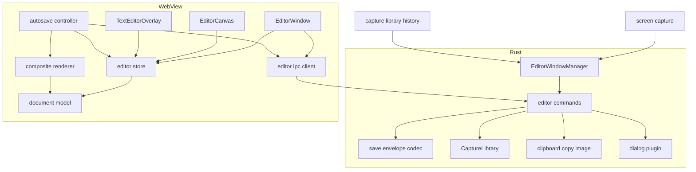
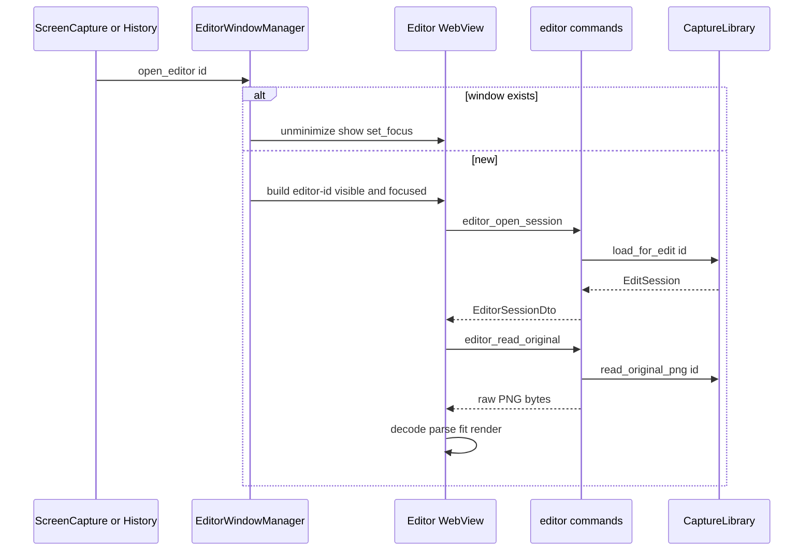
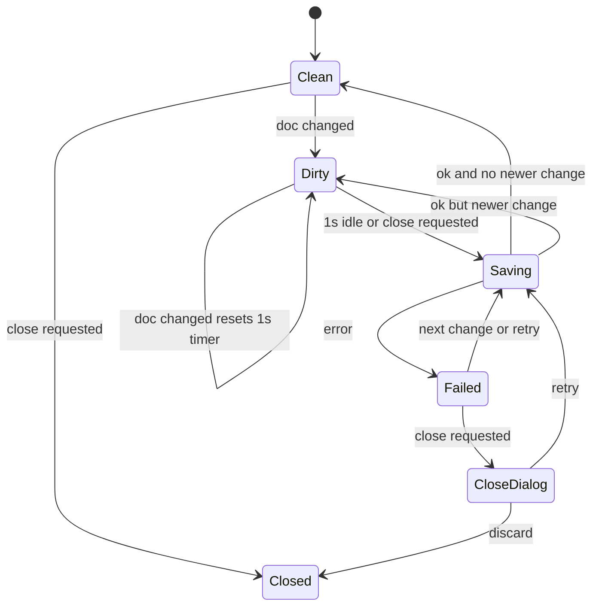

# Design Document: annotation-editor

## Overview
**Purpose**: キャプチャ画像の上に矢印・四角・テキスト・ぼかし(モザイク)・切り抜き・番号付きマーカーを非破壊のオブジェクトとして重ね、元解像度の合成画像をクリップボード / ファイルへ出力する編集画面を提供する。
**Users**: 手順書・バグ報告・チャット説明のために、撮影直後または履歴から開いたキャプチャへ注釈を付ける利用者。
**Impact**: 新規。`editor-<captureId>` ラベルの WebView ウィンドウ、Rust の `annotation_editor` モジュール、`shared::EditorLauncher` の実装、AnnotationDocument スキーマ(`schemaVersion: 1`)を追加する。

### Goals
- 1 キャプチャ = 1 編集ウィンドウ。既に開いていれば前面化する(1.4)
- 注釈は TypeScript で厳密に型付けした AnnotationDocument として保存し、何度でも再編集できる
- 書き出し / コピー / 自動保存の合成画像は、切り抜き範囲について元画像と同じピクセル解像度で、モザイク部の元画素を含まない

### Non-Goals
- フリーハンド、図形ライブラリ、回転、複数画像の結合、図形のコピー&ペースト
- 保存ファイルの配置・命名・履歴管理(capture-library)
- 撮影と撮影直後のクリップボードコピー(screen-capture)

## Boundary Commitments

### This Spec Owns
- 編集ウィンドウのライフサイクル(生成・前面化・閉じる際の保存要求・外部からの flush 付きクローズ)と `shared::EditorLauncher` の定義と実装
- 編集画面向け IPC command `editor_*`(読み込み・元画像バイト・注釈保存・コピー・書き出し)と保存封筒の形式
- 終了時の未保存注釈 flush(app-shell の `BeforeExitHooks` に登録)
- AnnotationDocument スキーマ(TypeScript 型、`schemaVersion`、読み込み時の検証と移行)
- 6 種のツール、選択・移動・変形・削除、スタイル、Undo/Redo、ズーム表示、キーボードショートカット
- 合成レンダリング(表示 / 書き出し / コピー / 自動保存用 PNG)とモザイクの不可逆性
- 「名前を付けて保存」のダイアログとファイル書き込み
- 前回スタイルの保持(`localStorage`)

### Out of Boundary
- 注釈 JSON・合成済み PNG の保存先とファイル名、履歴への反映、`has_annotations` の判定(capture-library)
- クリップボード書き込みの Win32 実装(capture-library の `platform::windows::clipboard::copy_image`)
- 元画像バイトの取得元と保存失敗時の一時画像の保持(capture-library の `read_original_png` / `load_for_edit` が透過的に提供)
- コマンド登録・プラグイン登録・ラベルによるビュー振り分け(app-shell のコンポジションルート)
- 履歴一覧 UI、撮影フロー

### Allowed Dependencies
- Rust: `capture_library::CaptureLibrary`(`load_for_edit`, `read_original_png`, `save_annotations`)、`shared::CaptureId`、`platform::windows::clipboard::{copy_image, ClipboardImage}`、app-shell の `Arc<dyn Notifier>` / `BeforeExitHooks`、Tauri v2 コア、`tauri-plugin-dialog`(登録は app-shell)
- TS: `@/shared/ipc/annotation-editor`(本 spec が定義)、`@tauri-apps/api`、konva / react-konva、zustand
- 禁止: screen-capture への依存、capture-library の保存ファイルパスを TS へ渡すこと、Rust 側で注釈スキーマを解釈すること(`schemaVersion` の整数チェックのみ可)

### Revalidation Triggers
- AnnotationDocument の `schemaVersion` 変更(capture-library の読み込み互換、2.5 に影響)
- `EditorLauncher` のメソッド追加・シグネチャ変更(screen-capture, capture-library)
- `EditSession` / `read_original_png` / `save_annotations` / `copy_image` / `BeforeExitHooks` のシグネチャ変更
- ウィンドウラベル規約 `editor-<captureId>` や CaptureId の文字種の変更

## Architecture

### Architecture Pattern & Boundary Map



**Architecture Integration**:
- 採用パターン: 純粋モデル(TS)+ 単一ストア + 薄いビュー。Konva ノードは真実のソースにしない。
- 依存方向(TS): `model` → `store` → `services` → `canvas` / `ui` → `EditorWindow`。左は右を import しない。`shared/ipc` は `services` からのみ import。
- 依存方向(Rust): `shared` → `annotation_editor::{error, envelope}` → `session` → `window_manager` / `commands`。`capture_library` は外部依存として `commands` と `window_manager` からのみ参照。
- 表示と書き出しは `shape-attrs.ts`(図形 → Konva 設定の純粋関数)を共有し、見た目の一致を保証する。
- steering 準拠: 座標は画像の物理ピクセル、画像は生バイト IPC、注釈は元画像と分離。

### Technology Stack

| Layer | Choice / Version | Role in Feature | Notes |
|-------|------------------|-----------------|-------|
| Frontend | React 19.3 / TypeScript 5 strict | 編集 UI | react-konva 19.3 が React ≥19.3 を要求 |
| Canvas | konva 10.x / react-konva 19.3.x | 表示・選択・Transformer・オフスクリーン書き出し | `toCanvas({ pixelRatio: 1 })` |
| State | zustand 5.x(vanilla store) | ドキュメント・履歴・選択・表示状態 | React 外(オートセーブ)からも購読 |
| Backend | Rust stable / Tauri 2.12 | ウィンドウ管理、IPC コマンド、ファイル書き込み | `tauri::ipc::{Request, Response}` |
| Dialog | tauri-plugin-dialog 2.x(Rust API) | 名前を付けて保存ダイアログ | 登録は app-shell のコンポジションルート |
| Storage | `localStorage`(WebView2) | 前回スタイル | キー `snipt.editor.lastStyle.v1` |

## File Structure Plan

### Directory Structure
```
src-tauri/
├── capabilities/editor.json            # windows: ["editor-*"]。core:window の close/destroy/onCloseRequested、core:event の listen(editor://close-request)と本 spec の command のみ許可
└── src/
    ├── shared/editor_launcher.rs       # trait EditorLauncher(本 spec が定義、他 spec が利用。shared/mod.rs に mod 追加)
    └── annotation_editor/
        ├── mod.rs                      # setup()(EditorState と Arc<dyn EditorLauncher> を manage、終了フック登録)、commands
        ├── error.rs                    # EditorError(serde tag="kind")
        ├── label.rs                    # captureId ⇔ "editor-<id>" 変換と検証
        ├── session.rs                  # EditorState: ウィンドウ別セッション(export トークン、クローズ完了待ち)
        ├── window_manager.rs           # EditorLauncher 実装、ウィンドウ生成 / 前面化 / flush 付きクローズ / 破棄時の掃除
        ├── envelope.rs                 # 保存用生ボディ封筒のデコードと検証(純粋、単体テスト)
        ├── export.rs                   # 保存ダイアログ、形式判定、ファイル書き込み(一時ファイル→rename)
        └── commands.rs                 # #[tauri::command] 群(薄い。session/library/export を呼ぶ)
src/
├── shared/ipc/annotation-editor.ts     # command 名、DTO、EditorErrorDto(Rust と一対一)
└── features/annotation-editor/
    ├── index.ts                        # EditorWindow({ captureId }) を名前付き export(ラベル振り分けは app-shell)
    ├── EditorWindow.tsx                # セッション読み込み、レイアウト、各フックの結線
    ├── model/
    │   ├── document.ts                 # AnnotationDocument 型と schemaVersion(本 spec の正本)
    │   ├── parse-document.ts           # unknown → AnnotationDocument の検証と移行
    │   ├── operations.ts               # 図形の追加・更新・削除、切り抜き、マーカー採番(純粋関数)
    │   ├── history.ts                  # スナップショット履歴(上限 200)
    │   ├── geometry.ts                 # 45 度スナップ、正方形制約、矩形正規化、整数丸め、クランプ
    │   ├── mosaic.ts                   # ブロックサイズ規則とブロック平均(ImageData 上の純粋処理)
    │   └── style.ts                    # StyleSettings 型、既定値、パレット、検証
    ├── store/editor-store.ts           # zustand: doc/history/selection/tool/style/view/textEdit/saveStatus
    ├── services/
    │   ├── editor-ipc.ts               # invoke ラッパ(Result 型に変換)
    │   ├── save-envelope.ts            # 保存封筒のエンコード
    │   ├── image-source.ts             # PNG bytes → ImageBitmap、モザイク用ピクセル取得キャッシュ
    │   ├── composite-renderer.ts       # オフスクリーン Stage で合成 → PNG/JPEG Blob
    │   ├── autosave.ts                 # 1 秒デバウンス、直列化、flush
    │   └── style-prefs.ts              # localStorage 読み書き(try/catch、検証)
    ├── canvas/
    │   ├── EditorCanvas.tsx            # Stage、ズーム/パン変換、ポインタ → ツール振り分け
    │   ├── shape-attrs.ts              # 図形 → Konva 設定(表示と書き出しで共有)
    │   ├── ShapeNode.tsx               # kind ごとの react-konva 描画(shape-attrs を使用)
    │   ├── SelectionHandles.tsx        # Transformer(四角/ぼかし/テキスト)と矢印端点アンカー
    │   ├── CropOverlay.tsx             # 切り抜き指定中のマスクと枠
    │   └── tools.ts                    # DragCreateTool / ClickCreateTool と各ツール定義
    ├── ui/
    │   ├── Toolbar.tsx                 # ツール、コピー、名前を付けて保存、Undo/Redo、切り抜き解除
    │   ├── StylePanel.tsx              # 色、線の太さ、文字サイズ、テキスト背景
    │   ├── StatusBar.tsx               # ズーム操作と表示、保存状態
    │   ├── TextEditorOverlay.tsx       # IME 対応 textarea オーバーレイ
    │   ├── NoticeBanner.tsx            # 読み込み警告・エラー表示
    │   └── CloseGuardDialog.tsx        # 保存失敗時の「再試行 / 破棄」
    └── hooks/
        ├── use-shortcuts.ts            # キーマップ(入力中・IME 変換中は無効)
        └── use-close-guard.ts          # onCloseRequested / editor://close-request → flush → destroy
```

### Modified Files(他 spec 所有。結線のみ依頼)
- `src-tauri/src/lib.rs`(app-shell)— `annotation_editor::setup(app)` の呼び出し(`capture_library::setup` の後、`screen_capture::setup` の前)、本 spec の 6 command を `generate_handler!` に追加。`Arc<dyn EditorLauncher>` の manage と `BeforeExitHooks` への登録は setup 内で行う(dialog プラグインは app-shell が登録済み)
- `src/app/WindowRouter.tsx`(app-shell)— ラベル `editor-<captureId>` で `EditorWindow({ captureId })` をマウント

## System Flows

### 起動と前面化

- `open_editor` は `tauri::async_runtime::spawn` で生成処理を投げて即座に戻る(呼び出し元をブロックせず、Windows の同期生成デッドロックを避ける)。
- 元画像は常に `CaptureLibrary::read_original_png` から取得する(未保存キャプチャもメモリから返る)。ファイルパスは TS へ渡さず、asset プロトコルも使わない。

### 保存・閉じる

- 保存は常に 1 件のみ実行。実行中の変更は完了後に再スケジュールする。保存対象は「保存開始時点の doc」とその合成 PNG。
- 閉じる: `onCloseRequested` で `preventDefault` → 入力中テキストを確定 → `flush()` → 成功なら `destroy()`、失敗なら CloseGuardDialog。
- 外部からのクローズ(`close_editor`: 履歴からの削除・アプリ終了): Rust が `editor://close-request` を当該ウィンドウへ送る → 入力中テキストを確定 → `flush()` → 結果にかかわらず `destroy()`(ダイアログは出さない。失敗はログ)。Rust は `Destroyed` を最大 3 秒待ち、超えたら強制 `destroy()`。

## Requirements Traceability

| Requirement | Summary | Components | Interfaces | Flows |
|-------------|---------|------------|------------|-------|
| 1.1 | 開いて前面表示 | EditorWindowManager, EditorWindow | `open_editor`, `editor_open_session`, `editor_read_original` | 起動 |
| 1.2 | 初期倍率 fit / 100% | EditorStore(view), EditorCanvas | `fitZoom()` | 起動 |
| 1.3 | ズーム操作 | EditorStore(view), StatusBar, use-shortcuts | `setZoom` | — |
| 1.4 | 既存ウィンドウを前面化 | EditorWindowManager | `open_editor` | 起動 |
| 1.5 | キャプチャごとに別ウィンドウ | EditorWindowManager, label.rs | ラベル `editor-<id>` | 起動 |
| 2.1 | ツール切替(ツールバー / キー) | Toolbar, use-shortcuts | `setTool` | — |
| 2.2 | 選択とハンドル | EditorCanvas, SelectionHandles | `select` | — |
| 2.3 | 移動 | SelectionHandles, operations | `commit(updateShape)` | — |
| 2.4 | リサイズ / 端点変更 | SelectionHandles, geometry | `commit(updateShape)` | — |
| 2.5 | Delete で削除 | use-shortcuts, operations | `deleteSelected` | — |
| 2.6 | スタイル反映と既定化 | StylePanel, EditorStore | `applyStyle` | — |
| 2.7 | 前回スタイル継承 | style-prefs | `loadStyle` / `saveStyle` | — |
| 3.1 | 矢印描画 | tools(arrow), shape-attrs | DragCreateTool | — |
| 3.2 | 45 度制限 | geometry | `snapAngle45` | — |
| 4.1 | 四角枠 | tools(rect), shape-attrs | DragCreateTool | — |
| 4.2 | 正方形制限 | geometry | `constrainSquare` | — |
| 5.1 | クリックで入力欄、IME | tools(text), TextEditorOverlay | `beginTextEdit` | — |
| 5.2 | 複数行 | TextEditorOverlay, TextShape | Enter = 改行 | — |
| 5.3 | ダブルクリックで再編集 | EditorCanvas, TextEditorOverlay | `beginTextEdit(id)` | — |
| 5.4 | 外側クリック / Esc で確定 | TextEditorOverlay | `commitTextEdit` | — |
| 5.5 | 空なら作成しない | operations | `commitTextEdit` | — |
| 5.6 | 背景色 | StylePanel, shape-attrs | `TextBackground` | — |
| 6.1 | モザイク表示 | mosaic, image-source, ShapeNode | `pixelate` | — |
| 6.2 | 移動・変形で再計算 | ShapeNode(mosaic), image-source | `pixelate` | — |
| 6.3 | 復元不能 | mosaic, composite-renderer | 不透明ブロック置換 | 保存 |
| 7.1 | 表示範囲を切り詰め | CropOverlay, EditorCanvas, composite-renderer | `setCrop` | — |
| 7.2 | 非破壊、Undo / 解除 | operations, history, Toolbar | `setCrop(null)` | — |
| 7.3 | Esc で指定取消 | CropOverlay, use-shortcuts | `cancelCrop` | — |
| 8.1 | 丸マーカー配置 | tools(marker), shape-attrs | ClickCreateTool | — |
| 8.2 | 最大番号 + 1 | operations | `nextMarkerNumber` | — |
| 8.3 | 削除で再採番しない | operations | `deleteShapes` | — |
| 9.1 | Ctrl+Z | history, use-shortcuts | `undo` | — |
| 9.2 | Ctrl+Y / Ctrl+Shift+Z | history, use-shortcuts | `redo` | — |
| 9.3 | 100 回以上 | history | 上限 200 | — |
| 10.1 | コピー(入力中除く) | composite-renderer, editor_copy | `copyToClipboard` | — |
| 10.2 | 名前を付けて保存 PNG/JPEG | export.rs, composite-renderer | `editor_pick_export_path`, `editor_write_export` | — |
| 10.3 | 元解像度 | composite-renderer | `renderComposite` | — |
| 10.4 | 失敗理由表示、編集保持 | NoticeBanner, EditorError | `Result` | — |
| 11.1 | 1 秒後に自動保存 | autosave, editor_save | `scheduleSave` | 保存 |
| 11.2 | 閉じる前に保存 | use-close-guard, autosave, EditorWindowManager | `flush`, `close_editor`, `BeforeExitHooks` | 保存 |
| 11.3 | 失敗表示と再試行 / 破棄 | StatusBar, CloseGuardDialog | `flush` | 保存 |

## Components and Interfaces

| Component | Layer | Intent | Req | Key Deps | Contracts |
|-----------|-------|--------|-----|----------|-----------|
| EditorWindowManager | Rust | ウィンドウ生成・前面化・掃除 | 1.1, 1.4, 1.5 | Tauri (P0), Notifier (P1) | Service |
| editor commands | Rust | IPC 境界 | 1.1, 10.1, 10.2, 10.4, 11.1 | CaptureLibrary (P0), clipboard (P0), dialog (P1) | API |
| AnnotationDocument / model | TS | スキーマと純粋操作 | 2.3〜2.5, 3〜9 | なし | State |
| EditorStore | TS | 編集状態と履歴 | 1.2, 1.3, 2.x, 9.x | model (P0) | State |
| CompositeRenderer | TS | 元解像度合成 | 6.3, 7.1, 10.1〜10.3, 11.1 | konva (P0), image-source (P0) | Service |
| AutosaveController | TS | デバウンス保存・flush | 11.1〜11.3 | EditorStore, CompositeRenderer, editor-ipc (P0) | Service |
| TextEditorOverlay | TS UI | IME 入力 | 5.1〜5.5, 10.1 | EditorStore | State |
| EditorCanvas / tools / SelectionHandles / CropOverlay | TS UI | 描画と入力 | 2.2〜2.4, 3〜8 | react-konva (P0) | — |
| Toolbar / StylePanel / StatusBar / NoticeBanner / CloseGuardDialog | TS UI | 操作 UI | 1.3, 2.1, 2.6, 5.6, 10.4, 11.3 | EditorStore | — |
| style-prefs / use-shortcuts / use-close-guard | TS | 永続化・キー・閉じる | 2.7, 2.1, 9.1, 9.2, 11.2 | localStorage, Tauri window | — |

### Rust

#### EditorWindowManager

| Field | Detail |
|-------|--------|
| Intent | `shared::EditorLauncher` を実装し、`editor-<captureId>` ウィンドウを 1 キャプチャ 1 つに保つ |
| Requirements | 1.1, 1.4, 1.5 |

**Responsibilities & Constraints**
- 同一ラベルが存在すれば `unminimize` → `show` → `set_focus`(失敗時は always-on-top を一瞬切り替えて再試行)。
- 新規生成: `WebviewWindowBuilder::new(app, label, WebviewUrl::App("index.html"))`、タイトル `Snipt - <撮影日時>`、初期サイズはカーソルのあるモニタ作業領域の 90% を上限に画像サイズ + UI 余白(最小 800×600 論理 px)、中央配置、`focused(true)`。
- `WindowEvent::Destroyed` で `EditorState` から当該セッションを削除。
- 非同期タスクで生成し、エラーは `log` + `Notifier` で通知(trait は `Result` を返さない契約のため)。

**Contracts**: Service [x]

```rust
// src-tauri/src/shared/editor_launcher.rs(本 spec が定義)
pub trait EditorLauncher: Send + Sync {
    /// 既存ウィンドウがあれば前面化、無ければ生成する。呼び出し元をブロックしない。
    fn open_editor(&self, id: &CaptureId);
    /// [契約追加・確定] 開いていれば未保存注釈を flush してから閉じる。閉じ終わるか 3 秒経過まで
    /// ブロックする(メインスレッドから呼ばないこと)。開いていなければ即座に戻る。
    /// 用途: capture-library の削除前(4.3)と、アプリ終了時のフック(app-shell 7.1)。
    fn close_editor(&self, id: &CaptureId);
}

pub struct EditorWindowManager { app: tauri::AppHandle }
impl EditorLauncher for EditorWindowManager { /* 上記 */ }
```
- Preconditions: `id` は capture-library の形式 `YYYYMMDD_HHMMSS[_NN]`(`CaptureId::parse` 済み、ラベル安全)。`label.rs` でも検証し、違反時は生成せず `EditorError::InvalidCaptureId` をログと通知。
- 終了フック: `setup` で `BeforeExitHooks::register("annotation-editor", ..)` し、開いている全 `editor-*` で未保存の変更を並行して flush する(最大 3 秒、ウィンドウは閉じない)。保存できなかった、または時間内に終わらなかった編集画面を `ExitCheck.unsaved` に「注釈: <CaptureId>」として返す。app-shell が確認ダイアログを出し、「再試行」なら再度呼ばれる(冪等)。ウィンドウの破棄は app-shell が最後に行う。
- Postconditions: 戻り後まもなく該当ウィンドウが表示・フォーカスされる。同一 id のウィンドウは常に高々 1 つ。

#### editor commands / EditorState / envelope / export

| Field | Detail |
|-------|--------|
| Intent | WebView からの要求を、呼び出し元ウィンドウのラベルで特定したキャプチャに対して実行する |
| Requirements | 1.1, 10.1, 10.2, 10.4, 11.1, 11.3 |

**Responsibilities & Constraints**
- キャプチャ ID は引数で受け取らず `WebviewWindow::label()` から導出する(他キャプチャを書き換えられない)。
- `EditorState = Mutex<HashMap<CaptureId, WindowSession>>`、`WindowSession { export_targets: HashMap<String, ExportTarget>, close_waiters: Vec<oneshot::Sender<()>> }`。
- 保存封筒: `[u32 LE: json_len][json_len bytes: UTF-8 JSON][残り: PNG]`。JSON はトップレベルが object かつ整数 `schemaVersion` を持つことだけ検証し、`serde_json::Value` のまま `save_annotations` へ渡す。PNG はシグネチャ 8 バイトを検証。
- エクスポート: ダイアログで選ばれたパスはトークン(UUID)と共にセッションへ保存し、書き込みはトークンでのみ許可(TS から任意パスを指定させない)。拡張子 `.jpg/.jpeg` → JPEG、それ以外 → PNG(拡張子なしは `.png` を付与)。同一ディレクトリの一時ファイルへ書いて rename。
- クリップボード: 受け取った合成 PNG を `png` クレートで RGBA にデコードし、`copy_image(ClipboardImage { width, height, rgba, png: Some(&body) })` で渡す(PNG の再エンコードを避ける)。

**Contracts**: API [x]

| Command | Request | Response | Errors |
|---------|---------|----------|--------|
| `editor_open_session` | なし | `EditorSessionDto`(JSON) | NotFound, Library |
| `editor_read_original` | なし | 生 PNG バイト(`ipc::Response`。`CaptureLibrary::read_original_png` の結果) | NotFound, Io |
| `editor_save` | 生ボディ: 保存封筒 | `null` | InvalidPayload, Library |
| `editor_copy` | 生ボディ: PNG | `null` | InvalidPayload, Clipboard |
| `editor_pick_export_path` | `{ suggestedName: string }` | `ExportTargetDto \| null`(キャンセル) | Dialog |
| `editor_write_export` | 生ボディ: PNG/JPEG、ヘッダ `x-snipt-export-token` | `null` | InvalidPayload, Io, UnknownToken |

```typescript
// src/shared/ipc/annotation-editor.ts
export interface EditorSessionDto {
  captureId: string;
  width: number;            // 元画像の物理 px
  height: number;
  capturedAt: string;       // RFC 3339
  windowTitle: string | null;
  annotations: unknown | null; // AnnotationDocument 候補。parse-document で検証
  warning: string | null;      // capture-library 2.6 の読み込み失敗通知 / 1.6 の未保存の旨
  unsaved: boolean;            // EditSession.unsaved(保存先に未保存。最初の注釈保存で元画像の保存を再試行)
}
export type ExportFormat = 'png' | 'jpeg';
export interface ExportTargetDto { token: string; format: ExportFormat; fileName: string }
export type EditorErrorKind =
  | 'notFound' | 'invalidCaptureId' | 'invalidPayload' | 'library'
  | 'clipboard' | 'dialog' | 'io' | 'unknownToken';
export interface EditorErrorDto { kind: EditorErrorKind; message: string } // message は日本語の表示用
export type IpcResult<T> = { ok: true; value: T } | { ok: false; error: EditorErrorDto };
```

### TS Model

#### AnnotationDocument(本 spec が正本)

| Field | Detail |
|-------|--------|
| Intent | 注釈の永続スキーマ。capture-library は `schemaVersion` 以外を解釈しない |
| Requirements | 2.3〜2.6, 3.1, 4.1, 5.2, 5.6, 6.1, 7.1, 7.2, 8.1〜8.3 |

```typescript
// src/features/annotation-editor/model/document.ts
export const CURRENT_SCHEMA_VERSION = 1 as const;

/** 座標・寸法はすべて元画像の物理ピクセル(切り抜き前の原点)。 */
export interface Point { x: number; y: number }
export interface Rect { x: number; y: number; width: number; height: number } // width/height > 0
export type HexColor = `#${string}`; // #RRGGBB(検証は parse-document)
export type ShapeId = string;        // crypto.randomUUID()

interface ShapeBase { id: ShapeId }
export interface ArrowShape extends ShapeBase {
  kind: 'arrow'; start: Point; end: Point; // 矢じりは end 側
  color: HexColor; strokeWidth: number;
}
export interface RectShape extends ShapeBase {
  kind: 'rect'; rect: Rect; color: HexColor; strokeWidth: number; // 塗りなし
}
export type TextBackground = 'none' | 'white' | 'color';
export interface TextShape extends ShapeBase {
  kind: 'text'; position: Point; // 左上
  text: string;                  // 非空、改行は \n
  color: HexColor; fontSize: number; background: TextBackground;
  // background === 'color' のとき背景 = color、文字 = 白または黒(輝度で自動)
}
export interface MosaicShape extends ShapeBase {
  kind: 'mosaic'; rect: Rect;    // 整数、画像範囲内にクランプ済み
  blockSize: number;             // 整数 ≥ 16
}
export interface MarkerShape extends ShapeBase {
  kind: 'marker'; center: Point; number: number; // 整数 ≥ 1
  color: HexColor; size: number; // 直径(px)
}
export type Shape = ArrowShape | RectShape | TextShape | MosaicShape | MarkerShape;

export interface AnnotationDocumentV1 {
  schemaVersion: 1;
  image: { width: number; height: number }; // 元画像サイズ(整合性検査用)
  crop: Rect | null;                         // null = 切り抜きなし。整数、画像範囲内
  shapes: readonly Shape[];                  // 描画順(後ろほど上)。mosaic は常に他図形より下に描画
}
export type AnnotationDocument = AnnotationDocumentV1;
```
- Invariants: `shapes` の `id` は一意。マーカー番号は採番後に変更しない(8.3)。モザイクは描画時に必ず元画像の画素から計算する(他注釈の画素は含めない)。
- `parse-document.ts`: `parseDocument(raw: unknown, image: {width; height}): ParseResult` — `{ ok: true; doc; migrated: boolean } | { ok: false; reason: 'unsupportedVersion' | 'invalid' }`。将来の版は `migrations: Record<number, (d: unknown) => unknown>` で 1 段ずつ移行。未知の新しい版・不正値は空ドキュメントで開き、NoticeBanner に「注釈を読み込めませんでした。編集すると上書きされます」を表示。

#### operations / history / geometry / mosaic / style

```typescript
// operations.ts(すべて純粋関数。入力 doc を変更しない)
export function addShape(doc: AnnotationDocument, shape: Shape): AnnotationDocument;
export function updateShape(doc: AnnotationDocument, id: ShapeId, patch: ShapePatch): AnnotationDocument;
export function deleteShapes(doc: AnnotationDocument, ids: readonly ShapeId[]): AnnotationDocument;
export function setCrop(doc: AnnotationDocument, crop: Rect | null): AnnotationDocument;
export function nextMarkerNumber(doc: AnnotationDocument): number; // max(number)+1、無ければ 1
export type ShapePatch<S extends Shape = Shape> = Partial<Omit<S, 'id' | 'kind'>>; // kind 不一致は呼び出し側の型で防ぐ

// history.ts
export interface History { past: readonly AnnotationDocument[]; present: AnnotationDocument; future: readonly AnnotationDocument[] }
export const HISTORY_LIMIT = 200; // 9.3(≥100)
export function commit(h: History, next: AnnotationDocument): History; // next === present なら no-op、future を破棄
export function undo(h: History): History;
export function redo(h: History): History;

// geometry.ts
export function snapAngle45(start: Point, current: Point): Point;       // 3.2
export function constrainSquare(start: Point, current: Point): Rect;    // 4.2
export function normalizeRect(a: Point, b: Point): Rect;
export function toIntegerRect(r: Rect, bounds: { width: number; height: number }): Rect | null; // 面積 0 なら null

// mosaic.ts
export function mosaicBlockSize(image: { width: number; height: number }): number; // max(16, round(max(w,h)/120))
export function pixelate(src: ImageData, blockSize: number): ImageData; // ブロック平均、alpha=255、ブロック内は単一色

// style.ts
export interface StyleSettings { color: HexColor; strokeWidth: number; fontSize: number; textBackground: TextBackground }
export const DEFAULT_STYLE: StyleSettings; // #E53935, 4, 24, 'none'
export const STROKE_WIDTHS: readonly number[]; // 2,4,6,8,12
export const FONT_SIZES: readonly number[];    // 14,18,24,32,48,64
export function validateStyle(raw: unknown): StyleSettings; // 不正値は既定値へ
```

### TS State

#### EditorStore

| Field | Detail |
|-------|--------|
| Intent | 1 ウィンドウ分の編集状態を保持し、履歴に積む操作を一元化する |
| Requirements | 1.2, 1.3, 2.1〜2.6, 5.3〜5.5, 7.1〜7.3, 9.1〜9.3 |

**Contracts**: State [x]

```typescript
export type ToolId = 'select' | 'arrow' | 'rect' | 'text' | 'mosaic' | 'crop' | 'marker';
export interface ViewState { zoom: number; pan: Point; mode: 'fit' | 'manual' } // zoom: 画像 1px = zoom 物理 px
export type SaveStatus = { kind: 'clean' } | { kind: 'dirty' } | { kind: 'saving' } | { kind: 'failed'; message: string };
export interface TextEditState { shapeId: ShapeId | null; position: Point; draft: string } // shapeId null = 新規
export interface EditorState {
  history: History; revision: number;          // revision は doc 変更ごとに +1
  savedRevision: number;
  selection: readonly ShapeId[]; tool: ToolId; style: StyleSettings;
  view: ViewState; viewport: { width: number; height: number }; devicePixelRatio: number;
  cropDraft: Rect | null; textEdit: TextEditState | null; saveStatus: SaveStatus;
}
export interface EditorActions {
  setTool(tool: ToolId): void;
  select(ids: readonly ShapeId[]): void;
  commitDoc(next: AnnotationDocument): void;      // 履歴へ 1 件、revision++
  applyStyle(patch: Partial<StyleSettings>): void; // 選択図形へ反映(commitDoc 1 件)+ 既定値更新 + style-prefs 保存
  deleteSelected(): void;
  beginTextEdit(target: { shapeId: ShapeId } | { position: Point }): void;
  commitTextEdit(): void;  // 空文字: 新規は作らない / 既存は削除(5.5)
  beginCrop(): void; updateCropDraft(r: Rect): void; confirmCrop(): void; cancelCrop(): void; clearCrop(): void;
  undo(): void; redo(): void;                      // 実行後 selection を存在 id に絞る
  setZoom(zoom: number, anchor?: Point): void; zoomIn(): void; zoomOut(): void; zoomActual(): void; zoomFit(): void;
  setViewport(size: { width: number; height: number }, dpr: number): void; // mode==='fit' なら再フィット
}
```
- ズーム: 段階 10%〜800%。Konva の Stage スケールは `zoom / devicePixelRatio`(100% で画像 1px = 物理 1px)。`fitZoom = min(1, viewport物理px / 表示対象px)`(表示対象 = crop ?? 画像全体)。初期表示と「全体表示」はこれを使う(1.2, 1.3)。DPR 変化(モニタ間移動)時は `setViewport` で再計算。
- ドラッグ・変形の中間状態はノードのローカル状態に置き、`dragend` / `transformend` で `commitDoc` を 1 回だけ呼ぶ。
- スタイル変更は選択が無ければ履歴に積まない。

### TS Services

#### CompositeRenderer

| Field | Detail |
|-------|--------|
| Intent | 表示状態から独立に、切り抜き範囲の元解像度合成画像を作る |
| Requirements | 6.3, 7.1, 10.1, 10.2, 10.3, 11.1 |

**Contracts**: Service [x]

```typescript
export type RenderError = { kind: 'tooLarge'; width: number; height: number } | { kind: 'encodeFailed' };
export interface CompositeRenderer {
  render(doc: AnnotationDocument, source: ImageBitmap, format: ExportFormat): Promise<
    { ok: true; bytes: Uint8Array; width: number; height: number } | { ok: false; error: RenderError }>;
}
```
- 手順: 出力範囲 `R = doc.crop ?? 画像全体` → 上限検査(1 辺 ≤ 32,767、面積 ≤ 268,435,456)→ 切り離した `div` に `Konva.Stage(R.width × R.height)` を生成し、Layer を `x=-R.x, y=-R.y` で配置 → 元画像 → モザイク(`pixelate` の結果を `imageSmoothingEnabled=false` で整数座標に描画)→ その他図形(`shape-attrs`)→ `layer.toCanvas({ x:0, y:0, width:R.width, height:R.height, pixelRatio: 1 })` → `toBlob('image/png' | 'image/jpeg', 0.92)` → Stage を destroy。
- Postconditions: 出力ピクセルサイズ = `R.width × R.height`(10.3)。モザイク矩形内の全画素はブロック色で、元画素は残らない(6.3)。メタデータを含まない。

#### AutosaveController

| Field | Detail |
|-------|--------|
| Intent | 変更後 1 秒アイドルで保存要求し、閉じる時に確実に flush する |
| Requirements | 11.1, 11.2, 11.3 |

**Contracts**: Service [x]

```typescript
export interface AutosaveController {
  start(): () => void;              // store の revision を購読。戻り値で購読解除
  flush(): Promise<IpcResult<null>>; // タイマーを捨てて即保存(実行中なら完了を待って必要なら再保存)
}
```
- `revision > savedRevision` の時だけ保存。保存 = `CompositeRenderer.render(doc,'png')` → `encodeSaveEnvelope(doc, png)` → `editor_save`。成功で `savedRevision = 保存開始時の revision`。
- 失敗時は `saveStatus = failed` を StatusBar に表示し(11.3)、次の変更か「再試行」で再実行。自動の無限再試行はしない。

#### style-prefs / editor-ipc / save-envelope / image-source
- `loadStyle(): StyleSettings` / `saveStyle(s): void` — `localStorage` の読み書きを try/catch で包み、失敗時は既定値(2.7)。
- `editor-ipc.ts` — 6 command の型付きラッパ。`invoke` の例外を `EditorErrorDto` に変換して `IpcResult` を返す。
- `encodeSaveEnvelope(doc: AnnotationDocument, png: Uint8Array): Uint8Array`。
- `image-source.ts` — `loadOriginal(): Promise<ImageBitmap>`(ArrayBuffer → Blob → `createImageBitmap`)、`getRegionPixels(rect): ImageData`(元画像を 1 度だけ OffscreenCanvas に展開してキャッシュ)。

### TS UI(サマリーのみ)

- **EditorCanvas** — ビューポート固定 Stage。レイヤー: 画像 / モザイク / 図形 / 選択ハンドル / 切り抜きマスク。表示は `crop` で clip(7.1)。Ctrl+ホイールでズーム、ホイール / Space+ドラッグでパン。選択ツールのクリックで選択(2.2)、ダブルクリックでテキスト再編集(5.3)。
- **tools.ts** — `DragCreateTool<T> { kind; build(start, current, shift, ctx): T | null; finish(T, store): void }` を arrow(3.1, 3.2)/ rect(4.1, 4.2)/ mosaic(6.1)/ crop(7.1)で共有。`ClickCreateTool` を text(5.1)/ marker(8.1, 8.2)で共有。描画後は選択ツールに戻さず同じツールを継続。
- **SelectionHandles** — rect / mosaic / text は Konva Transformer(`rotateEnabled:false`、Shift で `keepRatio`)、`transformend` で scale を寸法へ焼き込み。text は移動のみ。arrow は端点アンカー 2 個(2.4)。モザイクはドラッグ中も rAF 単位で再計算(6.2)。
- **CropOverlay** — 切り抜き中は全体を表示し範囲外を暗転、Transformer で調整、Enter / ツールバー「確定」で `confirmCrop`、Esc で `cancelCrop`(7.3)。「切り抜き解除」で `clearCrop`(7.2、Undo 可)。
- **TextEditorOverlay** — 画面座標に `<textarea>` を絶対配置。フォントは `fontSize × stageScale` CSS px、`white-space: pre`、内容に合わせ自動伸長。Enter は改行(5.2)。Esc(`isComposing` でない時)と blur で `commitTextEdit`(5.4)。`compositionstart/end` で変換中フラグを持ち、変換中は Esc / ショートカットを処理しない。
- **Toolbar / StylePanel / StatusBar** — ツール切替(2.1)、色 8 色パレット・太さ・文字サイズ・テキスト背景(2.6, 5.6)、ズーム操作と % 表示(1.3)、保存状態(保存済み / 保存中 / 保存失敗+再試行)。
- **NoticeBanner** — 読み込み警告、書き出し・コピー失敗理由(10.4)。編集状態には影響しない。
- **CloseGuardDialog** — 保存失敗時に「再試行」「変更を破棄して閉じる」(11.3)。

#### キーボードショートカット(use-shortcuts)
| キー | 動作 | Req |
|------|------|-----|
| V / A / R / T / B / C / N | 選択 / 矢印 / 四角 / テキスト / ぼかし / 切り抜き / マーカー | 2.1 |
| Delete, Backspace | 選択図形を削除 | 2.5 |
| Ctrl+Z / Ctrl+Y, Ctrl+Shift+Z | Undo / Redo | 9.1, 9.2 |
| Ctrl+C | 合成画像をコピー | 10.1 |
| Ctrl+Shift+S | 名前を付けて保存 | 10.2 |
| Ctrl+= / Ctrl+- / Ctrl+0 / Ctrl+1 | 拡大 / 縮小 / 全体表示 / 100% | 1.3 |
| Enter / Esc | 切り抜き確定 / 切り抜き取消・選択解除 | 7.3 |
- フォーカスが textarea・input にある時、または IME 変換中はすべて無効(10.1 の「テキスト入力中を除く」)。F5・Ctrl+R・Ctrl+P・Ctrl+F 等の WebView 既定動作は `preventDefault`。

## Data Models

スキーマは「TS Model」節の `AnnotationDocument` が正本。1 ウィンドウにつき 1 集約(`history.present`)で、元画像は不変、切り抜きは `crop` の値のみ(7.2)。

- 保存封筒(`editor_save`): `u32 LE JSON 長` + `UTF-8 JSON(AnnotationDocument)` + `PNG`。Rust 側上限: JSON 16 MiB、全体 512 MiB。
- capture-library へ: `save_annotations(id, serde_json::Value, Vec<u8>)`。capture-library は `schemaVersion` のみ参照。
- 互換性: 読み込みは `schemaVersion ≤ CURRENT` を移行して受け入れる。スキーマ変更時は版を上げ、移行関数を追加する(capture-library 2.5 の担保)。

## Error Handling

| 事象 | 応答 | Req |
|------|------|-----|
| `load_for_edit` 失敗 | ウィンドウ内に理由を表示し閉じるボタンのみ | 1.1 |
| 注釈読み込み不可(warning / parse 失敗) | 元画像のみで開き NoticeBanner | 1.1 |
| コピー / 書き出し失敗(tooLarge, encode, io, clipboard) | 理由を NoticeBanner、doc は不変 | 10.4 |
| 保存ダイアログのキャンセル | 何もしない | 10.2 |
| 自動保存失敗 | StatusBar に失敗表示、閉じる時に再試行 / 破棄 | 11.3 |
| ウィンドウ生成失敗 / 不正 CaptureId | ログ + Notifier 通知 | 1.1 |

- エラーは `EditorErrorDto { kind, message }` に統一し、TS は `IpcResult` で分岐(例外を UI に漏らさない)。
- Rust は `log` クレートで command 名・captureId・kind を記録(画像内容・テキスト内容は記録しない)。

## Testing Strategy

- **Unit(Vitest)**
  - `operations`: `nextMarkerNumber` が削除後も既存番号を変えず max+1 を返す(8.2, 8.3)、空テキスト確定で図形が作られない / 既存は削除される(5.5)
  - `history`: 200 件超で最古を捨てる・100 回 Undo できる(9.3)、commit で future が破棄される(9.1, 9.2)
  - `geometry`: 45 度スナップ・正方形制約・整数丸めとクランプ(3.2, 4.2, 6.1)
  - `mosaic.pixelate`: 各ブロックが単一色で alpha=255、出力画素が元画素のいずれとも一致しない入力例で元値が残らない(6.3)
  - `parse-document`: v1 往復、未知の版・不正色・重複 id を拒否、`style-prefs` の不正値フォールバック(2.7)
- **Unit(cargo test)**
  - `envelope`: 正常分解、JSON 長超過・切り詰め・`schemaVersion` 欠落・PNG シグネチャ不正を拒否
  - `label`: `editor-<id>` 往復と不正文字の拒否、`export`: 拡張子 → 形式判定と未知トークン拒否
- **Integration(Vitest + jsdom/canvas)**
  - `CompositeRenderer`: crop 付き doc で出力サイズ = crop サイズ(10.3, 7.1)、crop 外の図形が出力に現れない、モザイク領域の画素がブロック色のみ(6.3)
  - `AutosaveController`: 連続変更で最後の 1 秒後に 1 回だけ保存(11.1)、保存中の変更で再保存、失敗で `failed`(11.3)、`flush` が未保存時のみ送信(11.2)
  - `EditorStore`: スタイル変更が選択図形に反映され履歴 1 件、Undo で元色に戻る(2.6, 9.1)
- **E2E(Windows 実機 / tauri-driver)**
  - 撮影 → 編集画面が前面に開き、同じキャプチャを履歴から開くと既存ウィンドウが前面化(1.1, 1.4, 1.5)
  - テキストツールで日本語 IME 変換(候補表示中の Esc で確定されない)→ 外側クリックで確定(5.1, 5.4)
  - 矢印・四角・マーカー・モザイク・切り抜き → Ctrl+C → 貼り付け先の画像サイズが crop と一致(10.1, 10.3)
  - 編集 → 即座に閉じる → 履歴から再度開くと注釈が復元(11.2)
- **Performance**
  - 11520×2160 画像で合成 PNG 生成 ≤ 2.5 秒、表示中のドラッグが 60fps 付近を維持
  - `open_editor` 呼び出しからウィンドウ表示まで ≤ 700ms(screen-capture 5.4 の 1 秒予算内)

## Security Considerations
- 書き込み先はダイアログ由来のトークンのみ、保存先はラベル由来の ID のみ。capture-library のパスは TS へ渡さない。capability `editor.json` は `editor-*` に本 spec の command と最小限の window 権限のみ付与。モザイクは不透明ブロック置換でガウスぼかしは使わない(6.3)。

## Open Questions / Risks
- **[契約追加・確定] `EditorLauncher::close_editor`**: flush してから閉じる。capture-library が削除前(4.3)に呼ぶ。
- **[確定] `copy_image`**: capture-library の `ClipboardImage { width, height, rgba, png: Option }` を使う(上記)。
- **[確定] CaptureId**: capture-library の `YYYYMMDD_HHMMSS[_NN]`(`[0-9_]` のみ)。
- **[確定] アプリ終了時**: app-shell の `BeforeExitHooks` に flush を登録し、保存できなかった編集画面を `ExitCheck` で返す。確認(再試行 / 破棄して終了 / キャンセル)は app-shell の要件 7.3–7.5 として app-shell が表示する。
- **[リスク] 1 秒予算**: ウィンドウ生成 + WebView2 初期化が遅い場合、予備ウィンドウ方式(ラベル規約の変更が必要)を検討。
- **[リスク] 巨大画像**: canvas 上限超過時は書き出し・自動保存の合成 PNG が作れない(注釈 JSON も保存できない)。発生時は理由を表示する。
