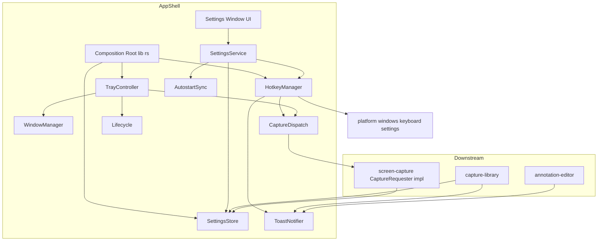
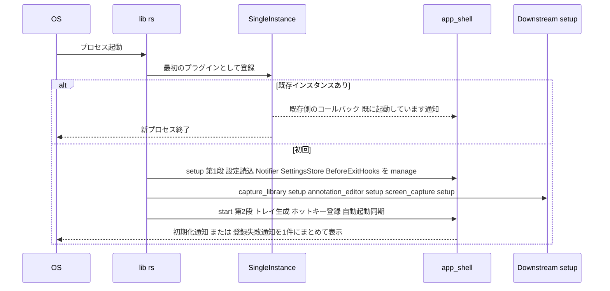
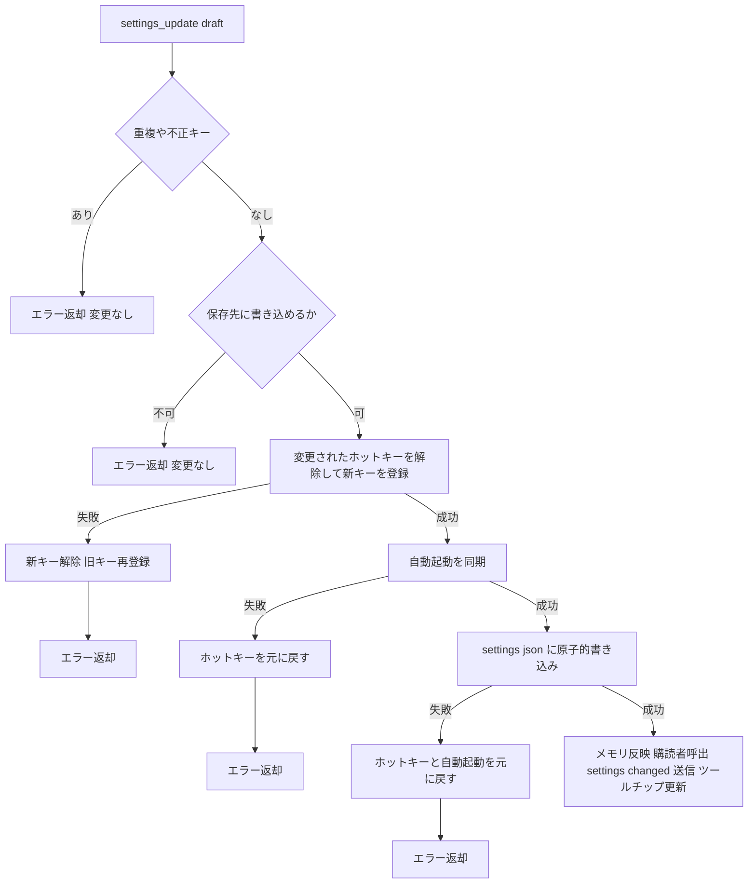

# Design Document: app-shell

## Overview
**Purpose**: app-shell は Snipt の常駐基盤です。トレイアイコン、グローバルホットキー、設定画面と設定の永続化、自動起動、多重起動防止、終了を提供し、利用者がいつでもキー一発でキャプチャを始められる状態を保ちます。

**Users**: Snipt の利用者全員(トレイ / ホットキー / 設定画面)と、下流の spec(capture-library, screen-capture, annotation-editor)。下流は app-shell が定義する `Settings` / `SettingsStore` / `Notifier` / `CaptureRequester` / `BeforeExitHooks` と、Rust・フロントエンド双方のコンポジションルートを利用します。

**Impact**: 新規プロジェクトの最初の spec として、Tauri アプリの骨格(`src-tauri/` と `src/` の入口、プラグイン構成、ウィンドウラベルによるビュー振り分け)を確立します。

### Goals
- 起動するとウィンドウを出さずトレイに常駐し、ホットキーとトレイメニューからキャプチャ開始を要求できる
- 設定の変更が再起動なしに反映され、次回起動時も保持される(壊れていても起動できる)
- ホットキー登録失敗(特に Windows 11 の PrintScreen 予約)を利用者が自力で解決できる案内を出す

### Non-Goals
- キャプチャの実行、busy 判定、オーバーレイ(screen-capture)
- 画像の保存・履歴の中身・履歴画面 UI(capture-library)
- 注釈編集と編集画面のライフサイクル(annotation-editor)
- ホットキーの「未割り当て」状態、設定のインポート / エクスポート

## Boundary Commitments

### This Spec Owns
- Rust コンポジションルート(`src-tauri/src/lib.rs`, `main.rs`)とプラグイン登録順、起動の 2 段階 setup 規約
- フロントエンドの入口(`src/main.tsx`)とウィンドウラベル → ビューの振り分け
- 共有型: `CaptureMode`, `Settings`, `HotkeySettings`, `FullscreenTarget`, `Accelerator`, `Notice`, トレイト `CaptureRequester`, `Notifier`
- `SettingsStore`(設定の唯一の保持者)、設定ファイル `settings.json` の形式と保存場所、Tauri event `settings://changed`
- トレイアイコン・メニュー・ツールチップ、グローバルホットキーの登録 / 解除 / 一時停止 / 失敗分類
- `settings` ウィンドウの UI とライフサイクル、`history` ウィンドウの生成と前面化(中身は除く)
- OS 自動起動の同期、多重起動時の通知、アプリ終了処理と終了前フック登録口 `BeforeExitHooks`
- `tauri.conf.json`(identifier、ウィンドウ 0 枚構成)と `capabilities/app-shell.json`

### Out of Boundary
- キャプチャ中のホットキー無視(2.5)の判定そのもの。busy フラグは screen-capture が所有し、`CaptureRequester::request_capture` の実装内で無視する
- 保存先フォルダへの書き込み・フォルダの再作成(capture-library。app-shell は初回の既定フォルダ作成と書き込み可否チェックのみ)
- 履歴ウィンドウ・編集ウィンドウ・オーバーレイの描画内容と、編集中データの退避
- annotation-editor の「前回使ったスタイル」等の各機能固有の設定

### Allowed Dependencies
- Tauri v2 コア(tray, menu, window, event, path)と公式プラグイン: single-instance, global-shortcut, autostart, notification, dialog, log
- `windows` クレート(`platform/windows/keyboard_settings.rs` のレジストリ読み取りのみ)
- `serde`, `serde_json`, `thiserror`
- 下流 spec への依存は **トレイト経由のみ**(`Arc<dyn CaptureRequester>` を managed state から取得)。`app_shell` モジュールは `capture_library` / `screen_capture` / `annotation_editor` を import しない(`lib.rs` のみ例外として各 `setup` を呼ぶ)

### Revalidation Triggers
- `Settings` / `HotkeySettings` / `FullscreenTarget` / `CaptureMode` の形やシリアライズ表記の変更
- `settings://changed` の payload 変更、`SettingsStore` / `Notifier` / `CaptureRequester` / `BeforeExitHooks` のシグネチャ変更
- 2 段階 setup の順序、各 spec の `setup` 関数シグネチャ、ウィンドウラベル規約、フロント入口の export 規約の変更
- 設定ファイルの保存場所・`schemaVersion` の変更、tauri identifier の変更

## Architecture

### Architecture Pattern & Boundary Map


**Architecture Integration**:
- Selected pattern: 機能モジュール + トレイト注入。app-shell が `shared` にトレイトを定義し、下流が実装を managed state に登録する(shared-contracts 準拠)。
- 依存方向(違反はレビューで不可とする): `shared`(型・トレイト)→ `platform::windows` → `app_shell::settings`(store, file)→ `app_shell::{hotkeys, autostart, notifier}` → `app_shell::{service, tray, windows, dispatch, lifecycle}` → `app_shell::commands` → `lib.rs`。フロントは `src/shared/ipc` → `src/features/app-shell` → `src/app`。
- Steering compliance: Windows API はアダプタに隔離、command 名と payload 型は `src/shared/ipc/app-shell.ts` と Rust で一対一、`any` 禁止。

### Technology Stack

| Layer | Choice / Version | Role in Feature | Notes |
|-------|------------------|-----------------|-------|
| Frontend | React 19.3 + TypeScript strict, Vite, `@tauri-apps/api` 2.x, `@tauri-apps/plugin-dialog` 2.x | 設定画面、ウィンドウ振り分け | フォルダ選択は dialog の `open({ directory: true })` |
| Backend | Rust stable ≥ 1.90, `tauri` 2.x(feature `tray-icon`) | 常駐・トレイ・ウィンドウ管理 | 公式プラグインの MSRV が 1.90 |
| Plugins | `tauri-plugin-single-instance` / `-global-shortcut` / `-autostart` / `-notification` / `-dialog` / `-log` 各 2.x | 6.1 / 2.x / 5.x / 通知 / 3.6 / ログ | single-instance を最初に登録。下流が使う `tauri-plugin-opener`(capture-library)も lib.rs のプラグイン区画で登録 |
| Data | `serde_json` ファイル `%APPDATA%\app.snipt\settings.json` | 設定の永続化 | plugin-store は不採用(破損検知のため。research.md) |
| OS | `windows` クレート(Win32 Registry) | PrintScreen 予約の判定 | `HKCU\Control Panel\Keyboard\PrintScreenKeyForSnippingEnabled` |

## File Structure Plan

### Directory Structure
```
src-tauri/
├── Cargo.toml                      # 依存定義(各 spec が自分の依存を追記)
├── tauri.conf.json                 # identifier=app.snipt, app.windows=[], バンドル設定
├── capabilities/app-shell.json     # windows:["settings"] に core:event:allow-listen / allow-unlisten, core:window:allow-close, dialog:allow-open
└── src/
    ├── main.rs                     # snipt_lib::run() を呼ぶだけ
    ├── lib.rs                      # コンポジションルート: プラグイン順、2 段階 setup、invoke_handler(spec 別区画)、RunEvent
    ├── shared/
    │   ├── mod.rs                  # 共有型の再 export
    │   ├── capture.rs              # CaptureMode, CaptureRequester
    │   ├── settings.rs             # Settings, HotkeySettings, FullscreenTarget, Accelerator
    │   └── notify.rs               # Notifier トレイト, Notice, NoticeLevel
    ├── platform/windows/
    │   ├── mod.rs
    │   └── keyboard_settings.rs    # print_screen_opens_snipping(): Option<bool>
    └── app_shell/
        ├── mod.rs                  # setup()(第 1 段)/ start()(第 2 段)/ 公開 API の再 export
        ├── settings/
        │   ├── mod.rs
        │   ├── store.rs            # SettingsStore(保持・購読・commit)
        │   ├── file.rs             # 読み込み / 原子的書き込み / 破損退避 / 既定値生成
        │   └── validate.rs         # 重複・アクセラレータ検証、保存先書き込み可否チェック
        ├── hotkeys/
        │   ├── mod.rs
        │   ├── accelerator.rs      # Accelerator ⇔ Shortcut 変換、表示文字列
        │   ├── backend.rs          # ShortcutBackend トレイトと global-shortcut 実装
        │   └── manager.rs          # HotkeyManager(適用・ロールバック・一時停止・失敗分類)
        ├── service.rs              # SettingsService(確定処理のオーケストレーション)
        ├── commands.rs             # Tauri command(settings_*, hotkeys_*)
        ├── tray.rs                 # TrayController(メニュー、ツールチップ、クリック)
        ├── windows.rs              # WindowManager(settings / history の生成・前面化)
        ├── dispatch.rs             # CaptureDispatch(CaptureRequester への転送)
        ├── notifier.rs             # ToastNotifier(Notifier 実装)
        ├── autostart.rs            # AutostartSync
        └── lifecycle.rs            # quit、BeforeExitHooks、ExitRequested 制御、二重起動コールバック
src/
├── main.tsx                        # React 起動、WindowRouter をマウント
├── app/
│   └── WindowRouter.tsx            # ウィンドウラベル → 各機能のルートコンポーネント
├── shared/ipc/
│   └── app-shell.ts                # 型、command ラッパー、イベント名
└── features/app-shell/
    ├── index.ts                    # SettingsWindow を export
    ├── SettingsWindow.tsx          # 設定画面(フォーム、保存 / 閉じる、エラー表示)
    ├── HotkeyInput.tsx             # ホットキー入力欄(suspend / resume を伴う)
    ├── HotkeyStatusBanner.tsx      # 登録失敗・PrintScreen 予約の案内と「再登録」
    ├── SaveDirField.tsx            # フォルダ選択と書き込み可否表示
    ├── use-settings-form.ts        # 下書き状態、重複検出、保存処理
    └── keyboard-accelerator.ts     # KeyboardEvent → Accelerator、表示整形
```

### Modified Files
- なし(新規プロジェクト)。ただし `lib.rs` の `invoke_handler` と `Cargo.toml`、`WindowRouter.tsx` は下流 spec も追記する共有ファイルであり、spec 別の区画(コメント見出し)を設けて衝突を避ける。

## System Flows

### 起動シーケンス(1.1, 2.1, 4.2, 4.3, 5.1, 6.1)

- 第 1 段で `Arc<SettingsStore>`・`Arc<dyn Notifier>`・`Arc<BeforeExitHooks>` を managed state に置くため、下流 `setup` はそれらを参照できる。各 spec の入口は `pub fn setup(app: &mut tauri::App) -> Result<(), Box<dyn std::error::Error>>` に統一し、順序は `app_shell::setup` → `capture_library::setup` → `annotation_editor::setup` → `screen_capture::setup` → `app_shell::start`。上流の setup 時点で未登録の下流トレイト(例: capture-library から見た `EditorLauncher`)は、呼び出し時に `try_state` で遅延解決する。第 2 段は `Arc<dyn CaptureRequester>` が登録済みである前提で動くが、未登録でも失敗せず警告ログのみ(screen-capture 実装前でも app-shell を単体で動かせる)。

### 設定確定(3.4, 3.5, 3.7, 3.8, 4.1, 5.2)

- 確定はオールオアナッシング。不変条件「永続化値 = 適用中の値」を維持する。

## Requirements Traceability

| Req | Summary | Components | Interfaces | Flows |
|-----|---------|------------|------------|-------|
| 1.1 | 起動時トレイのみ表示 | Bootstrap, TrayController | `tauri.conf.json` windows=[] | 起動 |
| 1.2 | トレイメニュー項目 | TrayController | `TrayMenuId` | — |
| 1.3 | メニューからキャプチャ要求 | TrayController, CaptureDispatch | `CaptureRequester::request_capture` | — |
| 1.4 | ダブルクリックで履歴 | TrayController, WindowManager | `WindowManager::show_history` | — |
| 1.5 | ツールチップ | TrayController | `TrayController::refresh_tooltip` | 設定確定 |
| 2.1 | 既定ホットキー | Settings defaults | `Settings::default_with` | 起動 |
| 2.2 | ホットキーでキャプチャ要求 | HotkeyManager, CaptureDispatch | `on_shortcut_event` | — |
| 2.3 | 競合時の通知と案内 | HotkeyManager, ToastNotifier | `HotkeyFailureKind::Conflict` | 起動 |
| 2.4 | PrintScreen 予約の案内 | HotkeyManager, keyboard_settings | `HotkeyFailureKind::PrintScreenReservedByWindows` | 起動 |
| 2.5 | 操作中は他ホットキー無視 | CaptureDispatch → screen-capture | `CaptureRequester` 契約(実装側が busy 時に無視) | — |
| 3.1 | 設定画面を開く / 前面化 | WindowManager | `WindowManager::show_settings` | — |
| 3.2 | 設定項目 | SettingsWindow | `Settings` | — |
| 3.3 | キー組み合わせの表示 | HotkeyInput, keyboard-accelerator | `hotkeys_suspend` / `hotkeys_resume` | — |
| 3.4 | 重複の拒否 | use-settings-form, validate.rs | `SettingsUpdateError.duplicateHotkey` | 設定確定 |
| 3.5 | 登録失敗時は旧キー維持 | HotkeyManager, SettingsService | `HotkeyManager::apply` | 設定確定 |
| 3.6 | フォルダ選択の反映 | SaveDirField | plugin-dialog `open` | — |
| 3.7 | 書き込み不可の拒否 | validate.rs, SaveDirField | `settings_check_save_dir` | 設定確定 |
| 3.8 | 再起動なしで反映 | SettingsService, SettingsStore | `settings://changed`, `SettingsStore::subscribe` | 設定確定 |
| 4.1 | 永続化 | settings/file.rs | `SettingsFile::save` | 設定確定 |
| 4.2 | 起動時の読込と適用 | settings/file.rs, app_shell::start | `SettingsFile::load` | 起動 |
| 4.3 | 破損時は初期化して通知 | settings/file.rs, ToastNotifier | `LoadOutcome::RecoveredFromCorruption` | 起動 |
| 4.4 | 既定の保存先 Pictures\Snipt | Settings defaults | `Settings::default_with(picture_dir)` | 起動 |
| 5.1 | ログイン時に常駐起動 | AutostartSync, Bootstrap | autostart plugin | 起動 |
| 5.2 | 無効化で次回から起動しない | AutostartSync, SettingsService | `AutostartSync::apply` | 設定確定 |
| 5.3 | 既定で自動起動有効 | Settings defaults, AutostartSync | `autostart: true` | 起動 |
| 6.1 | 多重起動防止と通知 | Lifecycle, single-instance | `Lifecycle::on_second_instance` | 起動 |
| 7.1 | 終了時にホットキー解放・全画面を閉じる | Lifecycle, HotkeyManager | `Lifecycle::quit`, `BeforeExitHooks` | — |
| 7.2 | 画面を閉じても常駐 | Lifecycle | `RunEvent::ExitRequested` 制御 | — |
| 7.3 | 未保存データがあれば確認を表示 | Lifecycle, BeforeExitHooks | `ExitCheck`, dialog | 終了 |
| 7.4 | 再試行で再保存し、残れば再確認 | Lifecycle, BeforeExitHooks | `BeforeExitHooks::run_all` | 終了 |
| 7.5 | キャンセルで常駐継続 | Lifecycle | `Lifecycle::quit` | 終了 |

## Components and Interfaces

| Component | Layer | Intent | Req | Key Dependencies | Contracts |
|-----------|-------|--------|-----|------------------|-----------|
| Shared types | shared | 下流と共有する型・トレイト | 1.3, 2.1, 2.2, 3.2 | — | Service, State |
| SettingsStore + file | settings | 設定の保持・永続化・購読 | 3.8, 4.1–4.4 | serde_json (P0) | Service, State |
| HotkeyManager | hotkeys | 登録・ロールバック・一時停止・失敗分類 | 2.1–2.4, 3.3, 3.5, 7.1 | global-shortcut (P0), keyboard_settings (P1) | Service |
| SettingsService + commands | service | 確定処理と Tauri command | 3.4–3.8, 4.1, 5.2 | Store, HotkeyManager, AutostartSync (P0) | API, Event |
| TrayController | ui-shell | トレイ表示・メニュー・ツールチップ | 1.1–1.5 | tauri tray (P0) | Service |
| WindowManager | ui-shell | settings / history の生成・前面化 | 1.4, 3.1 | tauri window (P0) | Service |
| CaptureDispatch | ui-shell | キャプチャ要求の転送 | 1.3, 2.2, 2.5 | CaptureRequester (P0) | Service |
| ToastNotifier | infra | OS トースト通知 | 2.3, 2.4, 4.3, 6.1 | notification plugin (P0) | Service |
| AutostartSync | infra | OS 自動起動の同期 | 5.1–5.3 | autostart plugin (P0) | Service |
| Lifecycle | infra | 終了・常駐継続・二重起動 | 6.1, 7.1–7.5 | single-instance (P0) | Service |
| Settings Window UI | frontend | 設定の編集 | 3.1–3.7 | `src/shared/ipc/app-shell.ts` (P0) | State |
| WindowRouter | frontend | ラベル → ビュー | 3.1 | 各機能の export (P1) | — |

### Shared(下流が依存する契約)

```rust
// shared/capture.rs
#[derive(Clone, Copy, Debug, PartialEq, Eq, Hash, Serialize, Deserialize)]
#[serde(rename_all = "camelCase")]            // "region" | "window" | "fullscreen"
pub enum CaptureMode { Region, Window, Fullscreen }

/// screen-capture が実装し、setup 内で `app.manage::<Arc<dyn CaptureRequester>>(..)` する。
pub trait CaptureRequester: Send + Sync + 'static {
    /// 非ブロッキングで即座に返ること(ホットキー / トレイのイベントスレッドから呼ばれる)。
    /// キャプチャ操作中(busy)の要求は実装側で黙って無視する(2.5)。
    fn request_capture(&self, mode: CaptureMode);
}

// shared/settings.rs
/// 正規化済みアクセラレータ文字列。修飾子は "Ctrl+Alt+Shift+Win+" の順、キーは
/// W3C KeyboardEvent.code 名(例: "PrintScreen", "Ctrl+PrintScreen", "Ctrl+Shift+KeyA", "F9")。
#[derive(Clone, Debug, PartialEq, Eq, Hash, Serialize, Deserialize)]
#[serde(transparent)]
pub struct Accelerator(String);
impl Accelerator { pub fn as_str(&self) -> &str; }   // 生成は app_shell::hotkeys::accelerator::parse 経由のみ

#[derive(Clone, Debug, PartialEq, Eq, Serialize, Deserialize)]
#[serde(rename_all = "camelCase")]
pub struct HotkeySettings { pub region: Accelerator, pub window: Accelerator, pub fullscreen: Accelerator }
impl HotkeySettings { pub fn get(&self, mode: CaptureMode) -> &Accelerator; }

#[derive(Clone, Copy, Debug, PartialEq, Eq, Serialize, Deserialize)]
#[serde(rename_all = "camelCase")]            // "cursorMonitor" | "allMonitors"
pub enum FullscreenTarget { CursorMonitor, AllMonitors }

#[derive(Clone, Debug, PartialEq, Eq, Serialize, Deserialize)]
#[serde(rename_all = "camelCase")]
pub struct Settings {
    pub hotkeys: HotkeySettings,
    pub fullscreen_target: FullscreenTarget,
    pub save_dir: PathBuf,
    pub autostart: bool,
}
impl Settings {
    /// 既定: PrintScreen / Ctrl+PrintScreen / Shift+PrintScreen、CursorMonitor、
    /// `<picture_dir>\Snipt`、autostart=true(2.1, 4.4, 5.3)
    pub fn default_with(picture_dir: &Path) -> Settings;
}

// shared/notify.rs
#[derive(Clone, Copy, Debug)] pub enum NoticeLevel { Info, Warning, Error }
#[derive(Clone, Debug)] pub struct Notice { pub level: NoticeLevel, pub title: String, pub body: String }
/// app-shell が実装し `Arc<dyn Notifier>` として manage する。全 spec が利用可。
pub trait Notifier: Send + Sync + 'static {
    /// 失敗しても panic せずログに記録するのみ(通知はベストエフォート)。
    fn notify(&self, notice: Notice);
}
```

```typescript
// src/shared/ipc/app-shell.ts(Rust と一対一)
export type CaptureMode = 'region' | 'window' | 'fullscreen';
export type FullscreenTarget = 'cursorMonitor' | 'allMonitors';
export type Accelerator = string & { readonly __brand: 'Accelerator' };
export interface HotkeySettings { region: Accelerator; window: Accelerator; fullscreen: Accelerator }
export interface Settings {
  hotkeys: HotkeySettings; fullscreenTarget: FullscreenTarget; saveDir: string; autostart: boolean;
}
export const SETTINGS_CHANGED_EVENT = 'settings://changed' as const; // payload: Settings
export type HotkeyFailureKind = 'conflict' | 'printScreenReservedByWindows';
export interface HotkeyStatus {
  mode: CaptureMode; accelerator: Accelerator; registered: boolean; failure: HotkeyFailureKind | null;
}
export type SettingsUpdateError =
  | { kind: 'duplicateHotkey'; accelerator: Accelerator; modes: CaptureMode[] }
  | { kind: 'invalidHotkey'; mode: CaptureMode; reason: 'noKey' | 'modifierRequired' | 'unknownKey' }
  | { kind: 'saveDirNotWritable'; path: string; message: string }
  | { kind: 'hotkeyRegistrationFailed'; statuses: HotkeyStatus[] }
  | { kind: 'autostartFailed'; message: string }
  | { kind: 'persistFailed'; message: string };
```

### settings

#### SettingsStore / SettingsFile

| Field | Detail |
|-------|--------|
| Intent | 現在の確定済み設定の唯一の保持者。永続化と変更購読を提供する |
| Requirements | 3.8, 4.1, 4.2, 4.3, 4.4 |

**Responsibilities & Constraints**
- `Arc<Settings>` を `RwLock` で保持し、`get` はスナップショットを返す。書き換えは `SettingsService` 経由の `commit` のみ(下流は読み取り専用)。
- ファイル: `app_config_dir()/settings.json`(`%APPDATA%\app.snipt\`)。形式は `{ "schemaVersion": 1, ...Settings }`。欠落フィールドは既定値で補完、型不一致・JSON 不正・`schemaVersion` 不明・アクセラレータ不正・重複は「破損」。
- 書き込みは `settings.json.tmp` へ書いて `rename`(Windows では置換)。破損時は `settings.corrupt-<unix秒>.json` に退避して既定値を保存し直す。
- 初回(ファイル無し)は既定値を保存し、既定保存先フォルダを `create_dir_all`(失敗してもログのみ)。

**Contracts**: Service [x] / State [x]

```rust
pub struct SettingsStore { /* RwLock<Arc<Settings>>, subscribers, file */ }
impl SettingsStore {
    pub fn get(&self) -> Arc<Settings>;
    /// 確定のたびに新しい設定で同期的に呼ばれる(ロック外、登録順)。重い処理は呼び出し側で別スレッドへ。
    pub fn subscribe(&self, f: Box<dyn Fn(&Settings) + Send + Sync + 'static>);
    pub(crate) fn load(path: PathBuf, picture_dir: &Path) -> (SettingsStore, LoadOutcome);
    pub(crate) fn commit(&self, next: Settings) -> Result<(), PersistError>; // 永続化成功後にのみ置換・購読者呼出
}
pub enum LoadOutcome { Loaded, FirstRun, RecoveredFromCorruption { backup: Option<PathBuf> } }
```
- 下流は `app.state::<Arc<SettingsStore>>()` で取得する。webview 側は `settings_get` と `settings://changed` を使う。
- Implementation Notes: `RecoveredFromCorruption` は第 2 段で Notice「設定を読み込めなかったため初期設定に戻しました」を出す(4.3)。

### hotkeys

#### HotkeyManager

| Field | Detail |
|-------|--------|
| Intent | 3 つのキャプチャ操作のホットキーを OS に登録し、状態と失敗理由を保持する |
| Requirements | 2.1, 2.2, 2.3, 2.4, 3.3, 3.5, 7.1 |

**Responsibilities & Constraints**
- `ShortcutBackend` を介して登録する(本番は global-shortcut、テストはフェイク)。プラグインの `with_handler` は `ShortcutState::Pressed` のみを処理し、`Shortcut` → `CaptureMode` の対応表を引いて `CaptureDispatch::request` を呼ぶ。
- `apply(next)`: 変更のある操作だけ旧キーを解除 → 新キーを登録。1 つでも失敗したら新キーを解除して旧キーを再登録し、`Err(statuses)`(キー交換にも対応するため解除を先に全部行う)。
- 失敗分類: 修飾なし `PrintScreen` かつ `keyboard_settings::print_screen_opens_snipping()` が `Some(false)` 以外 → `PrintScreenReservedByWindows`、それ以外 → `Conflict`。
- 一時停止: `suspend()` で全解除、`resume()` で現在の設定を再登録(設定画面のキー入力中のみ。ウィンドウ破棄時も必ず `resume`)。
- 起動時は `register_initial` の失敗を 1 件の Notice にまとめる。本文例: 「範囲キャプチャ(PrintScreen)のホットキーを登録できませんでした。ほかのアプリが使用している可能性があります。トレイの[設定]から別のキーを割り当ててください。」/ 予約時: 「Windows の 設定 > アクセシビリティ > キーボード にある『Print Screen キーを使用して画面キャプチャを開く』をオフにしてから、Snipt の設定画面で[再登録]を押してください。」

**Contracts**: Service [x]

```rust
pub trait ShortcutBackend: Send + Sync {
    fn register(&self, acc: &Accelerator) -> Result<(), BackendError>;
    fn unregister(&self, acc: &Accelerator) -> Result<(), BackendError>;
    fn unregister_all(&self) -> Result<(), BackendError>;
}
pub struct HotkeyManager { /* backend, current: HotkeySettings, statuses, suspended */ }
impl HotkeyManager {
    pub fn register_initial(&self, hk: &HotkeySettings) -> Vec<HotkeyStatus>;
    pub fn apply(&self, next: &HotkeySettings) -> Result<(), Vec<HotkeyStatus>>;
    pub fn retry_failed(&self) -> Vec<HotkeyStatus>;
    pub fn statuses(&self) -> Vec<HotkeyStatus>;
    pub fn mode_for(&self, shortcut: &Shortcut) -> Option<CaptureMode>;
    pub fn suspend(&self); pub fn resume(&self);
    pub fn release_all(&self);                                  // 7.1
}
// hotkeys/accelerator.rs
pub fn parse(raw: &str) -> Result<Accelerator, AcceleratorError>; // 正規化 + 検証
pub fn to_shortcut(acc: &Accelerator) -> Shortcut;              // Modifiers + Code
pub fn display(acc: &Accelerator) -> String;                    // "Ctrl + PrintScreen"
pub enum AcceleratorError { NoKey, ModifierRequired, UnknownKey }
```
- 検証規則: 非修飾キーが 1 つ必須。修飾なしで許すのは `PrintScreen`, `F1`〜`F24`, `Pause`, `ScrollLock` のみ(文字キー単独は入力を奪うため不可)。
- Implementation Notes: `Code` の文字列変換は `keyboard-types` の W3C 名を使う(実装時に `PrintScreen` の往復を単体テストで確認)。`platform/windows/keyboard_settings.rs` は `RegGetValueW(HKCU, "Control Panel\\Keyboard", "PrintScreenKeyForSnippingEnabled")` を読み、値なしは `None`。

### service

#### SettingsService / commands

| Field | Detail |
|-------|--------|
| Intent | 設定画面からの確定要求を検証・適用・永続化・通知まで一括で行う |
| Requirements | 3.4, 3.5, 3.7, 3.8, 4.1, 5.2 |

**Contracts**: API [x] / Event [x]

| Command | Request | Response | Errors |
|---------|---------|----------|--------|
| `settings_get` | — | `Settings` | — |
| `settings_update` | `{ next: Settings }` | `Settings`(確定値) | `SettingsUpdateError` |
| `settings_check_save_dir` | `{ path: string }` | `void` | `saveDirNotWritable` |
| `hotkeys_status` | — | `HotkeyStatus[]` | — |
| `hotkeys_retry` | — | `HotkeyStatus[]` | — |
| `hotkeys_suspend` / `hotkeys_resume` | — | `void` | — |

- 処理順は「設定確定」フローのとおり。`settings_check_save_dir` / 確定時チェックは「フォルダが無ければ作成 → 一意名の一時ファイルを作成・削除」で判定する(3.7)。
- Event: 確定成功後に `settings://changed`(payload `Settings`)を全ウィンドウへ `emit`。購読者コールバックの後、ツールチップ更新(1.5)。順序保証: 1 回の確定につき 1 回、確定順。
- `hotkeys_retry` 成功で状態が変わったらツールチップを更新する。command は `capabilities/app-shell.json` で `settings` ウィンドウにのみ許可する。

### ui-shell

#### TrayController(summary)
- ID `snipt-tray`。メニュー: 範囲キャプチャ / ウィンドウキャプチャ / 全画面キャプチャ / ─ / 履歴を開く / 設定 / ─ / 終了(1.2)。`show_menu_on_left_click(false)`。
- `MenuEvent` → `capture-region|capture-window|capture-fullscreen` は `CaptureDispatch`(1.3)、`open-history` / `open-settings` は `WindowManager`、`quit` は `Lifecycle::quit`。`TrayIconEvent::DoubleClick { button: Left }` → `show_history`(1.4)。
- `refresh_tooltip(settings, statuses)`: 「Snipt - 範囲キャプチャ: Ctrl + PrintScreen」、未登録なら「範囲キャプチャ: 未登録」(1.5)。

#### WindowManager(summary)
- `show_settings()` / `show_history()`: 同ラベルが存在すれば `unminimize` + `show` + `set_focus`、無ければ `WebviewWindowBuilder::new(app, label, WebviewUrl::App("index.html"))` で生成(3.1, 1.4)。settings は 560×640 固定・中央、history は 960×640 可変。閉じると破棄(常駐は Lifecycle が維持)。

#### CaptureDispatch(summary)
- `request(mode)`: `app.try_state::<Arc<dyn CaptureRequester>>()` があれば `request_capture(mode)`、無ければ warn ログ。busy 判定は行わない(2.5 は screen-capture の責任)。

### infra

#### ToastNotifier / AutostartSync / Lifecycle(summary)
- `ToastNotifier`: `Notifier` 実装。`app.notification().builder().title(..).body(..).show()`、失敗は `log::warn`。案内は本文で完結させる(クリック動作に依存しない)。
- `AutostartSync::apply(enabled) -> Result<(), String>`: `autolaunch().is_enabled()` と比較して `enable` / `disable`。起動時の第 2 段でも同期(5.1, 5.3)。`cfg(debug_assertions)` では何もしない。起動時の失敗は Notice(Warning)。
- `Lifecycle::on_second_instance`: 既存側で Notice「Snipt は既に起動しています。通知領域のアイコンから操作できます。」(6.1)。
- `Lifecycle::quit`(7.1, 7.3–7.5): 二重実行を防ぐフラグを立て、終了用ワーカースレッドで次を行う。
  1. `BeforeExitHooks::run_all()` で各フックを登録順に同期実行(各フックは自前で最大 3 秒)。各フックは未保存データの保存を試み、保存できずに残ったものを `ExitCheck` で返す。
  2. 残りが 0 件なら 3 へ。1 件以上なら `tauri-plugin-dialog` で確認を表示(「保存できていないデータが N 件あります」+ 内訳、ボタン: 再試行 / 破棄して終了 / キャンセル)(7.3)。再試行は 1 に戻る(7.4)。キャンセルはフラグを戻して何もせず戻る。ホットキーも画面もそのまま(7.5)。破棄して終了は 3 へ。
  3. `HotkeyManager::release_all` → メインスレッドで全 `webview_windows()` を `destroy` → `app.exit(0)`(7.1)。
  フックはメインスレッド外で走るため、フック内でウィンドウのイベントや IPC の完了を待ってよい。ホットキーの解放は確認の後に行うので、キャンセル時に再登録は要らない。
```rust
/// 第 1 段で `Arc<BeforeExitHooks>` として manage。下流は自分の setup で登録する(app-shell は下流に依存しない)。
pub struct BeforeExitHooks { /* Mutex<Vec<(&'static str, Box<dyn Fn() -> ExitCheck + Send + Sync>)>> */ }

/// フックの結果。保存できずに残ったものを利用者向けの短い説明で返す(例: "注釈: 20261022_173512")。
#[derive(Debug, Default)]
pub struct ExitCheck { pub unsaved: Vec<String> }

impl BeforeExitHooks {
    /// 終了時に呼ばれる。未保存データの保存を試み、残りを返す。ブロックしてよいが自前のタイムアウトを持つこと。
    /// 「再試行」のたびに再度呼ばれるため冪等であること。
    pub fn register(&self, name: &'static str, hook: Box<dyn Fn() -> ExitCheck + Send + Sync + 'static>);
    pub(crate) fn run_all(&self) -> ExitCheck;
}
```
- `on_run_event`: `RunEvent::ExitRequested { code: None, api }` は `api.prevent_exit()`、`Some(_)` は許可(7.2)。

### frontend

#### WindowRouter(summary)
- `getCurrentWebviewWindow().label` で振り分ける: `settings` → `@/features/app-shell` の `SettingsWindow`、`history` → `@/features/capture-library` の `HistoryWindow`、`editor-<captureId>` → `@/features/annotation-editor` の `EditorWindow({ captureId })`、`overlay-<monitorIndex>` → `@/features/screen-capture` の `OverlayWindow({ monitorIndex: number })`。各機能の `index.ts` は名前付き export で提供し、`React.lazy` で遅延読み込みする。

#### Settings Window UI(summary)
- `use-settings-form`: `settings_get` で下書き初期化、`settings://changed` で未編集時は追従。重複は即時検出して該当欄に「ほかの操作と重複しています」を表示し保存ボタンを無効化(3.4)。保存で `settings_update`、エラーは `kind` ごとに欄へ表示し下書きを保持(3.5, 3.7)。
- `HotkeyInput`: フォーカスで `hotkeys_suspend`、blur / アンマウントで `hotkeys_resume`。`keydown` で修飾+キーを確定し、PrintScreen は `keyup` で確定(WebView2 は keydown を送らない)。表示は `display` と同じ整形(3.3)。
- `SaveDirField`: `open({ directory: true, defaultPath })` → `settings_check_save_dir` → 可なら下書きへ反映・表示(3.6)、不可なら「このフォルダには保存できません」を表示し反映しない(3.7)。
- `HotkeyStatusBanner`: `hotkeys_status` を表示し、`printScreenReservedByWindows` には Windows 設定の場所を案内、[再登録] で `hotkeys_retry`(2.3, 2.4)。
- 全画面対象はラジオ(カーソルのあるモニタ / 全モニタ)、自動起動はチェックボックス(3.2)。

## Data Models
- 集約は `Settings` 1 つ。不変条件: 3 つの `Accelerator` は互いに異なる、各 `Accelerator` は `parse` 済み、`save_dir` は絶対パス。
- 永続形式(`settings.json`):
```json
{ "schemaVersion": 1,
  "hotkeys": { "region": "PrintScreen", "window": "Ctrl+PrintScreen", "fullscreen": "Shift+PrintScreen" },
  "fullscreenTarget": "cursorMonitor", "saveDir": "C:\\Users\\me\\Pictures\\Snipt", "autostart": true }
```
- 将来の項目追加は `#[serde(default)]` で後方互換。破壊的変更時のみ `schemaVersion` を上げ、`file.rs` に移行関数を追加する。

## Error Handling
- **利用者起因**(重複・不正キー・書き込み不可): 設定画面の該当欄に表示し確定しない。OS 通知は出さない。
- **OS 競合**(ホットキー登録失敗): 起動時はトースト 1 件 + 設定画面のバナー、確定時は設定画面のみ。旧キーを維持。
- **永続化 / 自動起動の失敗**: 確定をロールバックしエラー表示。起動時の自動起動同期失敗は Warning トースト。
- **設定ファイル破損**: 退避 + 既定値 + トースト(4.3)。起動は継続。
- **通知失敗**: ログのみ。致命的エラー(トレイ生成失敗)は `setup` からエラーを返し、ログを残して終了。
- ログ: `tauri-plugin-log` で `%LOCALAPPDATA%\app.snipt\logs` へ。ホットキー登録結果、設定読込結果、二重起動検知を info で記録。

## Testing Strategy
- **Unit (Rust)**
  - `accelerator::parse`: 正規化順序、`PrintScreen` / `Ctrl+PrintScreen` の往復、文字キー単独を `ModifierRequired` で拒否(2.1, 3.3)
  - `HotkeyManager::apply` をフェイク backend で: 2 件目失敗時に旧キーへ完全復元、キー交換(region⇔window)成功(3.5)
  - 失敗分類: 修飾なし PrintScreen + レジストリ値 1 / 未設定 → 予約、値 0 またはCtrl+PrintScreen → 競合(2.3, 2.4)
  - `SettingsFile::load`: ファイル無し → 既定値と `Pictures\Snipt`(4.4, 2.1, 5.3)、不正 JSON / 重複キー → 退避 + 既定値 + `RecoveredFromCorruption`(4.3)、保存→読込の往復(4.1, 4.2)
  - `validate`: 重複検出(3.4)、読み取り専用フォルダで `saveDirNotWritable`(3.7)
- **Integration (Rust, フェイク注入)**
  - `SettingsService::update` 成功で購読者が 1 回呼ばれ、ファイルが更新される(3.8, 4.1)。永続化失敗時にホットキー・自動起動が元に戻る
  - 自動起動フェイクで、無効化確定 → `disable` 呼出(5.2)、起動時同期で `enable`(5.3)
  - `CaptureDispatch`: requester 未登録でも panic しない、登録済みなら mode がそのまま渡る(1.3, 2.2)
- **Unit (Vitest)**
  - `keyboard-accelerator`: KeyboardEvent → Accelerator(PrintScreen は keyup)と表示整形(3.3)
  - `use-settings-form`: 重複時に保存不可、`SettingsUpdateError` 各 kind の表示先(3.4, 3.5, 3.7)
- **手動 E2E(Windows 10 / 11 実機チェックリスト)**
  - 起動でウィンドウ無し・トレイ表示・ツールチップ(1.1, 1.5)、右クリックメニューと各項目、ダブルクリックで履歴(1.2–1.4)
  - Windows 11 で PrintScreen 予約オンのまま初回起動 → 案内トースト → 設定オフ → [再登録] で成功(2.4)。他アプリで Ctrl+PrintScreen を先取り → 競合通知(2.3)
  - 2 回目の起動で既存側に通知・トレイ 1 個(6.1)。終了後に別アプリで同じキーを登録できる(7.1)。設定・履歴を閉じても常駐(7.2)
  - インストール版で自動起動 ON/OFF → 再ログインで確認(5.1, 5.2)
- **Performance**: ホットキー押下から `request_capture` 呼出まで 10ms 未満(app-shell 内はロック 1 回 + 転送のみ)。待機中に app-shell 起因のポーリング・タイマーを持たない。

## Security Considerations
- WebView に global-shortcut / autostart の permission を与えない(Rust 側のみが操作)。`settings` ウィンドウの capability は `core:event:allow-listen` / `allow-unlisten`(設定変更イベントの購読)、`core:window:allow-close`(閉じるボタン)、`dialog:allow-open`(保存先の選択)と app-shell の command のみ。
- `save_dir` は Rust 側で絶対パス化・書き込み検証してから確定する。

## Open Questions / Risks
- **共有契約への追加(逸脱ではなく具体化、cross-spec レビューで確定)**: `Accelerator`(正規化文字列)、`Notifier` をトレイト + `Notice` 型として定義、`SettingsStore::subscribe` はコールバック方式、下流トレイトは `Arc<dyn Trait>` として managed state に置く、2 段階 setup と各 spec 共通の `setup` シグネチャ、終了前フック `BeforeExitHooks`。
- **history ウィンドウ(確定)**: app-shell がラベル `history` で生成・前面化し、capture-library は `HistoryWindow` を export するだけ。
- **フロント入口の export 規約(確定)**: `SettingsWindow` / `HistoryWindow` / `EditorWindow({ captureId })` / `OverlayWindow({ monitorIndex })`。各 spec の設計はこれに合わせた。
- **終了時の未保存データ(確定、利用者判断 2026-10-22)**: annotation-editor(未保存注釈の flush)と capture-library(保存に失敗した撮影画像の再保存)が `BeforeExitHooks` に登録し、残りを `ExitCheck` で返す。残りがあれば確認ダイアログ(再試行 / 破棄して終了 / キャンセル)を出す(7.3–7.5)。
- PrintScreen 予約がレジストリ値と無関係に失敗する環境(他の常駐ツール)では「競合」と区別できない場合があるが、案内文は両方の対処を含むため実害は小さい。
