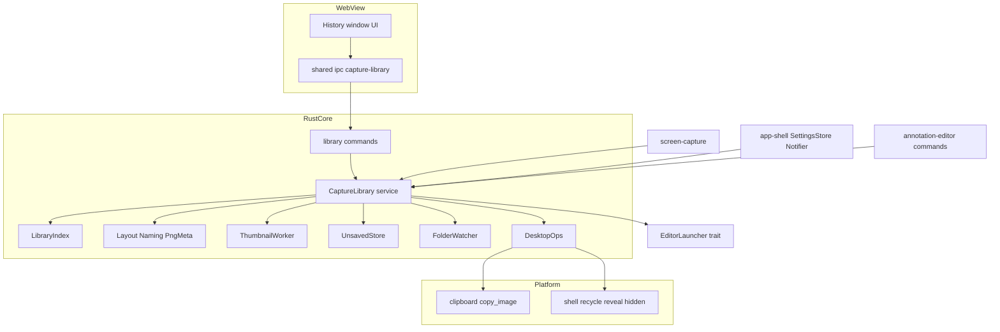
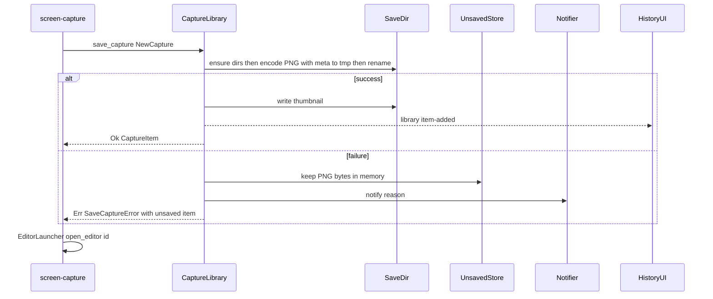
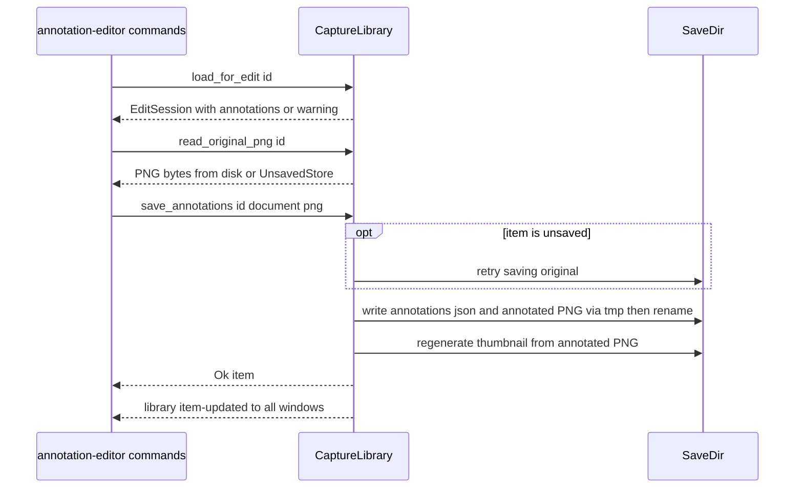

# Technical Design: capture-library

## Overview
**Purpose**: capture-library は、撮影結果と注釈の保管庫です。キャプチャ 1 件を「元画像 + 注釈ドキュメント + 合成済み画像 + メタデータ」のまとまりとして保存し、履歴一覧から再編集・コピー・削除・エクスプローラー表示を行えるようにします。
**Users**: 手順書づくりやバグ報告で Snipt を使う利用者が、過去の撮影結果を探して再利用するときに使います。screen-capture(撮影結果の保存)と annotation-editor(注釈の読み書き)は、互いに直接依存せず、このサービスを通して画像と注釈をやり取りします。
**Impact**: 新規。`src-tauri/src/capture_library/`、`src/features/capture-library/`、共有 IPC 型を追加します。

### Goals
- 撮影結果を保存先フォルダへ PNG で確実に自動保存し、失敗しても編集画面で開ける(1.1–1.6)
- 注釈を元画像と分けてバージョン付きで保存し、合成済み PNG を通常の画像として置く(2.1–2.6)
- 1,000 件でも 1 秒以内に最初のサムネイル群を表示する履歴一覧(3.1–3.8)
- ごみ箱への削除と、保存先変更時の再表示(4.1–4.3, 5.1–5.2)

### Non-Goals
- 画像の取得、撮影直後のクリップボードコピー(screen-capture)
- 注釈ドキュメントの中身(スキーマ定義・移行)と描画・合成処理(annotation-editor)
- 検索・タグ・フォルダ分け、クラウド同期、既存キャプチャの新フォルダへの移動
- 履歴ウィンドウを開く操作(トレイのダブルクリック / メニュー)は app-shell

## Boundary Commitments

### This Spec Owns
- 保存先フォルダ内のファイル配置、命名、メタデータ形式、インデックス(`.snipt/` 以下すべて)
- 共有型 `CaptureId`、`CaptureItem`、`NewCapture`、`CaptureImage`、`EditSession`、`SaveCaptureError`、`LibraryError` と、履歴画面が使う TS 対応型
- サービス `CaptureLibrary`(保存・読み込み・元画像バイト取得 `read_original_png`・注釈保存・一覧・削除・表示・コピー)と履歴画面向けの `library_*` Tauri command
- イベント `library://item-added` / `library://item-updated` / `library://items-removed` / `library://reloaded`
- 画像クリップボードアダプタ `platform::windows::clipboard::copy_image`(他 spec も使用)
- 保存失敗時の通知(1.6)と未保存キャプチャの保持
- 履歴ウィンドウ(ラベル `history`)の UI 内容 `src/features/capture-library/`

### Out of Boundary
- 注釈ドキュメントのスキーマ・移行・合成画像の生成(annotation-editor)。capture-library はトップレベルの整数 `schemaVersion` 以外を解釈しない
- 編集画面のライフサイクルと編集画面向けの IPC command(annotation-editor)。capture-library は `EditorLauncher::open_editor` / `close_editor` で依頼し、編集画面の読み書きは annotation-editor の command が本サービスを呼ぶ
- 設定値の保持・保存先の書き込み可否検証(app-shell)
- トースト通知の実装(app-shell の `Notifier`)
- 撮影後フローの順序(screen-capture)

### Allowed Dependencies
- app-shell: `shared::CaptureMode`、`SettingsStore`(`save_dir` の取得と変更購読)、`Notifier`
- annotation-editor: `shared::EditorLauncher` trait(managed state の `Arc<dyn EditorLauncher>` を呼び出し時に `try_state` で遅延解決。annotation-editor のモジュールを直接 import しない)
- 外部 crate: `png`, `image`, `notify`, `trash`, `tauri-plugin-opener`, `windows`, `serde`/`serde_json`, `chrono`, `thiserror`
- 依存方向: app-shell ← capture-library ← (screen-capture, annotation-editor)。capture-library は screen-capture / annotation-editor のモジュールを参照しない

### Revalidation Triggers
- `CaptureItem` / `EditSession` / `SaveCaptureError` / イベント payload の形の変更
- `load_for_edit` / `read_original_png` / `save_annotations` のシグネチャ変更(annotation-editor の command が呼ぶ)
- ファイル配置・命名規則・`index.json` スキーマの変更(既存フォルダの互換性)
- `editor-<captureId>` ラベル規約、`CaptureId` の文字種の変更
- `save_capture` の所要時間の大幅な増加(screen-capture 5.4 の 1 秒予算)

## Architecture

### Architecture Pattern & Boundary Map



**Architecture Integration**:
- 選択パターン: サービス + ファイルリポジトリ。`CaptureLibrary` がファサードで、純粋モジュール(命名・レイアウト・PNG メタ・インデックス)と OS アダプタを組み合わせる
- 真実の情報源はファイル。`index.json` は再構築可能なキャッシュ(research.md「ファイルを真実の情報源とし…」)
- 依存方向(レイヤー): `shared types → capture_library::types → naming/layout/png_meta → index/thumbnails/unsaved → service → commands/events → WebView`。上位から下位のみ import する。Windows API は `platform/windows/` のみ
- Steering 準拠: 物理ピクセル、base64 JSON 禁止、Windows API の platform 分離

### Technology Stack

| Layer | Choice / Version | Role in Feature | Notes |
|-------|------------------|-----------------|-------|
| Frontend | React + TypeScript (strict)、`@tanstack/react-virtual` 3.x | 履歴グリッドの仮想スクロール | 1,000 件でも描画は可視分のみ |
| Backend | Rust stable、Tauri v2 | command / event / asset プロトコル | `protocol-asset` 機能を有効化 |
| Image | `png` 0.17.x(`Compression::Fast`)、`image` 0.25.x | 元画像エンコード + iTXt、サムネイル縮小、デコード | |
| Data | ファイル(PNG + JSON) | 保存形式 | DB なし |
| OS 連携 | `trash` 5.x、`tauri-plugin-opener` 2.x、`notify` 8.x、`windows` crate | ごみ箱、エクスプローラー表示、監視、クリップボード | |

## File Structure Plan

### Directory Structure
```
src-tauri/src/
├── shared/
│   └── capture_id.rs            # CaptureId newtype(capture-library 所有。EditorLauncher が参照するため shared に置く)
├── capture_library/
│   ├── mod.rs                   # 公開 API の再エクスポート、setup()(状態生成・購読・監視開始)
│   ├── types.rs                 # CaptureItem, NewCapture, CaptureImage, EditSession, エラー型
│   ├── naming.rs                # ID・ファイル名の生成と衝突回避(純粋)
│   ├── layout.rs                # LibraryLayout: ルートから各パスを導出(純粋)
│   ├── png_meta.rs              # PNG エンコード + iTXt メタの読み書き
│   ├── atomic_fs.rs             # 一時ファイル + rename による原子的書き込み
│   ├── index.rs                 # LibraryIndex: メモリ索引、index.json の読み書き・再構築・突き合わせ
│   ├── thumbnails.rs            # ThumbnailWorker: 生成と不足分のバックグラウンド補完
│   ├── unsaved.rs               # UnsavedStore: 保存失敗時の PNG 保持(1.6)
│   ├── watcher.rs               # FolderWatcher: notify による外部削除検知(3.7)
│   ├── ports.rs                 # DesktopOps trait(ごみ箱・表示・クリップボード)と本番実装
│   ├── service.rs               # CaptureLibrary ファサード
│   ├── events.rs                # イベント名と payload、emit ヘルパー
│   └── commands.rs              # library_* Tauri command
└── platform/windows/
    ├── clipboard.rs             # copy_image: CF_DIBV5 + "PNG" 登録形式(他 spec も使用)
    └── shell.rs                 # recycle(trash)、reveal(opener)、set_hidden

src/
├── shared/ipc/
│   └── capture-library.ts       # TS 型、command ラッパー、イベント名
└── features/capture-library/
    ├── index.ts                 # HistoryWindow を名前付き export(WindowRouter が使用)
    ├── HistoryWindow.tsx        # history ウィンドウのルート(ツールバー + グリッド + ダイアログ)
    ├── HistoryGrid.tsx          # 仮想スクロールのサムネイルグリッド、選択、ダブルクリック
    ├── HistoryTile.tsx          # 1 件のタイル(サムネイル・日時・サイズ・読み込み失敗時の存在確認)
    ├── DeleteConfirmDialog.tsx  # 件数入り削除確認(4.1)
    ├── use-history-items.ts     # 一覧取得とイベント購読による状態更新
    ├── history-selection.ts     # 複数選択ロジック(純粋、Ctrl / Shift)
    └── format.ts                # 日時・サイズ表示の整形
```

### Modified Files
- `src-tauri/src/lib.rs`(合成ルート、app-shell 所有) — `capture_library::setup(app)` の呼び出し、`library_*` command の登録、`tauri-plugin-opener` の登録
- `src-tauri/src/shared/mod.rs` — `capture_id` モジュールの追加
- `src-tauri/src/platform/windows/mod.rs` — `clipboard` / `shell` の `mod` 宣言
- `src-tauri/Cargo.toml` — `png`, `image`, `notify`, `trash`, `tauri-plugin-opener`, tauri の `protocol-asset` 機能
- `src-tauri/tauri.conf.json` — `app.security.assetProtocol.enable: true`(スコープは実行時に動的付与)、CSP の `img-src` に asset を許可
- `src-tauri/capabilities/history.json`(新規、本 spec 所有)— `history` ウィンドウに `library_*` command を許可
- `src/app/WindowRouter.tsx`(app-shell 所有) — ラベル `history` で `HistoryWindow` を表示

## System Flows

### 撮影結果の保存(成功 / 失敗)

- 成功・失敗どちらでも screen-capture は返された ID で編集画面を開く。失敗の通知は capture-library のみが行う(screen-capture は重ねて通知しない)。
- インデックス(`index.json`)の書き出しは保存後にバックグラウンドで合流させる(500ms 以内)。書き出し失敗は保存失敗扱いにしない(次回読み込み時に突き合わせで回復)。

### 再編集と注釈保存


### 保存先の切り替えと外部削除
- `SettingsStore` の変更通知で `save_dir` が変わったら: 監視停止 → 新ルートの索引読み込み(突き合わせ込み)→ asset スコープ更新 → 監視再開 → `library://reloaded`。既存ファイルは移動しない(5.1, 5.2)。
- 外部削除は (1) 読み込み時の突き合わせ、(2) `FolderWatcher` の削除 / リネームイベント(300ms デバウンス)、(3) UI のサムネイル読み込み失敗時の `library_prune_missing`、のいずれかで検知し、`library://items-removed`(reason `missingOnDisk`)を出す。エラーは表示しない(3.7)。

## Requirements Traceability

| Req | Summary | Components | Interfaces | Flows |
|-----|---------|------------|------------|-------|
| 1.1 | PNG 保存と履歴登録 | CaptureLibrary, PngMeta, LibraryIndex | `save_capture` | 保存 |
| 1.2 | 日時入りで重複しない名前 | Naming | `next_name` | 保存 |
| 1.3 | 日時・方法・サイズを記録 | PngMeta, LibraryIndex | `SniptMetaV1`, `CaptureItem` | 保存 |
| 1.4 | ウィンドウタイトル記録 | PngMeta | `NewCapture.window_title` | 保存 |
| 1.5 | フォルダが無ければ作成 | LibraryLayout | `ensure_dirs` | 保存 |
| 1.6 | 失敗通知と編集画面用の保持 | UnsavedStore, CaptureLibrary | `SaveCaptureError`, `EditSession.unsaved` | 保存(失敗) |
| 2.1 | 注釈を別保存、元画像不変 | CaptureLibrary | `save_annotations` | 注釈保存 |
| 2.2 | 合成済み PNG を置き換え保存 | CaptureLibrary, AtomicFs | `save_annotations` | 注釈保存 |
| 2.3 | 通常の画像ファイル | LibraryLayout | `*_annotated.png` | — |
| 2.4 | 元画像と注釈をそろえて提供 | CaptureLibrary | `load_for_edit`, `read_original_png` | 再編集 |
| 2.5 | 注釈形式のバージョン | CaptureLibrary | `schemaVersion` 検証 | 注釈保存 |
| 2.6 | 注釈が読めないとき元画像のみ+通知 | CaptureLibrary | `EditSession.warning` | 再編集 |
| 3.1 | サムネイル付き新しい順 | LibraryIndex, HistoryGrid | `library_list` | — |
| 3.2 | 日時・サイズ、合成済みをサムネイルに | ThumbnailWorker, HistoryTile | `CaptureItem.thumbnailPath` | — |
| 3.3 | 新規を先頭に追加 | use-history-items | `library://item-added` | 保存 |
| 3.4 | ダブルクリックで編集 | HistoryGrid, CaptureLibrary | `library_open_in_editor` → `EditorLauncher` | — |
| 3.5 | コピー | CaptureLibrary, clipboard | `copy_to_clipboard`, `copy_image` | — |
| 3.6 | エクスプローラーで表示 | CaptureLibrary, shell | `reveal_in_explorer` | — |
| 3.7 | 外部削除を黙って除く | LibraryIndex, FolderWatcher, HistoryTile | `library_prune_missing`, `items-removed` | 外部削除 |
| 3.8 | 1,000 件で 1 秒以内 | LibraryIndex, ThumbnailWorker, HistoryGrid | メモリ索引 + 仮想スクロール | — |
| 4.1 | 件数入り確認 | DeleteConfirmDialog | — | — |
| 4.2 | ごみ箱へ移動し一覧から除く | CaptureLibrary, shell | `delete` | — |
| 4.3 | 編集画面を閉じてから削除 | CaptureLibrary | `EditorLauncher::close_editor` | — |
| 5.1 | 以降は新フォルダに保存 | CaptureLibrary | `SettingsStore` 購読 | 切り替え |
| 5.2 | 移動せず新フォルダで再表示 | LibraryIndex | `library://reloaded` | 切り替え |

## Components and Interfaces

| Component | Layer | Intent | Req | Key Dependencies | Contracts |
|-----------|-------|--------|-----|------------------|-----------|
| CaptureLibrary | Service | 保管庫のファサード | 1.x, 2.x, 3.4–3.7, 4.2–4.3, 5.x | SettingsStore (P0), Notifier (P1), EditorLauncher (P1) | Service, Event, State |
| LibraryIndex | Data | メモリ索引とキャッシュ | 1.1, 3.1, 3.7, 3.8, 5.2 | LibraryLayout, PngMeta (P0) | State |
| Naming / LibraryLayout / PngMeta / AtomicFs | Data | 命名・配置・メタ・原子的書き込み | 1.2–1.5, 2.2, 2.3 | png (P0) | — |
| ThumbnailWorker | Data | サムネイル生成・補完 | 3.2, 3.8 | image (P0) | Batch |
| UnsavedStore | Data | 保存失敗時の保持 | 1.6 | — | State |
| FolderWatcher | Data | 外部削除検知 | 3.7 | notify (P1) | Event |
| DesktopOps + platform adapters | Platform | ごみ箱・表示・クリップボード | 3.5, 3.6, 4.2 | trash, opener, windows (P0) | Service |
| library commands + IPC TS | IPC | WebView との契約 | 2.x, 3.x, 4.x | CaptureLibrary (P0) | API, Event |
| History UI | UI | 履歴一覧 | 3.1–3.7, 4.1 | IPC TS (P0) | — |

### Shared Types (Rust)

```rust
// src-tauri/src/shared/capture_id.rs
/// 形式: "YYYYMMDD_HHMMSS" または同秒衝突時 "YYYYMMDD_HHMMSS_NN"(NN=02..99)。ローカル時刻。
/// 文字種は [0-9_] のみ(ウィンドウラベル editor-<id> にそのまま使える)。辞書順 = 撮影順。
#[derive(Clone, Debug, PartialEq, Eq, Hash, PartialOrd, Ord, Serialize, Deserialize)]
#[serde(transparent)]
pub struct CaptureId(String);
impl CaptureId {
    pub fn parse(s: &str) -> Result<Self, InvalidCaptureId>; // パターン検証(パス注入防止)
    pub fn as_str(&self) -> &str;
}

// src-tauri/src/capture_library/types.rs
#[derive(Clone, Debug, Serialize)]
#[serde(rename_all = "camelCase")]
pub struct CaptureItem {
    pub id: CaptureId,
    pub captured_at: chrono::DateTime<chrono::FixedOffset>, // RFC 3339 でシリアライズ
    pub mode: CaptureMode,                // app-shell 所有の shared::CaptureMode
    pub width: u32,                       // 物理ピクセル
    pub height: u32,
    pub window_title: Option<String>,     // mode == Window のときのみ Some
    pub original_path: PathBuf,           // 絶対パス
    pub annotated_path: Option<PathBuf>,  // 合成済み PNG が存在するとき
    pub has_annotations: bool,            // 注釈ドキュメントが存在するとき
    pub thumbnail_path: Option<PathBuf>,  // 追加フィールド: 生成済みのとき
    pub thumbnail_version: u64,           // 追加フィールド: キャッシュ無効化用(ミリ秒)
}
impl CaptureItem {
    /// コピー・表示・サムネイルの元: annotated_path があればそれ、無ければ original_path
    pub fn display_path(&self) -> &Path;
}

pub enum CaptureImage {
    /// 非乗算済み RGBA8、行詰め(stride = width * 4)
    Rgba { width: u32, height: u32, pixels: Vec<u8> },
    /// 既にエンコード済みの PNG(メタは capture-library が付け直す)
    Png(Vec<u8>),
}

pub struct NewCapture {
    pub image: CaptureImage,
    pub mode: CaptureMode,
    pub captured_at: chrono::DateTime<chrono::Local>,
    pub window_title: Option<String>,
}

#[derive(Serialize)]
#[serde(rename_all = "camelCase")]
pub struct EditSession {
    pub item: CaptureItem,
    pub original_path: PathBuf,                     // 未保存時は存在しないことがある。画素は read_original_png で取得する
    pub annotations: Option<serde_json::Value>,     // 不透明。トップレベル整数 schemaVersion を保証
    pub warning: Option<String>,                    // 利用者向け日本語メッセージ(2.6, 1.6)
    pub unsaved: bool,                              // 追加フィールド: 保存先に未保存(1.6)
}

#[derive(Debug, thiserror::Error, Serialize)]
#[serde(tag = "kind", rename_all = "camelCase")]
pub enum LibraryError {
    NotFound { id: CaptureId },
    SaveDirUnavailable { path: PathBuf, message: String },
    DiskFull { message: String },
    PermissionDenied { path: PathBuf, message: String },
    InvalidImage { message: String },
    InvalidAnnotationDocument { message: String },   // JSON でない / schemaVersion が整数でない
    Clipboard { message: String },
    Shell { message: String },                       // ごみ箱・表示の失敗
    Io { message: String },
}

#[derive(Debug, Serialize)]
#[serde(rename_all = "camelCase")]
pub struct SaveCaptureError {
    pub reason: LibraryError,
    pub unsaved: CaptureItem,   // UnsavedStore に保持済み。この id で編集画面を開ける
}
```

### Service Layer

#### CaptureLibrary

| Field | Detail |
|-------|--------|
| Intent | 保存・読み込み・注釈保存・一覧・削除・表示・コピーの唯一の入口 |
| Requirements | 1.1–1.6, 2.1–2.6, 3.4–3.7, 4.2, 4.3, 5.1, 5.2 |

**Responsibilities & Constraints**
- 書き込み系(保存・注釈保存・削除・ルート切り替え)は内部の書き込みロックで直列化する。重い I/O は `spawn_blocking` 上で行う
- 元画像は作成後に変更しない(2.1)。注釈保存で書くのは注釈 JSON・合成済み PNG・サムネイルのみ
- すべての書き込みは `.snipt/tmp/` に書いてから同一ボリューム内 rename(置き換え)する
- 編集中セッションの登録表(`load_for_edit` した ID → `CaptureItem`)を持ち、保存先切り替え後も開いている編集画面の注釈保存は元の場所へ書く

**Dependencies**
- Inbound: screen-capture — `save_capture`(P0)、annotation-editor — command 経由(P0)、History UI — command 経由(P0)
- Outbound: `SettingsStore` — `save_dir` 取得と変更購読(P0)、`Notifier` — 保存失敗通知(P1)、`EditorLauncher` — 履歴からの再編集(P1)、`DesktopOps`(P0)
- External: `png`, `image`, `notify`, `trash`, `tauri-plugin-opener`

**Contracts**: Service [x] / API [x] / Event [x] / Batch [ ] / State [x]

##### Service Interface
```rust
pub struct CaptureLibrary { /* Arc で共有、tauri::State として管理 */ }

impl CaptureLibrary {
    pub fn save_capture(&self, capture: NewCapture) -> Result<CaptureItem, SaveCaptureError>;
    pub fn load_for_edit(&self, id: &CaptureId) -> Result<EditSession, LibraryError>;
    /// 元画像の PNG バイト(未保存項目は UnsavedStore から)。編集画面への唯一の画素供給元
    pub fn read_original_png(&self, id: &CaptureId) -> Result<Vec<u8>, LibraryError>;
    pub fn save_annotations(&self, id: &CaptureId, document: serde_json::Value,
                            flattened_png: Vec<u8>) -> Result<CaptureItem, LibraryError>;
    pub fn list(&self) -> Vec<CaptureItem>;                       // 新しい順(captured_at 降順、同値は id 降順)
    pub fn delete(&self, ids: &[CaptureId]) -> Result<DeleteOutcome, LibraryError>;
    pub fn reveal_in_explorer(&self, id: &CaptureId) -> Result<(), LibraryError>;
    pub fn copy_to_clipboard(&self, id: &CaptureId) -> Result<(), LibraryError>;
    pub fn open_in_editor(&self, id: &CaptureId) -> Result<(), LibraryError>;
    pub fn prune_missing(&self, ids: &[CaptureId]) -> Vec<CaptureId>; // 実際に除いた ID
}

pub struct DeleteOutcome { pub removed: Vec<CaptureId>, pub failed: Vec<(CaptureId, LibraryError)> }

/// 合成ルートから呼ぶ。managed state の Arc<SettingsStore> / Arc<dyn Notifier> を取得し、
/// Arc<CaptureLibrary> を manage する。索引読み込みはバックグラウンドで開始し、list() は完了まで待つ。
/// EditorLauncher は annotation_editor::setup より前に呼ばれるため、使用時に try_state で解決する。
pub fn setup(app: &mut tauri::App) -> Result<(), Box<dyn std::error::Error>>;
```
- `save_capture` 事前条件: 画素数 > 0。事後条件(成功): 元 PNG がルートに存在し、索引に登録され、`item-added` が出ている。サムネイル生成は戻り値の後に行い、完了時に `item-updated`
- `save_capture` 失敗時: `UnsavedStore` に PNG を保持(一時フォルダにも書けたら書く)、`Notifier` で理由を通知、`Err(SaveCaptureError)`。PNG エンコードはディスク書き込みより前にメモリ上で行うため、I/O 失敗時も必ず `unsaved` を作れる。入力不正(画素数 0、`pixels.len() != width*height*4`、`Png` が壊れている)は呼び出し側の不具合として `debug_assert` + `InvalidImage` を理由に通知する
- `load_for_edit`: 注釈ファイルが無ければ `annotations: None, warning: None`。読めない / JSON でない / `schemaVersion` が整数でない場合は `annotations: None` と `warning: Some("注釈を読み込めませんでした。元画像のみ開きます。")`(2.6)。未保存項目は `unsaved: true` と未保存の旨の warning
- `save_annotations` 事前条件: `document` がオブジェクトでトップレベル `schemaVersion` が 1 以上の整数、`flattened_png` が PNG としてヘッダを読める。未保存項目ならまず元画像の保存を再試行し、成功時は通常項目化して `item-added`、失敗時は `Err`。事後条件: 注釈 JSON と `*_annotated.png` を置き換え、`has_annotations = true`、サムネイル再生成、`item-updated`。削除済み ID は `NotFound`(ファイルを再作成しない)
- `delete`: 書き込みロックを取る前に、対象ごとに `EditorLauncher::close_editor(id)` を呼ぶ(開いていれば未保存注釈を flush してから閉じ、完了まで最大 3 秒ブロック。flush の `save_annotations` がロックを要するためロック外で呼ぶ。`library_delete` は async command でメインスレッド外)→ ロックを取り `deleted` に登録 → 元 PNG・合成済み PNG・注釈 JSON をまとめてごみ箱へ(`trash::delete_all` 1 回)→ サムネイルは通常削除 → 索引から除去 → `items-removed`(reason `deleted`)。launcher 未登録時はクローズを省略
- `copy_to_clipboard`: `display_path()` の PNG を読み、デコードした RGBA とその PNG バイト列を `copy_image` に渡す
- `reveal_in_explorer`: `display_path()` を選択状態で開く

##### State Management
- 状態: `RwLock<LibraryState { root: LibraryLayout, index: LibraryIndex, sessions: HashMap<CaptureId, CaptureItem>, deleted: HashSet<CaptureId> }>`、`UnsavedStore`、ready ラッチ
- ルート切り替え中の `save_capture` は書き込みロックで待たされ、新ルートに保存される(5.1)

**Implementation Notes**
- Integration: `setup` 内で `app.manage(Arc<CaptureLibrary>)`。screen-capture / annotation-editor は自分の `setup` で `app.state::<Arc<CaptureLibrary>>()` を取得する
- Validation: すべての command 入力の ID は `CaptureId::parse` で検証してからパスを組み立てる
- Risks: 4K / 全モニタ画像のエンコード時間 → `Compression::Fast`。注釈保存と削除の競合 → `deleted` 集合で拒否

### Data Layer

#### Naming / LibraryLayout / PngMeta / AtomicFs(要約)
- `naming::next_name(at: DateTime<Local>, exists: impl Fn(&str) -> bool) -> (CaptureId, String /*base*/)`: base は `Snipt_YYYYMMDD_HHMMSS`、衝突時は `_02`〜`_99`(1.2)。索引とディスクの両方で存在確認
- `LibraryLayout::new(root)`: `original(base)`、`annotated(base)`、`annotations(id)`、`thumbnail(id)`、`index_file()`、`tmp_dir()`、`ensure_dirs()`(ルートと `.snipt` 一式を作成し `.snipt` を隠し属性に、1.5)
- `png_meta::encode(image: &CaptureImage, meta: &SniptMetaV1) -> Result<Vec<u8>, LibraryError>`、`png_meta::read_header(path) -> Result<(u32, u32, Option<SniptMetaV1>), LibraryError>`(先頭チャンクのみ読む)
- `atomic_fs::write_replace(tmp_dir, dest, bytes)`: 一時ファイルに書いて flush 後 `rename`。`ERROR_DISK_FULL` / `ERROR_ACCESS_DENIED` を `DiskFull` / `PermissionDenied` に写像(1.6 の理由通知)

#### LibraryIndex

| Field | Detail |
|-------|--------|
| Intent | 現在のルートの全項目をメモリに持ち、`index.json` キャッシュで高速に起動する |
| Requirements | 1.1, 3.1, 3.7, 3.8, 5.2 |

**Contracts**: State [x]
```rust
impl LibraryIndex {
    pub fn load(layout: &LibraryLayout) -> LibraryIndex;   // キャッシュ読み込み + 突き合わせ、失敗時は再構築
    pub fn items_newest_first(&self) -> Vec<CaptureItem>;
    pub fn get(&self, id: &CaptureId) -> Option<&CaptureItem>;
    pub fn upsert(&mut self, item: CaptureItem);
    pub fn remove(&mut self, ids: &[CaptureId]) -> Vec<CaptureId>;
    pub fn snapshot_for_persist(&self) -> IndexFileV1;      // 書き出しはバックグラウンドで合流
}
```
- 突き合わせ: ルートと `.snipt/annotations` の `read_dir`(名前のみ)を索引と比較し、索引に無い `Snipt_*.png`(`_annotated` 以外、snipt メタ付き)を取り込み、元 PNG が無い項目を除く。`*_annotated.png` の有無で `annotated_path` を補正
- `schemaVersion` が未知・JSON 破損・ファイル無しの場合はファイルから再構築して上書き(キャッシュなので安全)

#### ThumbnailWorker
- **Batch**: トリガーは (a) 保存 / 注釈保存の直後(メモリ上の画像から即生成)、(b) 索引読み込み後に `thumbnail_path` が無い項目。入力は `display_path()`、出力は `.snipt/thumbs/<id>.png`(長辺最大 320px、アスペクト維持、透明保持)。同一 ID の要求は合流し、完了ごとに `item-updated`。冪等(上書き生成)。新しい順に処理し、先頭の表示分を優先する

#### UnsavedStore
- **State**: `Mutex<HashMap<CaptureId, UnsavedCapture { item, png: Arc<Vec<u8>>, reason }>>`。プロセス終了で消える。注釈保存時の再保存成功、または削除で除去。一覧(`list`)には含めない

#### FolderWatcher
- **Event**: `notify` の非再帰監視(ルートのみ)。削除・リネーム元のうち索引にある元 PNG → `prune_missing`、`*_annotated.png` の消失 → `annotated_path = None` にしてサムネイル再生成。300ms デバウンス。自アプリの削除で生じたイベントは無視(索引に無い)

### Platform Layer

#### DesktopOps と platform adapters
```rust
// src-tauri/src/capture_library/ports.rs(テストで偽物に差し替える)
pub trait DesktopOps: Send + Sync {
    fn recycle(&self, paths: &[PathBuf]) -> Result<(), LibraryError>;
    fn reveal(&self, path: &Path) -> Result<(), LibraryError>;
    fn copy_image(&self, image: ClipboardImage<'_>) -> Result<(), LibraryError>;
}

// src-tauri/src/platform/windows/clipboard.rs(他 spec も直接使用してよい)
pub struct ClipboardImage<'a> {
    pub width: u32,
    pub height: u32,
    pub rgba: &'a [u8],          // 非乗算済み RGBA8、stride = width * 4
    pub png: Option<&'a [u8]>,   // None のときアダプタが高速圧縮で PNG を作る
}
#[derive(Debug, thiserror::Error)]
pub enum ClipboardError { #[error("clipboard busy")] Busy, #[error("{0}")] Win32(String) }
pub fn copy_image(image: ClipboardImage<'_>) -> Result<(), ClipboardError>;

// src-tauri/src/platform/windows/shell.rs
pub fn recycle(paths: &[PathBuf]) -> Result<(), String>;               // trash::delete_all
pub fn reveal(app: &tauri::AppHandle, path: &Path) -> Result<(), String>; // opener の reveal_item_in_dir
pub fn set_hidden(path: &Path) -> Result<(), String>;                  // FILE_ATTRIBUTE_HIDDEN
```
- 呼び出し規約(全呼び出し元で共通): capture-library は PNG をデコードした RGBA と元の PNG(`png: Some`)、screen-capture は撮影した RGBA のみ(`png: None`)、annotation-editor は合成 PNG をデコードした RGBA と その PNG(`png: Some`)を渡す。エラーは各 spec のエラー型(`clipboard` 種別)へ写像する
- `copy_image`: 1 回の `OpenClipboard` 内で `EmptyClipboard` → CF_DIBV5(BI_BITFIELDS、アルファ付き、ボトムアップ)→ 登録形式 `"PNG"` を設定。`OpenClipboard` 失敗時は 20ms 間隔で最大 10 回再試行し、駄目なら `Busy`。呼び出しスレッドは任意(ウィンドウハンドル不要)

### IPC Layer

#### library commands

| Command | Request | Response | Errors |
|---------|---------|----------|--------|
| `library_list` | — | `CaptureItem[]`(新しい順) | — |
| `library_open_in_editor` | `{ id }` | — | `notFound` |
| `library_copy` | `{ id }` | — | `notFound`, `clipboard`, `io` |
| `library_reveal` | `{ id }` | — | `notFound`, `shell` |
| `library_delete` | `{ ids }` | `{ removed: CaptureId[], failed: { id, error }[] }` | — |
| `library_prune_missing` | `{ ids }` | `CaptureId[]` | — |

- 編集画面向けの読み込み・元画像取得・注釈保存は command として公開しない。annotation-editor の `editor_open_session` / `editor_read_original` / `editor_save`(ラベル由来の ID)が `load_for_edit` / `read_original_png` / `save_annotations` を呼ぶ(所有の一本化)
- エラーは `LibraryError` を `{ kind, ...fields, message }` でシリアライズして reject する

#### Event Contract
| Event | Payload | 発行タイミング |
|-------|---------|----------------|
| `library://item-added` | `{ item: CaptureItem }` | 新規保存、未保存項目の保存成功、外部で追加された snipt PNG の取り込み |
| `library://item-updated` | `{ item: CaptureItem }` | 注釈保存、サムネイル生成、合成済み PNG の外部削除(契約への追加) |
| `library://items-removed` | `{ ids: CaptureId[], reason: "deleted" \| "missingOnDisk" }` | 削除、外部削除の検知 |
| `library://reloaded` | `{ saveDir: string }` | 保存先切り替え後の索引読み込み完了 |
- 全ウィンドウへ `emit`。順序は発行スレッド内で保証、ウィンドウ間の到着順は保証しない。受信側は `id` で冪等に扱う(追加済み ID の `item-added` は置き換え)

#### Shared IPC Types (TS)
```typescript
// src/shared/ipc/capture-library.ts
import type { CaptureMode } from './app-shell'; // app-shell 所有: 'region' | 'window' | 'fullscreen'

export type CaptureId = string & { readonly __brand: 'CaptureId' };

export interface CaptureItem {
  id: CaptureId;
  capturedAt: string;            // RFC 3339(オフセット付き)
  mode: CaptureMode;
  width: number;                 // 物理ピクセル
  height: number;
  windowTitle: string | null;
  originalPath: string;
  annotatedPath: string | null;
  hasAnnotations: boolean;
  thumbnailPath: string | null;
  thumbnailVersion: number;
}

export type LibraryErrorKind =
  | 'notFound' | 'saveDirUnavailable' | 'diskFull' | 'permissionDenied' | 'invalidImage'
  | 'invalidAnnotationDocument' | 'clipboard' | 'shell' | 'io';
export interface LibraryError { kind: LibraryErrorKind; message: string; id?: CaptureId; path?: string }

export type ItemsRemovedReason = 'deleted' | 'missingOnDisk';
export interface LibraryEvents {
  'library://item-added': { item: CaptureItem };
  'library://item-updated': { item: CaptureItem };
  'library://items-removed': { ids: CaptureId[]; reason: ItemsRemovedReason };
  'library://reloaded': { saveDir: string };
}

export function listCaptures(): Promise<CaptureItem[]>;
export function openInEditor(id: CaptureId): Promise<void>;
export function copyCapture(id: CaptureId): Promise<void>;
export function revealCapture(id: CaptureId): Promise<void>;
export function deleteCaptures(ids: CaptureId[]): Promise<{ removed: CaptureId[]; failed: { id: CaptureId; error: LibraryError }[] }>;
export function pruneMissing(ids: CaptureId[]): Promise<CaptureId[]>;
export function thumbnailSrc(item: CaptureItem): string | null; // convertFileSrc(thumbnailPath) + '?v=' + thumbnailVersion
export function onLibraryEvent<K extends keyof LibraryEvents>(name: K, handler: (payload: LibraryEvents[K]) => void): Promise<() => void>;
```

### UI Layer(要約)
- `HistoryWindow`: ツールバー(コピー・エクスプローラーで表示・削除。選択数で有効化)、`HistoryGrid`、`DeleteConfirmDialog`。Delete キーで削除確認。右クリックメニューでも同操作
- `HistoryGrid`: `@tanstack/react-virtual` の行仮想化。タイルにサムネイル・撮影日時(`yyyy/MM/dd HH:mm:ss`)・`幅 × 高さ`。ダブルクリック / Enter で `openInEditor`(3.4)
- `HistoryTile`: サムネイル未生成時はプレースホルダー。`` の `onError` で `pruneMissing([id])` を呼ぶ(3.7)
- `DeleteConfirmDialog`: 「{n} 件のキャプチャをごみ箱へ移動しますか?」(4.1)
- `use-history-items`: 初回 `listCaptures()`、`item-added` は先頭に挿入(3.3)、`item-updated` は置換、`items-removed` は除去、`reloaded` は再取得。選択状態は削除された ID を自動で外す

## Data Models

### Physical Layout(保存先フォルダ)
```
<save_dir>/
├── Snipt_20261022_174150.png             # 元画像(iTXt "snipt:meta" 付き)。作成後は不変
├── Snipt_20261022_174150_annotated.png   # 合成済み画像(通常の PNG、注釈保存ごとに置き換え)
├── Snipt_20261022_174150_02.png          # 同じ秒の 2 枚目
└── .snipt/                               # 隠しフォルダ(Snipt 管理)
    ├── index.json                        # 索引キャッシュ(削除しても再構築される)
    ├── annotations/20261022_174150.json  # 注釈ドキュメント(不透明、schemaVersion 必須)
    ├── thumbs/20261022_174150.png        # サムネイルキャッシュ
    └── tmp/                              # 原子的書き込み用の一時ファイル
```
- 保存先フォルダごとに自己完結するため、保存先を戻せば旧履歴がそのまま表示される(5.2)

### Data Contracts
- **PNG iTXt `snipt:meta`(SniptMetaV1)**: `{ "v": 1, "id": "20261022_174150", "capturedAt": "2026-10-22T17:41:50.123+09:00", "mode": "window", "windowTitle": "..." }`。幅・高さは IHDR。読み取り側は未知フィールドを無視し、`v` が未知でも必須フィールドが読めれば取り込む
- **index.json(IndexFileV1)**: `{ "schemaVersion": 1, "items": [{ "id", "base", "capturedAt", "mode", "width", "height", "windowTitle", "hasAnnotatedPng", "hasAnnotations", "thumbnailVersion" }] }`。パスはルート相対の `base` から導出(フォルダごと移動しても有効)
- **注釈ドキュメント**: annotation-editor が渡した JSON をそのまま UTF-8 で保存。capture-library はトップレベル整数 `schemaVersion >= 1` のみ検証(2.5)。古い版の移行は annotation-editor が読み込み時に行う
- **不変条件**: 元 PNG が存在する ⇔ 項目が存在する。`has_annotations` ⇔ 注釈 JSON が存在する。`annotated_path` は合成済み PNG が存在するときのみ Some

## Error Handling

| 状況 | 応答 |
|------|------|
| 保存先の作成・書き込み失敗(容量不足・権限なし・ドライブ切断) | `Notifier` で理由付き通知、`UnsavedStore` に保持、`SaveCaptureError`(1.6) |
| 注釈 JSON 破損 | 元画像のみの `EditSession` + warning(2.6)。破損ファイルは上書き保存されるまで残す |
| 注釈保存失敗 | `Err(LibraryError)` を返す。表示・再試行は annotation-editor(同 11.3) |
| 履歴ファイルの外部削除 | 黙って除外(3.7)。ログのみ |
| ごみ箱移動の一部失敗 | 成功分のみ除外し、`failed` を UI がトースト表示 |
| クリップボード使用中 | 再試行後 `clipboard` エラー、UI が表示 |
| index.json 破損・未知バージョン | 再構築(利用者には見せない) |
- ログ: `log` クレート(app-shell の tauri-plugin-log に出力)で保存時間・再構築時間・突き合わせ件数を記録

## Testing Strategy
- **Unit**: `naming`(同秒 3 件で `_02`, `_03`、辞書順 = 時刻順、1.2)、`png_meta`(iTXt 往復、日本語ウィンドウタイトル、IHDR からのサイズ、1.3/1.4)、`LibraryIndex` 突き合わせ(索引にない PNG の取り込み、元 PNG 欠損の除外、破損 / 未知バージョンでの再構築、3.7/5.2)、`CaptureId::parse`(`..\` などの拒否)、注釈 `schemaVersion` 検証(2.5)
- **Integration(一時ディレクトリ + 偽 DesktopOps)**: 存在しない保存先への保存でフォルダ作成(1.5)→ 注釈保存で元 PNG のバイト列が不変かつ合成済み PNG が置き換わる(2.1/2.2)→ `load_for_edit` で注釈がそろう / 破損 JSON で warning(2.4/2.6)→ `delete` で 3 ファイルが recycle に渡り、偽 `EditorLauncher::close_editor` がロック外で先に呼ばれる(4.2/4.3)。読み取り専用フォルダでの保存失敗 → `SaveCaptureError` と `load_for_edit(unsaved.id)` 成功、再保存(1.6)。保存先切り替えで新フォルダの内容に入れ替わり、旧フォルダに戻すと旧履歴が戻る(5.1/5.2)
- **E2E(Windows)**: 撮影 → 開いている履歴の先頭に追加(3.3)、ダブルクリックで編集画面(3.4)、コピー後に Paint / Teams へ貼り付け(透明度含む、3.5)、エクスプローラーで合成済みファイルが選択される(3.6)、エクスプローラーで削除 → 一覧から消える(3.7)、複数選択削除の確認件数とごみ箱からの復元(4.1/4.2)
- **Performance**: 1,000 件の生成済みフォルダで履歴ウィンドウ表示 → 最初の可視サムネイル群の `load` 完了まで < 1 秒(3.8、索引あり)。索引なし再構築時間の計測(目標: SSD で 2 秒以内、起動時バックグラウンド)。4K / 7680×2160 の `save_capture` 所要時間(目標 < 150ms)

## Security Considerations
- WebView から受け取るのは `CaptureId` のみでパスは受け取らない。ID はパターン検証してからパスを組み立てる(パストラバーサル防止)
- asset プロトコルのスコープは現在のルートの `.snipt/thumbs` のみを実行時に許可し、切り替え時に旧スコープを外す

## Performance & Scalability
- 3.8: 索引は起動時にバックグラウンドで読み込み済み。`library_list` は 1,000 件(約 300KB JSON)を 1 回で返す。グリッドは可視行 + 前後 1 行のみ描画、サムネイルは長辺 320px の小さな PNG
- `save_capture` はエンコード + rename までを同期で行い、サムネイル・索引書き出しは後回し

## Open Questions / Risks
- **契約への追加(後方互換)**: `CaptureItem.thumbnail_path` / `thumbnail_version`、`EditSession.unsaved`、イベント `library://item-updated`、`library://items-removed` の `reason`。既存フィールドは変更しない
- **契約の具体化**: `save_capture` のエラー型を `SaveCaptureError { reason, unsaved }` とした(共有契約の `Result<CaptureItem>` の具体化)。screen-capture は `Err` でも `unsaved.id` で `open_editor` し、通知はしない
- **4.3 の編集画面クローズ(確定)**: annotation-editor が追加した `EditorLauncher::close_editor`(未保存注釈を flush してから閉じる)を削除前に呼ぶ。flush された注釈も同じ削除でごみ箱へ移る
- **履歴ウィンドウを開く経路(確定)**: app-shell が `history` ラベルのウィンドウを作成 / 前面化し、capture-library は `HistoryWindow` を export するだけ
- **元画像バイトの所有(確定)**: `read_original_png` サービスは capture-library、WebView 向け command `editor_read_original` は annotation-editor が所有する
- **要件の未定義点**: 合成済み PNG だけが外部削除された場合(3.7 の対象外)は、項目を残してサムネイルを元画像に戻す。未保存キャプチャ(1.6)はアプリ終了で失われる
