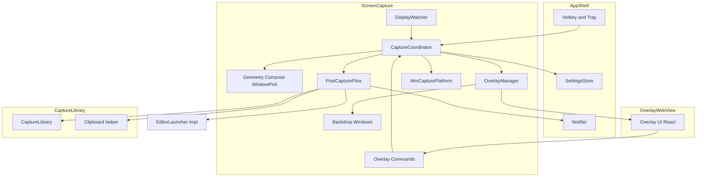
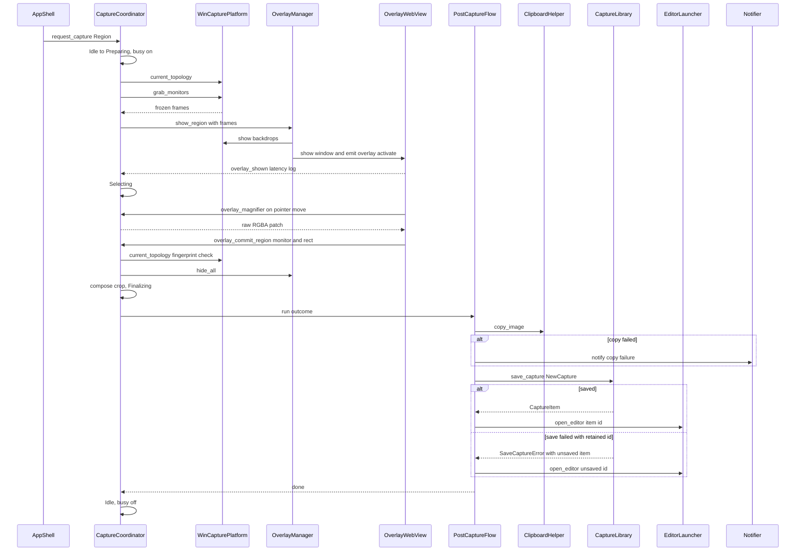
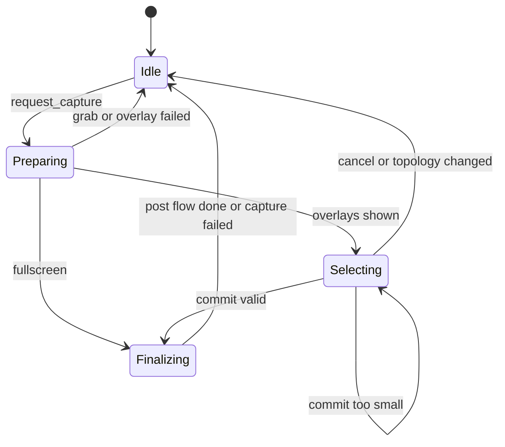

# Design Document: screen-capture

## Overview
**Purpose**: screen-capture は、app-shell から届いた撮影開始要求を受けて画面を取得し、範囲またはウィンドウを選ばせ、確定した画像をクリップボード・capture-library・annotation-editor へ順に引き渡す。マルチモニタと混在 DPI の環境でも、撮影画像の各ピクセルが画面の画素と 1 対 1 に対応する。

**Users**: 手順書作成・バグ報告・チャットでの説明のために画面を撮る利用者。ホットキーまたはトレイから範囲・ウィンドウ・全画面の 3 方式を使う。

**Impact**: 新規モジュール `src-tauri/src/screen_capture/`、Windows アダプタ群、オーバーレイ UI `src/features/screen-capture/` を追加する。app-shell の `CaptureRequester` を実装し、composition root で注入される。

### Goals
- ホットキーから範囲選択画面の表示まで 200ms 以内(1.2)、確定から編集画面表示まで 1 秒以内(5.4)
- 100% / 150% などの混在 DPI でも、選択範囲と撮影範囲を物理ピクセル単位で一致させる(4.1, 4.2)
- 隠れたウィンドウもそのウィンドウ自身の内容で撮る(2.3)
- 撮影処理の状態機械・座標計算・合成を OS 非依存にし、`cargo test` で検証できるようにする

### Non-Goals
- ホットキー登録とトレイメニュー(app-shell)、保存形式・ファイル名・履歴(capture-library)、注釈(annotation-editor)
- スクロールキャプチャ、動画、タイマー撮影
- DXGI Desktop Duplication 実装(計測で必要になった場合のみ追加。ポートは用意する)

## Boundary Commitments

### This Spec Owns
- 撮影バックエンド: モニタの凍結取得(GDI BitBlt)、ウィンドウ単体の取得(WGC、PrintWindow フォールバック)
- モニタ構成(物理矩形・DPI)の把握、構成変化の検知、構成指紋
- オーバーレイ: モニタごとに事前生成する非表示の Tauri ウィンドウ `overlay-<monitorIndex>` と、凍結画像を表示するネイティブ背景ウィンドウ。その生成・再構築・表示・非表示
- オーバーレイ UI(範囲選択、暗幕、寸法表示、拡大鏡、ウィンドウ強調)とオーバーレイ用 Tauri command / event
- ウィンドウ候補の列挙・除外・当たり判定
- 「撮影中」フラグ(5.6)と撮影セッションの状態機械
- 撮影後フロー: クリップボードコピー → `CaptureLibrary::save_capture` → `EditorLauncher::open_editor` の順序と失敗時の分岐
- 型: `CapturedImage`、`MonitorInfo`、`TopologyFingerprint`、`CaptureError`、オーバーレイ IPC の payload 型

### Out of Boundary
- ホットキーの登録・競合通知、トレイメニュー、撮影要求を「無視するか」の判断以外の転送ロジック(app-shell)
- 設定の保持と `fullscreen_target` の値の所有(app-shell。screen-capture は読むだけ)
- PNG エンコード、ファイル名、保存先、履歴登録、保存失敗の通知(capture-library 1.6)
- クリップボードへの書き込み形式(capture-library の `copy_image` が担う)
- 編集画面の生成・表示・事前生成(annotation-editor)
- OS 通知の表示方法(app-shell の `Notifier`)

### Allowed Dependencies
- app-shell: `shared::CaptureMode`、`shared::CaptureRequester`(実装する)、`SettingsStore`(`get`)、`Settings.fullscreen_target`、`Notifier`
- capture-library: `CaptureLibrary::save_capture`、`NewCapture`、`CaptureImage`、`CaptureItem`、`SaveCaptureError`、`CaptureId`、`platform::windows::clipboard::{copy_image, ClipboardImage}`
- annotation-editor: `shared::EditorLauncher`(トレイト経由のみ。具体型に依存しない)
- 外部: `windows` crate(Win32 / WinRT)、Tauri v2 コア API
- 制約: app-shell・capture-library から screen-capture への依存は禁止。annotation-editor の具体モジュールを import しない。Windows API 呼び出しは `platform/windows/` 配下のアダプタに限る

### Revalidation Triggers
- `CaptureRequester`・`EditorLauncher`・`save_capture`・`NewCapture`・`copy_image` のシグネチャ変更
- `save_capture` 失敗時に `SaveCaptureError.unsaved` で編集用 ID を返す取り決めの変更
- オーバーレイのウィンドウラベル規約(`overlay-<monitorIndex>`)や command 名の変更(フロントエンドのルーティングに影響)
- 撮影後フローの順序変更、または「撮影中」フラグの所有者の変更
- 座標系(物理ピクセル)の変更、対応 OS 下限(1903)の変更

## Architecture

### Architecture Pattern & Boundary Map
Ports & Adapters。OS 非依存の中核(状態機械・座標・合成・当たり判定)を、`CapturePlatform`(OS 撮影)と `OverlayPresenter`(画面表示)の 2 ポートで外界から切り離す。



**Architecture Integration**:
- 依存方向(この順にのみ import 可): `shared 型` → `screen_capture::{geometry, topology, compose, window_pick}`(純粋)→ `ports` → `coordinator, post_capture` → `overlay, commands`(Tauri)→ `platform::windows::*`(アダプタ、ports を実装)。純粋モジュールは Tauri・`windows` crate を import しない
- 範囲モードは「Win32 背景ウィンドウ(凍結画像)+ 透明 WebView オーバーレイ(UI のみ)」の 2 層。凍結画像は WebView に一切送らない(Windows の IPC は 10MB で約 200ms かかるため。詳細は research.md)
- ウィンドウモードは背景を出さず、実際の画面の上に透明オーバーレイを重ねて強調枠だけを描く
- 全画面モードはオーバーレイを使わず、凍結 → 合成 → 撮影後フローに直行する
- steering 準拠: Windows API は `platform/windows/` に隔離、座標は物理ピクセル、オーバーレイは事前生成、base64 不使用

### Technology Stack

| Layer | Choice / Version | Role in Feature | Notes |
|-------|------------------|-----------------|-------|
| Frontend | React + TypeScript strict(Vite)、Canvas 2D | オーバーレイ UI(暗幕・選択枠・寸法・拡大鏡・強調枠) | Konva は使わない(描画が単純なため) |
| Backend | Rust stable、Tauri 2.x | 状態機械、command / event、ウィンドウ管理 | `tauri::ipc::Response` で拡大鏡の小片のみ生バイト転送 |
| OS API | `windows` crate(Tauri が依存する版に揃える) | GDI BitBlt、DWM 属性、HiDpi、EnumWindows、WGC、D3D11、PrintWindow | features: `Win32_Graphics_Gdi`, `Win32_Graphics_Dwm`, `Win32_UI_HiDpi`, `Win32_UI_WindowsAndMessaging`, `Win32_Graphics_Direct3D11`, `Win32_Graphics_Dxgi`, `Win32_System_WinRT_Graphics_Capture`, `Win32_System_WinRT_Direct3D11`, `Win32_Storage_Xps`, `Graphics_Capture`, `Graphics_DirectX_Direct3D11`, `Foundation_Metadata` |
| Runtime | Windows 10 1903+ / 11 x64、WebView2 | PMv2 プロセス(tao が設定) | 起動時に awareness を検証してログ出力 |

## File Structure Plan

### Directory Structure
```
src-tauri/src/screen_capture/
├── mod.rs            # 公開 API: setup()(CaptureCoordinator を Arc<dyn CaptureRequester> として manage、オーバーレイ事前生成), commands 一覧
├── error.rs          # CaptureError
├── geometry.rs       # PhysicalPoint/PhysicalRect、クランプ、ローカル⇔グローバル変換(純粋)
├── topology.rs       # MonitorInfo、MonitorTopology、TopologyFingerprint、カーソル下モニタの決定(純粋)
├── compose.rs        # CapturedImage、FrozenFrame からの切り出し・全モニタ合成・BGRA→RGBA(純粋)
├── window_pick.rs    # WindowCandidate、除外規則、z 順当たり判定(純粋)
├── ports.rs          # CapturePlatform / OverlayPresenter トレイト
├── session.rs        # CaptureSession(凍結フレーム、候補一覧、強調中候補、指紋)
├── coordinator.rs    # CaptureCoordinator: 状態機械、撮影中フラグ、CaptureRequester 実装
├── post_capture.rs   # PostCaptureFlow: copy → save → open_editor
├── overlay.rs        # OverlayManager: overlay-<i> の事前生成・再構築・表示・event 送信(OverlayPresenter 実装)
└── commands.rs       # オーバーレイ用 Tauri command
src-tauri/src/platform/windows/
├── monitors.rs       # EnumDisplayMonitors / GetMonitorInfoW / GetDpiForMonitor、DPI awareness 検証
├── screen_grab.rs    # モニタごとの BitBlt → DIB セクション(FrozenFrame 生成)
├── window_enum.rs    # EnumWindows + 可視・最小化・cloaked・EXTENDED_FRAME_BOUNDS・タイトル取得
├── window_capture.rs # WGC 1 フレーム取得(D3D11 デバイス保持)+ PrintWindow フォールバック
├── backdrop.rs       # 凍結画像を描くネイティブ背景ウィンドウ(モニタごと)
├── display_watch.rs  # 非表示トップレベル監視ウィンドウ(WM_DISPLAYCHANGE / WM_DPICHANGED / WM_SETTINGCHANGE)
└── capture_platform.rs # WinCapturePlatform: 上記を束ねて CapturePlatform を実装
src-tauri/capabilities/
└── overlay.json      # overlay-* ウィンドウに許可する command / event
src/features/screen-capture/
├── index.ts               # OverlayWindow を名前付き export(WindowRouter が使用)
├── OverlayWindow.tsx      # overlay-<i> のルート({ monitorIndex })。activate / deactivate を受けてモード別画面を切替
├── RegionSelector.tsx     # ドラッグ選択、暗幕、寸法表示、モニタ端クランプ
├── Magnifier.tsx          # カーソル付近の拡大表示と座標表示
├── WindowHighlighter.tsx  # 強調枠の描画、クリック確定
├── use-overlay-session.ts # event 購読・command 呼び出し・Esc / 右クリック処理
└── coords.ts              # CSS px ⇔ ローカル物理 px 変換、矩形正規化(Vitest 対象)
src/shared/ipc/
└── screen-capture.ts      # オーバーレイ IPC の型(Rust の commands.rs / overlay.rs と一対一)
```

### Modified Files
- `src-tauri/src/lib.rs`(app-shell 所有の composition root)— `screen_capture::setup(app)` の呼び出し(`annotation_editor::setup` の後。`CaptureRequester` の manage は setup 内で行う)、`screen_capture::commands` の登録
- `src-tauri/src/platform/windows/mod.rs` — 上記アダプタの `mod` 宣言を追加
- `src/app/WindowRouter.tsx`(app-shell 所有)— `overlay-<i>` を `OverlayWindow({ monitorIndex })` に割り当てる
- `src-tauri/Cargo.toml` — `windows` crate の features を追加

## System Flows

### 範囲キャプチャ(ホットキー → オーバーレイ → 撮影 → コピー・保存・編集)


**Key Decisions**:
- 凍結(BitBlt)は自分のウィンドウを表示する前に完了させる。背景 → オーバーレイの順に表示し、オーバーレイを最前面に置いてフォーカスを渡す
- 確定時に構成指紋を取り直し、変化していれば撮影を取り消す(4.3)
- ウィンドウモードは「候補スナップショット取得 → 透明オーバーレイ表示 → `overlay_pointer` ごとに Rust で当たり判定 → 全オーバーレイへ `overlay://highlight` を送信 → クリックで WGC 撮影 → オーバーレイを隠す」。撮影はオーバーレイ表示中に行う(WGC は前面の重なりに影響されない)
- 全画面モードは `Preparing` から直接 `Finalizing` に進む(3.1)

### 撮影セッションの状態

- `Idle` 以外で届いた `request_capture` は破棄し、ログのみ残す(5.6)
- オーバーレイからの command はすべて `session_id` を持ち、現在のセッションと一致しないものは `StaleSession` で無視する

## Requirements Traceability

| Requirement | Summary | Components | Interfaces | Flows |
|-------------|---------|------------|------------|-------|
| 1.1 | 全モニタを凍結し全モニタに選択画面 | CaptureCoordinator, WinCapturePlatform(screen_grab), OverlayManager, Backdrop | `CapturePlatform::grab_monitors`, `OverlayPresenter::show_region` | 範囲キャプチャ |
| 1.2 | 200ms 以内に表示 | OverlayManager(事前生成), Backdrop, CaptureCoordinator(計測) | `overlay_shown` | 範囲キャプチャ、Performance |
| 1.3 | 暗幕・寸法・拡大表示 | RegionSelector, Magnifier, commands | `overlay_magnifier` | 範囲キャプチャ |
| 1.4 | ドラッグ終了で確定 | RegionSelector, CaptureCoordinator, compose | `overlay_commit_region`, `compose::crop` | 範囲キャプチャ |
| 1.5 | 1 モニタ内に限定・端で停止 | coords.ts, geometry | `clamp_to_monitor` | 範囲キャプチャ |
| 1.6 | Esc / 右クリックで取消 | use-overlay-session, CaptureCoordinator | `overlay_cancel` | 状態遷移 |
| 1.7 | 1px 未満は確定しない | RegionSelector, geometry | `CommitError::TooSmall` | 状態遷移 |
| 2.1 | ウィンドウ選択画面と強調 | WindowHighlighter, window_pick, window_enum | `overlay_pointer`, `overlay://highlight` | ウィンドウモード |
| 2.2 | クリックで確定 | WindowHighlighter, CaptureCoordinator | `overlay_commit_window` | ウィンドウモード |
| 2.3 | 隠れていても自身の内容 | window_capture(WGC) | `CapturePlatform::capture_window` | ウィンドウモード |
| 2.4 | 最小化・非表示・自身の選択画面を除外 | window_enum, window_pick | `WindowFilter` | ウィンドウモード |
| 2.5 | Esc / 右クリックで取消 | use-overlay-session, CaptureCoordinator | `overlay_cancel` | 状態遷移 |
| 2.6 | 撮影失敗を通知し何もしない | CaptureCoordinator, Notifier | `CaptureError::WindowCaptureFailed` | Error Handling |
| 3.1 | 選択画面なしで即撮影 | CaptureCoordinator | `request_capture(Fullscreen)` | 状態遷移 |
| 3.2 | 既定はカーソルのモニタ | topology, SettingsStore | `monitor_at_cursor` | — |
| 3.3 | 全モニタを配置どおり 1 枚、空き領域は透明 | compose | `compose::compose_region` | — |
| 4.1 | 1 対 1 の画素対応 | screen_grab, window_capture, compose, geometry | 物理 px 契約 | — |
| 4.2 | 混在 DPI で選択範囲と一致 | coords.ts, OverlayManager(物理矩形配置), geometry | `OverlayActivate.monitor` | 範囲キャプチャ |
| 4.3 | 構成変化で取消し、次回は新構成 | display_watch, topology, CaptureCoordinator, OverlayManager | `on_topology_changed`, 指紋比較 | 状態遷移 |
| 4.4 | カーソルを含めない | screen_grab(BitBlt), window_capture(`IsCursorCaptureEnabled=false`, 確定時カーソル非表示) | — | — |
| 5.1 | クリップボードへコピー | PostCaptureFlow | `copy_image` | 範囲キャプチャ |
| 5.2 | 画像と撮影情報の保存要求 | PostCaptureFlow | `CaptureLibrary::save_capture` | 範囲キャプチャ |
| 5.3 | 編集画面を開く要求 | PostCaptureFlow | `EditorLauncher::open_editor` | 範囲キャプチャ |
| 5.4 | 確定から編集画面まで 1 秒 | PostCaptureFlow(計測) | — | Performance |
| 5.5 | コピー失敗は通知して続行 | PostCaptureFlow, Notifier | — | 範囲キャプチャ |
| 5.6 | 撮影中は新規要求を受けない | CaptureCoordinator | 状態機械 | 状態遷移 |

## Components and Interfaces

| Component | Domain/Layer | Intent | Req Coverage | Key Dependencies (P0/P1) | Contracts |
|-----------|--------------|--------|--------------|--------------------------|-----------|
| CaptureCoordinator | Core | 撮影セッションの状態機械と撮影中フラグ | 1.1, 1.4, 1.6, 1.7, 2.2, 2.5, 2.6, 3.1, 4.3, 5.6 | CapturePlatform (P0), OverlayPresenter (P0), PostCaptureFlow (P0), SettingsStore (P1) | Service, State |
| Pure logic(geometry / topology / compose / window_pick) | Core | 座標・合成・当たり判定 | 1.5, 1.7, 2.1, 2.4, 3.2, 3.3, 4.1, 4.2 | なし | Service |
| PostCaptureFlow | Core | コピー → 保存 → 編集の順次実行 | 5.1–5.5 | copy_image (P0), CaptureLibrary (P0), EditorLauncher (P0), Notifier (P1) | Service |
| OverlayManager | Tauri | overlay-<i> の事前生成・表示・event | 1.1, 1.2, 2.1, 4.2, 4.3 | Tauri (P0), Backdrop (P0) | Service, Event |
| Overlay commands | Tauri | オーバーレイ → Rust の入口 | 1.3, 1.4, 1.6, 2.1, 2.2, 2.5 | CaptureCoordinator (P0) | API |
| WinCapturePlatform | Platform | 凍結・ウィンドウ撮影・列挙・構成取得 | 1.1, 2.3, 2.4, 4.1, 4.4 | windows crate (P0) | Service |
| Backdrop / DisplayWatcher | Platform | 凍結画像の表示、構成変化の検知 | 1.1, 1.2, 4.3 | Win32 (P0) | Event |
| Overlay UI | Frontend | 選択・暗幕・寸法・拡大鏡・強調 | 1.3, 1.5, 1.6, 1.7, 2.1, 2.2, 2.5, 4.2 | Overlay commands (P0) | State |

### Core

#### CaptureCoordinator

| Field | Detail |
|-------|--------|
| Intent | 撮影要求を受けて 1 つのセッションを開始から終了まで管理する |
| Requirements | 1.1, 1.4, 1.6, 1.7, 2.2, 2.5, 2.6, 3.1, 4.3, 5.6 |

**Responsibilities & Constraints**
- 同時に存在するセッションは最大 1 つ。状態は `Mutex<CoordinatorState>` で保持し、遷移は本コンポーネントだけが行う
- 重い処理(BitBlt、WGC、合成、撮影後フロー)は専用ワーカースレッド `capture-worker`(PMv2 スレッド DPI、COM MTA 初期化済み)で実行し、呼び出し元(ホットキー処理)をブロックしない
- 凍結フレームはセッション終了時に破棄する(ディスクに書かない)

**Dependencies**
- Inbound: app-shell(`CaptureRequester` 経由)— 撮影開始 (P0)/ Overlay commands — 選択操作 (P0)/ DisplayWatcher — 構成変化 (P0)
- Outbound: CapturePlatform (P0)、OverlayPresenter (P0)、PostCaptureFlow (P0)、SettingsStore — `fullscreen_target` (P1)、Notifier — 2.6 / 開始失敗の通知 (P1)

**Contracts**: Service [x] / State [x]

##### Service Interface
```rust
pub struct CaptureCoordinator { /* state, ports, worker */ }

impl shared::CaptureRequester for CaptureCoordinator {
    /// Idle 以外では何もしない(5.6)。即座に戻り、処理はワーカーで行う。
    fn request_capture(&self, mode: CaptureMode);
}

impl CaptureCoordinator {
    pub fn on_overlay_shown(&self, session: SessionId, monitor: MonitorIndex);
    pub fn magnifier_patch(&self, q: MagnifierQuery) -> Result<PixelPatch, CaptureError>;
    pub fn pointer_moved(&self, session: SessionId, global: PhysicalPoint) -> Result<(), CaptureError>;
    pub fn commit_region(&self, session: SessionId, monitor: MonitorIndex, local: PhysicalRect)
        -> Result<(), CommitError>;
    pub fn commit_window(&self, session: SessionId) -> Result<(), CommitError>;
    pub fn cancel(&self, session: SessionId);
    pub fn on_topology_changed(&self);
}

pub enum CommitError { TooSmall, NoWindowHighlighted, StaleSession, TopologyChanged }
```
- Preconditions: `commit_*` / `pointer_moved` は `Selecting` かつ `session` 一致のときのみ有効
- Postconditions: `cancel`・取消・失敗の後は必ず `Idle` に戻り、オーバーレイと背景は非表示、凍結フレームは破棄される。撮影後フロー完了(編集画面を開く要求の送出)後に `Idle` に戻る
- Invariants: `Idle` でないとき撮影中フラグは真。`TooSmall` では状態を変えない(1.7)

##### State Management
- `CoordinatorState = Idle | Preparing{session} | Selecting{session} | Finalizing{session}`(図は System Flows)
- `on_topology_changed`: `Selecting`/`Preparing` なら取消(通知はしない)。いずれの状態でもオーバーレイを「要再構築」とし、`Idle` になってから 500ms のデバウンス後に OverlayPresenter へ再構築を依頼する
- 開始時に構成指紋がオーバーレイ生成時と異なる場合は、その場で再構築してから表示する(その回は 200ms を超えうる)

**Implementation Notes**
- Integration: `request_capture(Fullscreen)` は `SettingsStore::get().fullscreen_target` を読み、`CursorMonitor` ならカーソル下モニタ 1 枚、`AllMonitors` なら仮想デスクトップ外接矩形で合成する
- Validation: 範囲確定時は `geometry::clamp_to_monitor` で再クランプし、幅・高さが 1 未満なら `TooSmall`
- Risks: ワーカースレッドでのパニックは捕捉して `Idle` に戻す(撮影中フラグが立ちっぱなしになるのを防ぐ)

#### Pure logic(geometry / topology / compose / window_pick)

| Field | Detail |
|-------|--------|
| Intent | OS 非依存の座標計算・合成・当たり判定 |
| Requirements | 1.5, 1.7, 2.1, 2.4, 3.2, 3.3, 4.1, 4.2 |

**Contracts**: Service [x]

```rust
// geometry.rs
pub struct PhysicalPoint { pub x: i32, pub y: i32 }
pub struct PhysicalRect { pub x: i32, pub y: i32, pub width: u32, pub height: u32 }
pub fn clamp_to_monitor(local: PhysicalRect, monitor_size: (u32, u32)) -> PhysicalRect;
pub fn to_global(monitor: &MonitorInfo, local: PhysicalRect) -> PhysicalRect;

// topology.rs
pub struct MonitorIndex(pub u32);
pub struct MonitorInfo {
    pub index: MonitorIndex, pub device_name: String,
    pub rect: PhysicalRect, pub dpi: u32, pub scale: f64, pub is_primary: bool,
}
pub struct MonitorTopology { pub monitors: Vec<MonitorInfo> } // 並び: top, left の昇順
pub struct TopologyFingerprint(u64); // device_name・rect・dpi から算出
impl MonitorTopology {
    pub fn fingerprint(&self) -> TopologyFingerprint;
    pub fn monitor_at(&self, p: PhysicalPoint) -> Option<&MonitorInfo>; // 外れたら最寄り
    pub fn virtual_bounds(&self) -> PhysicalRect;
}

// compose.rs
pub struct FrozenFrame { pub monitor: MonitorIndex, pub rect: PhysicalRect, pub stride: usize, pub bgra: Arc<[u8]> }
pub struct CapturedImage { pub width: u32, pub height: u32, pub rgba: Vec<u8> } // straight alpha
pub fn compose_region(frames: &[FrozenFrame], global: PhysicalRect) -> CapturedImage;
pub fn patch(frame: &FrozenFrame, center: PhysicalPoint, radius: u32) -> PixelPatch;

// window_pick.rs
pub struct WindowCandidate { pub hwnd: isize, pub rect: PhysicalRect, pub title: String, pub z: u32 }
pub fn hit_test(candidates: &[WindowCandidate], p: PhysicalPoint) -> Option<&WindowCandidate>;
```
- `compose_region` はモニタの無い領域を `alpha=0` で埋め、モニタ領域は `alpha=255` にする(3.3)。拡大縮小は一切行わない(4.1)
- `hit_test` は `z` 昇順(最前面から)で最初に点を含む候補を返す
- 範囲キャプチャ・全画面(1 枚)・全画面(全モニタ)はいずれも `compose_region` に帰着させる(将来の scroll-capture も再利用可能)

#### PostCaptureFlow

| Field | Detail |
|-------|--------|
| Intent | 確定した画像をコピー → 保存 → 編集の順で引き渡す |
| Requirements | 5.1, 5.2, 5.3, 5.4, 5.5 |

**Dependencies**
- Outbound: `platform::windows::clipboard::copy_image`(capture-library 所有)(P0)、`CaptureLibrary::save_capture` (P0)、`dyn EditorLauncher` (P0)、`Notifier` (P1)

**Contracts**: Service [x]

```rust
pub struct CaptureOutcome {
    pub image: CapturedImage,
    pub mode: CaptureMode,
    pub captured_at: DateTime<Local>,   // 範囲・全画面は凍結時刻、ウィンドウは撮影時刻
    pub window_title: Option<String>,   // Window のみ
}

pub struct PostCaptureFlow {
    library: Arc<CaptureLibrary>,      // setup で app.state から取得
    editor: Arc<dyn EditorLauncher>,   // annotation_editor::setup が manage 済み
    notifier: Arc<dyn Notifier>,
}

impl PostCaptureFlow {
    pub fn run(&self, outcome: CaptureOutcome) -> PostCaptureReport;
}
pub struct PostCaptureReport { pub copied: bool, pub saved: Option<CaptureId>, pub editor_opened: bool, pub elapsed: Duration }
```
- 手順: (1) `copy_image(ClipboardImage { width, height, rgba: &image.rgba, png: None })`。失敗時は Notifier で「クリップボードへのコピーに失敗しました」を通知して続行(5.5)。(2) `save_capture(NewCapture { image: CaptureImage::Rgba { width, height, pixels }, mode, captured_at, window_title })`(5.2、画素はムーブで渡しコピーしない)。(3) `Ok(item)` なら `item.id`、`Err(SaveCaptureError { unsaved, .. })` なら `unsaved.id` で `open_editor`(5.3)。保存失敗の通知は capture-library が行う(1.6)ため本コンポーネントは通知しない
- 画像は PNG 化せず RGBA のまま渡す(PNG 化は capture-library の責任)

### Tauri layer

#### OverlayManager

| Field | Detail |
|-------|--------|
| Intent | モニタごとのオーバーレイと背景を事前生成し、セッションに合わせて表示・非表示する |
| Requirements | 1.1, 1.2, 2.1, 4.2, 4.3 |

**Responsibilities & Constraints**
- 起動時(`setup`)とモニタ構成変化後に、`MonitorTopology` の各モニタについて `overlay-<index>` を生成する: `visible(false)`, `decorations(false)`, `transparent(true)`, `always_on_top(true)`, `skip_taskbar(true)`, `resizable(false)`, `shadow(false)`, `focused(false)`。位置 → サイズの順に物理座標で設定し、`DWMWCP_DONOTROUND` を設定する
- 表示時は HWND に `SetWindowPos(HWND_TOPMOST, モニタ物理矩形, SWP_SHOWWINDOW)` を再設定してから `overlay://activate` を送り、セッション開始モニタ(カーソルのあるモニタ)のオーバーレイにフォーカスを渡す
- オーバーレイと背景の HWND 一覧を CapturePlatform に渡し、ウィンドウ候補から除外させる(2.4)
- 各オーバーレイの読み込み完了(`overlay_ready`)を記録し、未完了なら最大 1 秒待つ

**Contracts**: Service [x] / Event [x]

```rust
pub trait OverlayPresenter: Send + Sync {
    fn ensure_built(&self, topology: &MonitorTopology) -> Result<(), CaptureError>;
    fn show_region(&self, session: SessionId, frames: &[FrozenFrame], focus: MonitorIndex) -> Result<(), CaptureError>;
    fn show_window_picker(&self, session: SessionId, focus: MonitorIndex) -> Result<(), CaptureError>;
    fn highlight(&self, session: SessionId, rect: Option<PhysicalRect>);
    fn hide_all(&self);
    fn own_hwnds(&self) -> Vec<isize>;
}
```

##### Event Contract(Rust → overlay-<i>)
| Event | Payload | 用途 |
|-------|---------|------|
| `overlay://activate` | `{ sessionId: number, mode: "region" \| "window", monitor: { index, rect, scale } }` | 表示とモード指定。`rect` はグローバル物理 px |
| `overlay://highlight` | `{ sessionId, rect: PhysicalRect \| null }` | 強調中ウィンドウ(グローバル物理 px)。全オーバーレイに送信し、各自が自モニタとの交差部分を描く |
| `overlay://deactivate` | `{ sessionId }` | UI 状態の破棄 |
- 配送: `emit_to(label)`。順序は Tauri の単一チャネル内で保たれる。古い `sessionId` の event は UI 側で無視する

#### Overlay commands

| Field | Detail |
|-------|--------|
| Intent | オーバーレイ UI から Rust への入口 |
| Requirements | 1.2, 1.3, 1.4, 1.6, 1.7, 2.1, 2.2, 2.5 |

**Contracts**: API [x]

| Command | Request | Response | Errors |
|---------|---------|----------|--------|
| `capture_overlay_ready` | `{ monitorIndex }` | `()` | — |
| `capture_overlay_shown` | `{ sessionId, monitorIndex }` | `()`(遅延をログ出力) | StaleSession |
| `capture_overlay_magnifier` | `{ sessionId, monitorIndex, x, y, radius }`(ローカル物理 px、radius ≤ 16) | `tauri::ipc::Response`(RGBA 生バイト、(2r+1)² × 4) | StaleSession, OutOfRange |
| `capture_overlay_pointer` | `{ sessionId, monitorIndex, x, y }` | `()`(結果は `overlay://highlight`) | StaleSession |
| `capture_overlay_commit_region` | `{ sessionId, monitorIndex, rect }`(ローカル物理 px) | `()` | TooSmall, StaleSession, TopologyChanged |
| `capture_overlay_commit_window` | `{ sessionId }` | `()` | NoWindowHighlighted, StaleSession, TopologyChanged |
| `capture_overlay_cancel` | `{ sessionId }` | `()` | — |
- エラーは `{ kind: "tooSmall" \| "noWindowHighlighted" \| "staleSession" \| "topologyChanged" \| "outOfRange" }` の判別共用体で返す
- 呼び出し元ウィンドウのラベルが `overlay-` で始まることを検証する(capabilities でも制限)

### Platform layer(`platform/windows/`)

#### WinCapturePlatform

| Field | Detail |
|-------|--------|
| Intent | Windows API による構成取得・凍結・列挙・ウィンドウ撮影 |
| Requirements | 1.1, 2.3, 2.4, 2.6, 4.1, 4.4 |

**Dependencies**
- External: `windows` crate — GDI / DWM / HiDpi / WGC / D3D11 / PrintWindow (P0)

**Contracts**: Service [x]

```rust
pub trait CapturePlatform: Send + Sync {
    fn topology(&self) -> Result<MonitorTopology, CaptureError>;
    fn cursor_position(&self) -> PhysicalPoint;
    fn grab_monitors(&self, topology: &MonitorTopology) -> Result<Vec<FrozenFrame>, CaptureError>;
    fn list_windows(&self, exclude: &[isize]) -> Vec<WindowCandidate>;
    fn capture_window(&self, hwnd: isize, timeout: Duration) -> Result<CapturedImage, CaptureError>;
}
```
- `grab_monitors`(screen_grab.rs): モニタごとに画面 DC から `CreateDIBSection`(32bpp トップダウン)へ `BitBlt(SRCCOPY)`。CAPTUREBLT は使わない(カーソルのちらつき回避。レイヤードウィンドウが写ることを実機テストで確認)。カーソルは含まれない(4.4)
- `list_windows`(window_enum.rs): `EnumWindows` の z 順で、`IsWindowVisible`・`!IsIconic`・`DWMWA_CLOAKED == 0`・矩形が空でない・`exclude` に無い・デスクトップ / タスクバー系クラスでないものを候補にする(2.4)。矩形は `DWMWA_EXTENDED_FRAME_BOUNDS`、タイトルは `GetWindowTextW`
- `capture_window`(window_capture.rs):
  1. WGC: `IGraphicsCaptureItemInterop::CreateForWindow` → 保持済み D3D11 デバイスで `Direct3D11CaptureFramePool::CreateFreeThreaded(B8G8R8A8, 1, item.Size)` → `IsCursorCaptureEnabled=false`(`ApiInformation::IsPropertyPresent` で 19041+ のみ)、`IsBorderRequired=false`(20348+ かつ起動時の `RequestAccessAsync(Borderless)` が許可された場合)→ 最初のフレームを `timeout`(1 秒)まで待つ → `ContentSize` で切り詰めステージングテクスチャ経由で読み出す。デバイス消失時は再生成して 1 回だけ再試行
  2. WGC が失敗したら `PrintWindow(PW_RENDERFULLCONTENT)` を別スレッド + タイムアウトで試す
  3. 両方失敗で `CaptureError::WindowCaptureFailed`(2.6)
- 1903/1909 では `IsCursorCaptureEnabled` が無いため、オーバーレイは確定直前にカーソルを非表示(`cursor: none`)にしてから `capture_overlay_commit_window` を呼ぶ(4.4)

#### Backdrop / DisplayWatcher(Summary)
- **Backdrop**(backdrop.rs, 1.1, 1.2): Tauri のメインスレッド上(`run_on_main_thread`)で作るモニタごとの Win32 ウィンドウ(`WS_POPUP`, `WS_EX_TOPMOST | WS_EX_TOOLWINDOW | WS_EX_NOACTIVATE`)。表示時に FrozenFrame の DIB をモニタ物理矩形へ 1:1 で `BitBlt` する。オーバーレイの直下に置く。範囲モードでのみ表示する
- **DisplayWatcher**(display_watch.rs, 4.3): メインスレッド上の非表示トップレベルウィンドウで `WM_DISPLAYCHANGE`・`WM_DPICHANGED`・`WM_SETTINGCHANGE` を受け、`CaptureCoordinator::on_topology_changed` を呼ぶ。取りこぼしは開始時・確定時の指紋比較で補う

### Frontend(`src/features/screen-capture/`)

#### Overlay UI(Summary)
- **OverlayWindow / use-overlay-session**: `overlay://activate` で表示モードに入り、`requestAnimationFrame` 後に `capture_overlay_shown` を呼ぶ。Esc キーと右クリック(`contextmenu` を抑止)で `capture_overlay_cancel`(1.6, 2.5)
- **RegionSelector**(1.3, 1.4, 1.5, 1.7): Canvas をローカル物理 px 解像度で確保し(`canvas.width = rect.width`、CSS サイズは `/ scale`)、選択範囲外に半透明の黒を描く。ポインタキャプチャ中の座標を自モニタ内にクランプし、寸法を物理 px で表示する。ドラッグ終了で幅・高さが 1 以上なら `capture_overlay_commit_region`。`TooSmall` なら選択を継続
- **Magnifier**(1.3): ポインタ移動ごと(rAF で間引き)に `capture_overlay_magnifier` の生バイトを `ImageData` にして拡大描画し、グローバル物理座標を表示する
- **WindowHighlighter**(2.1, 2.2): `capture_overlay_pointer` を rAF で間引いて呼び、`overlay://highlight` の矩形と自モニタの交差部分に枠を描く。クリックでカーソルを非表示にしてから `capture_overlay_commit_window`

```typescript
// src/shared/ipc/screen-capture.ts
export type PhysicalRect = { x: number; y: number; width: number; height: number };
export type OverlayMode = 'region' | 'window';
export type OverlayActivate = {
  sessionId: number; mode: OverlayMode;
  monitor: { index: number; rect: PhysicalRect; scale: number };
};
export type OverlayHighlight = { sessionId: number; rect: PhysicalRect | null };
export type CaptureCommandError = {
  kind: 'tooSmall' | 'noWindowHighlighted' | 'staleSession' | 'topologyChanged' | 'outOfRange';
};
// coords.ts
export function toLocalPhysical(clientX: number, clientY: number, scale: number): { x: number; y: number };
export function normalizeRect(a: { x: number; y: number }, b: { x: number; y: number },
  bounds: { width: number; height: number }): PhysicalRect;
```

## Data Models

### Domain Model
- **CaptureSession**(集約、メモリ内のみ): `id: SessionId(u64, 単調増加)`, `mode`, `topology`, `fingerprint`, `frozen: Option<Vec<FrozenFrame>>`(範囲・全画面), `windows: Option<Vec<WindowCandidate>>`(ウィンドウ), `highlighted: Option<usize>`, `started_at: Instant`, `frozen_at: DateTime<Local>`
- 不変条件: `frozen` の各フレームの `rect` は `topology` の同 index のモニタ矩形と一致する。セッション終了で全データを破棄する
- 永続化するデータは無い(保存は capture-library に委ねる)

## Error Handling

### Error Strategy
```rust
pub enum CaptureError {
    TopologyChanged,
    GrabFailed { monitor: MonitorIndex, source: windows::core::Error },
    WindowCaptureFailed { reason: String },
    OverlayUnavailable { reason: String },
    StaleSession,
    Internal(String),
}
```

| 事象 | 対応 | 通知 |
|------|------|------|
| Esc / 右クリック(1.6, 2.5) | 取消、何も保存・コピーしない | なし |
| 構成変化(4.3) | 取消、オーバーレイ再構築を予約 | なし(利用者の操作による変化のため) |
| 凍結失敗・オーバーレイ表示失敗 | 取消して `Idle` | 「撮影を開始できませんでした」 |
| ウィンドウ撮影失敗(2.6) | 何も保存・コピーしない | 「ウィンドウを撮影できませんでした」 |
| 選択範囲 1px 未満(1.7) | 選択を継続 | なし |
| コピー失敗(5.5) | 保存・編集を続行 | 「クリップボードへのコピーに失敗しました」 |
| 保存失敗 | `SaveCaptureError.unsaved.id` で編集を開く | capture-library が通知(1.6) |
| 撮影中の新規要求(5.6) | 破棄 | なし(ログのみ) |

### Monitoring
- `log` クレート(app-shell の tauri-plugin-log)で、セッションごとに「要求受信 → 凍結完了 → 背景表示 → オーバーレイ描画完了」「確定 → コピー → 保存 → 編集要求」の各時刻を記録する。200ms / 1 秒の超過は warn レベルで出す
- 起動時に DPI awareness、OS ビルド、WGC の Borderless 可否をログに出す

## Testing Strategy

### Unit Tests(Rust `cargo test` / Vitest)
- `geometry::clamp_to_monitor`: モニタ端を越えたドラッグが端で止まる(1.5)、負の座標を持つ左側モニタでも正しい
- `compose::compose_region`: 100% と 150% のモニタを並べた配置で、切り出し寸法が物理 px と一致し拡大縮小されない(4.1, 4.2)。全モニタ合成でモニタ外の画素が alpha=0(3.3)
- `window_pick::hit_test`: 重なったウィンドウで最前面が選ばれる。除外規則(最小化・cloaked・自分のオーバーレイ HWND)が効く(2.1, 2.4)
- `CaptureCoordinator`(フェイクの CapturePlatform / OverlayPresenter): 撮影中の `request_capture` を無視(5.6)、`TooSmall` で `Selecting` のまま(1.7)、取消でコピー・保存が呼ばれない(1.6, 2.5)、確定時の指紋不一致で取消(4.3)、ウィンドウ撮影失敗で通知のみ(2.6)
- `coords.ts`(Vitest): 1.25 / 1.5 倍で CSS px → 物理 px の丸めが 1px ずれない

### Integration Tests(Rust、フェイク隣接サービス)
- `PostCaptureFlow`: コピー失敗でも `save_capture` と `open_editor` が呼ばれる(5.5)。呼び出し順が copy → save → open(5.1–5.3)。保存失敗時に保持 ID で編集を開き、二重通知しない
- 全画面: `fullscreen_target` が `CursorMonitor` / `AllMonitors` で結果の寸法が変わる(3.2, 3.3)。オーバーレイが表示されない(3.1)

### E2E / 実機手動テスト(Windows 10 1903・Windows 11、100% + 150% の 2 モニタ)
- 範囲: 150% モニタ上で既知の画素パターンを撮り、選択枠と結果の画素が一致する(4.2)。カーソルが写らない(4.4)
- ウィンドウ: 半分隠れたウィンドウ・昇格ウィンドウ・Chromium 系ウィンドウを撮る(2.3)。最小化・別仮想デスクトップのウィンドウが強調されない(2.4)。1903 でカーソルが写らない
- 撮影中にモニタを抜く・拡大率を変える → 取消され、次回は新しい構成で撮れる(4.3)
- 範囲確定 → クリップボード貼り付け可、履歴に追加、編集画面が開く(5.1–5.3)

### Performance
- 4K + 1080p の 2 モニタで、要求から全オーバーレイ描画完了まで p95 ≤ 200ms(1.2)。内訳(凍結 / 背景 / オーバーレイ)をログで確認
- 範囲確定から編集画面表示まで p95 ≤ 1 秒(5.4)。全モニタ合成(例 6000×2160)でも計測
- 常駐時(非撮影時)にオーバーレイ・WGC デバイスが CPU を消費しない

## Security Considerations
- 凍結画像・ウィンドウ画像はメモリ内のみで扱い、取消時は即破棄する。一時ファイルを作らない
- オーバーレイ用 command は `capabilities/overlay.json` で `overlay-*` ウィンドウにのみ許可し、ハンドラでもラベルを検証する
- ウィンドウタイトルは保存要求時にのみ capture-library へ渡し、ログには出さない

## Performance & Scalability
- 予算: 要求 → 凍結完了 ≤ 80ms(BitBlt を DIB セクションへ直接)、背景表示 ≤ 15ms、オーバーレイ表示 → 初回描画 ≤ 60ms(読み込み済み WebView、画素転送なし)、確定 → 編集画面 ≤ 1000ms(PNG 化は capture-library、編集画面生成は annotation-editor の責任)
- 画面の永続的なキャプチャセッションは持たない(常駐負荷を増やさない)。WGC 用 D3D11 デバイスのみ初回利用時に作って保持する

## Open Questions / Risks
1. **保存失敗時の編集用 ID(確定)**: capture-library の `SaveCaptureError { reason, unsaved: CaptureItem }` を受け、`unsaved.id`(`load_for_edit` / `read_original_png` で開ける)で編集画面を開く。通知は capture-library のみ
2. **`copy_image` / `Notifier` / `NewCapture`(確定)**: capture-library の `copy_image(ClipboardImage<'_>)`(`png: None`)、app-shell の `Arc<dyn Notifier>` + `Notice`、`CaptureImage::Rgba` を使う。`png: None` によるアダプタ側の高速 PNG 化は 5.4 の 1 秒予算内で計測する
3. **200ms(1.2)の実現性**: 非表示 WebView2 の初回描画遅延と BitBlt 時間は実測が必要。超過時は (a) DXGI Desktop Duplication 実装を `CapturePlatform` に追加、(b) オーバーレイを透明のまま表示状態で待機させる方式に切り替える。初回ホットキー時(オーバーレイ読み込み中)と構成変化直後は超過を許容する
4. **透明 WebView の入力受け取り**: 透明部分でクリックが透過する場合、ウィンドウモードでも背景(凍結画像)を表示する方式に切り替える
5. **1903/1909 のカーソル写り込みと黄色枠**: カーソル非表示の手当ては実機確認が必要。黄色枠は撮影画像には入らないが、Windows 10 では一瞬表示される(仕様上の制約として受け入れる)
6. **フォーカス**: オーバーレイが前面化できず Esc が効かない場合、撮影中のみ Esc を一時登録する案を追加検討する
7. **契約からの逸脱**: なし。オーバーレイ下のネイティブ背景ウィンドウは契約(大きな画像を IPC に載せない)の範囲内の追加要素である
